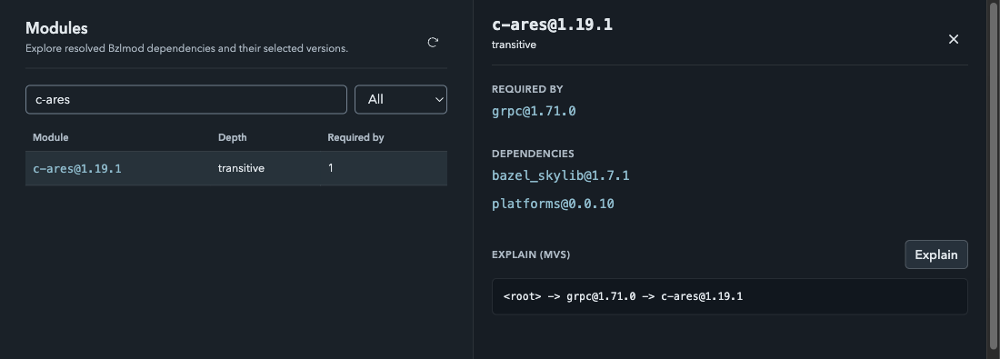
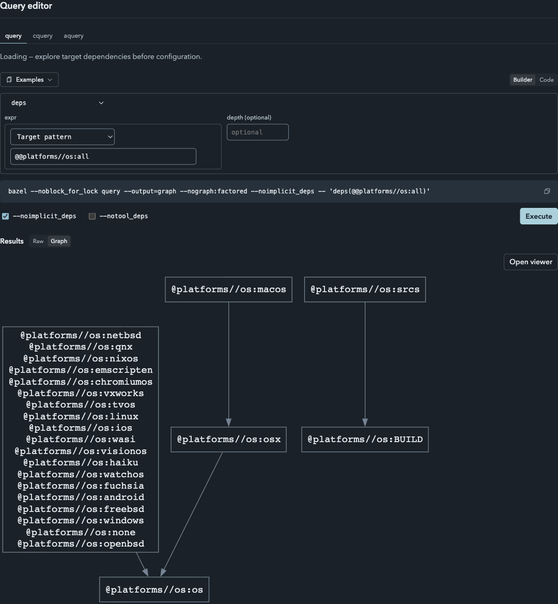
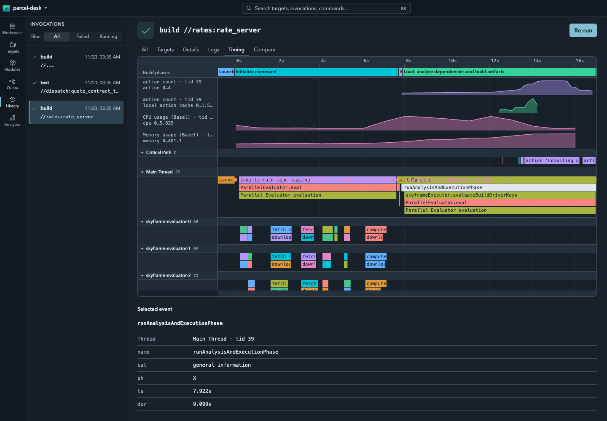
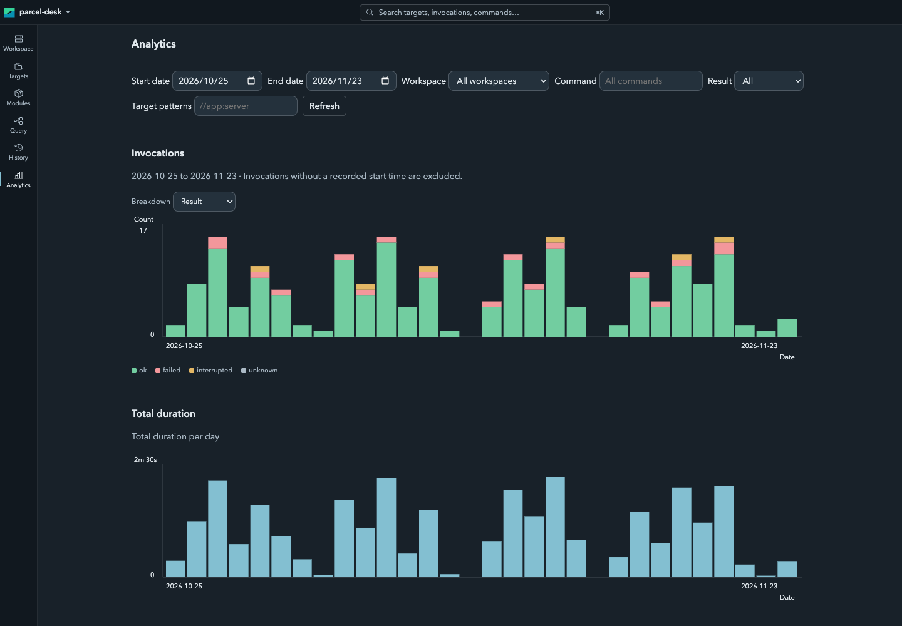

<p align="center">
  
</p>

<h1 align="center">Zeal</h1>

<p align="center">A local-first Bazel GUI client.</p>

<p align="center">Explore targets and dependencies, run builds and tests, and analyze build history.</p>

<p align="center">
  <a href="https://github.com/OhataKenji/zeal/actions/workflows/ci.yml"></a>
</p>

[](https://youtu.be/Kkmc5_eOLA0)

<p align="center">
  <a href="https://youtu.be/Kkmc5_eOLA0">Watch on YouTube</a>
</p>

## Getting Started

> [!WARNING]
> Zeal is in development. Expect breaking changes. Local data may not carry over to new versions.

### Step1: Install

#### Option 1: Download a release

Prebuilt releases currently support **macOS (Apple Silicon) only**.

Download the app from [GitHub Releases](https://github.com/OhataKenji/zeal/releases).

#### Option 2: Build from source

Follow the [Development guide](docs/development.md#getting-started).

### Step2: Open a repository

**Requires:** Bazelisk or Bazel on your `PATH`.

On macOS and Linux, Zeal loads your login shell's `PATH`.

Open only trusted repositories.

1. Enter your Bazel workspace root path or select it with **Choose folder…**.
2. Keep **target patterns** as `//...` for all packages in the main repository. To narrow the scope, use a pattern such as `//app/...`.
3. Select **open**.
4. Select a target and run `build`, `test`, or `run`.


## Features

### Workspace

Find your build output and test logs. Choose which packages Zeal scans. To record terminal builds too, copy the settings shown here into your `.bazelrc`.


### Targets

Browse packages or press `⌘K` / `Ctrl+K` to find a target. Build, test, or run it. Open **Definition** for rule attributes or **Configured** for resolved outputs and dependencies. **Actions** shows each action's command, inputs, and outputs.


### Modules

Select a Bzlmod module. Follow **Required by** to see what depends on it, or choose **Explain** to see why Bazel picked that version.



### Query

Build a `deps` query with blocks, or edit it in **Code**. See the dependency graph and the Bazel command that produced it. Use `cquery` for configured targets and `aquery` for build actions.



### History

Follow builds across worktrees. If you started a build in Zeal, you can stop it from any worktree. After a run, check its logs and test results. Use **Timing** to see what took time or **Compare** to see which flags changed between runs.



### Analytics

See daily results and run times (p50 and p95) for builds and tests recorded on your machine. Filter the charts by workspace, command, or target pattern. The ranking lists target patterns by total build time. The target pattern filter does not change this ranking.



## Record terminal invocations

Zeal records commands run in the app. To also record terminal commands, add to `.bazelrc`:

```bazelrc
build --bes_backend=grpc://127.0.0.1:4718
build --experimental_build_event_upload_strategy=local
build --bes_timeout=5s
build --experimental_collect_system_network_usage
```

While Zeal is open, run `bazel build //...`.

If port 4718 is already in use, Zeal listens on a different port — open the
Workspace page for a one-off `--bes_backend` flag to pass to Bazel for that
session instead of editing `.bazelrc`.

## Development

- [Setup and checks](docs/development.md)

## License

[Apache-2.0](LICENSE)
