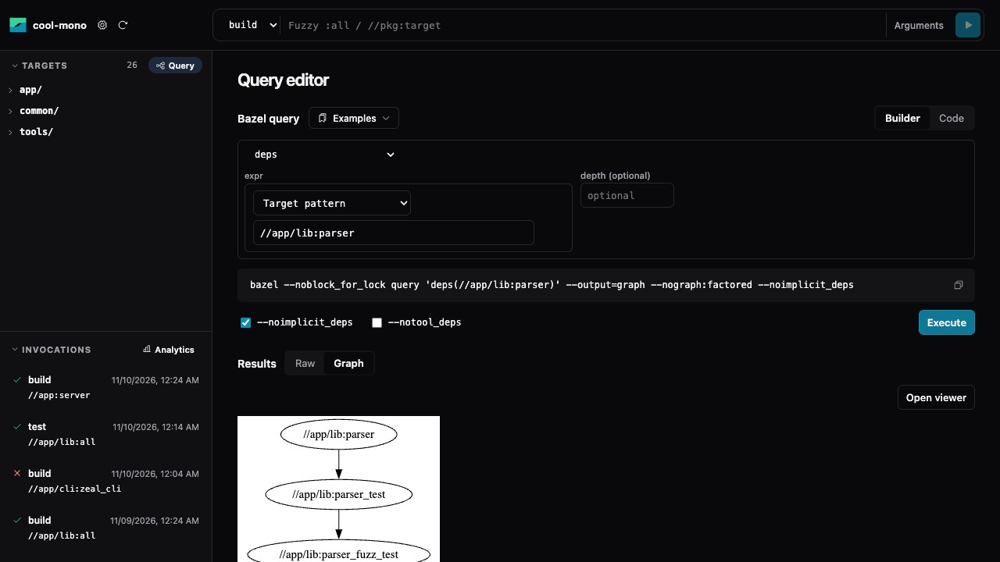
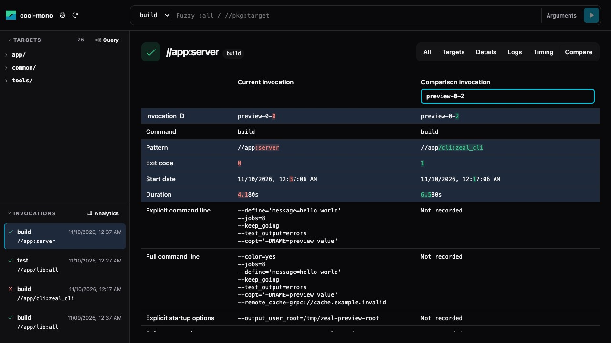

<p align="center">
  
</p>

<h1 align="center">Zeal</h1>

<p align="center">A local-first Bazel GUI client.</p>

<p align="center">Explore targets and dependencies, run builds and tests, and analyze build history.</p>

<p align="center">
  <a href="https://github.com/OhataKenji/zeal/actions/workflows/ci.yml"></a>
</p>

[](https://youtu.be/Kkmc5_eOLA0)

<p align="center">
  <a href="https://youtu.be/Kkmc5_eOLA0">Watch on YouTube</a>
</p>

## Getting Started

> [!WARNING]
> Zeal is in development. Expect breaking changes. Local data may not carry over to new versions.

### Step1: Install

#### Option 1: Download a release

Download the app for your platform from [GitHub Releases](https://github.com/OhataKenji/zeal/releases).

#### Option 2: Build from source

Follow the [Development guide](docs/development.md#getting-started).

### Step2: Open a repository

**Requires:** Bazelisk or Bazel on your `PATH`.

On macOS and Linux, Zeal loads your login shell's `PATH`.

Open only trusted repositories.

1. Choose your Bazel workspace root with **Choose folder…**.
2. Keep **target patterns** as `//...` for all packages in the main repository. To narrow the scope, use a pattern such as `//app/...`.
3. Select **open**.
4. Select a target and run `build`, `test`, or `run`.


## Features

### Find and Run Targets

Find targets with fuzzy search. Run `build`, `test`, or `run`.


### Query Builder

Build Bazel queries visually from preset examples or from scratch. View results as target lists or dependency graphs.



### Invocation Page

View logs, results, details, and available timing data.


### Compare Invocations

Compare commands, options, and outcomes of two invocations side by side.



### Analytics Page

Filter build and test history from Zeal and recorded terminal commands. Compare counts, results, and durations (total, p50, p95).


## Record terminal invocations

Zeal records commands run in the app. To also record terminal commands, add to `.bazelrc`:

```bazelrc
build --bes_backend=grpc://127.0.0.1:4718
build --experimental_build_event_upload_strategy=local
build --bes_timeout=5s
build --experimental_collect_system_network_usage
```

While Zeal is open, run `bazel build //...`.

## Development

- [Setup and checks](docs/development.md)

## License

[Apache-2.0](LICENSE)
