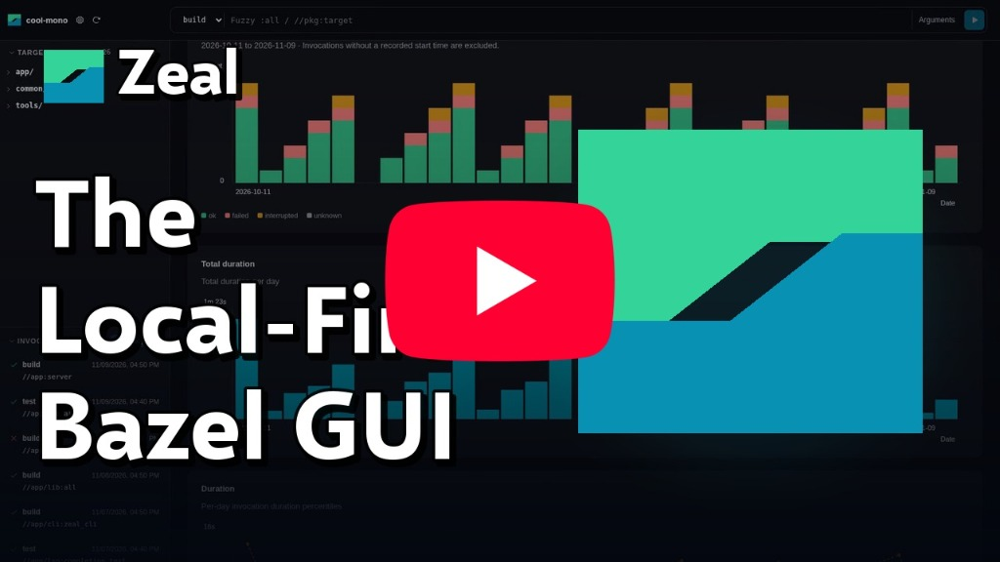
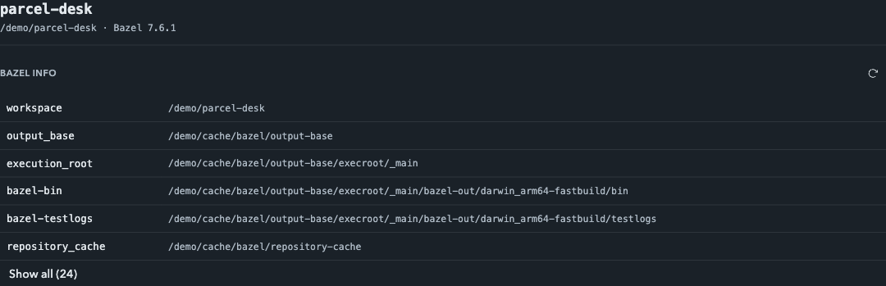

<p align="center">
  
</p>

<h1 align="center">Zeal</h1>

<p align="center">A local-first Bazel GUI client.</p>

<p align="center">Explore targets and dependencies, run builds and tests, and analyze build history.</p>

<p align="center">
  <a href="https://github.com/OhataKenji/zeal/actions/workflows/ci.yml"></a>
</p>

[](https://youtu.be/Kkmc5_eOLA0)

<p align="center">
  <a href="https://youtu.be/Kkmc5_eOLA0">Watch on YouTube</a>
</p>

## Getting Started

> [!WARNING]
> Zeal is in development. Expect breaking changes. Local data may not carry over to new versions.

### Step1: Install

#### Option 1: Download a release

Prebuilt releases currently support **macOS (Apple Silicon) only**.

Download the app from [GitHub Releases](https://github.com/OhataKenji/zeal/releases).

#### Option 2: Build from source

Follow the [Development guide](docs/development.md#getting-started).

### Step2: Open a repository

**Requires:** Bazelisk or Bazel on your `PATH`.

On macOS and Linux, Zeal loads your login shell's `PATH`.

Open only trusted repositories.

1. Enter your Bazel workspace root path or select it with **Choose folder…**.
2. Keep **target patterns** as `//...` for all packages in the main repository. To narrow the scope, use a pattern such as `//app/...`.
3. Select **open**.
4. Select a target and run `build`, `test`, or `run`.


## Features

### Workspace

Find the output directory or test logs without sifting through `bazel info`. Set which packages Zeal explores and copy the `.bazelrc` settings to record terminal builds alongside runs started in Zeal.



### Targets

Browse packages or press `⌘K` / `Ctrl+K` to find a target by name, then build, test, or run it. Inspect its rule attributes in **Definition**, resolved outputs and dependencies in **Configured**, or the commands Bazel will execute in **Actions**.


### Modules

Find out why a Bzlmod dependency is in your build. Follow **Required by** back to its parents, or choose **Explain** to see why Bazel selected that version.


### Query

Build a `deps` expression from blocks and see both the dependency graph and the Bazel command that produced it. Switch to **Code** to edit the expression directly, or use `cquery` and `aquery` to inspect configured targets and build actions.


### History

Follow live runs across worktrees, or open a finished invocation to inspect logs and test results. Select a span in **Timing** to see where a build spent its time, or use **Compare** to find which flags changed between two runs.


### Analytics

Track daily outcomes and p50/p95 durations for builds and tests recorded locally. Filter by workspace, command, or target pattern, then rank patterns by total time to see where slower builds add up.


## Record terminal invocations

Zeal records commands run in the app. To also record terminal commands, add to `.bazelrc`:

```bazelrc
build --bes_backend=grpc://127.0.0.1:4718
build --experimental_build_event_upload_strategy=local
build --bes_timeout=5s
build --experimental_collect_system_network_usage
```

While Zeal is open, run `bazel build //...`.

If port 4718 is already in use, Zeal listens on a different port — open the
Workspace page for a one-off `--bes_backend` flag to pass to Bazel for that
session instead of editing `.bazelrc`.

## Development

- [Setup and checks](docs/development.md)

## License

[Apache-2.0](LICENSE)
