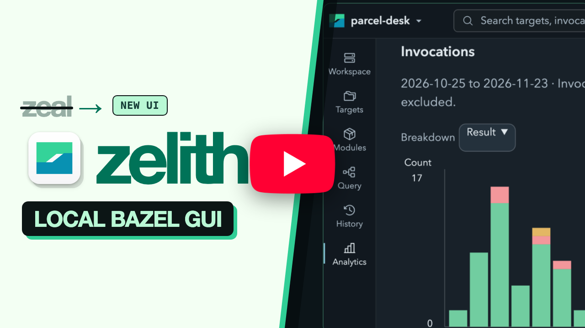
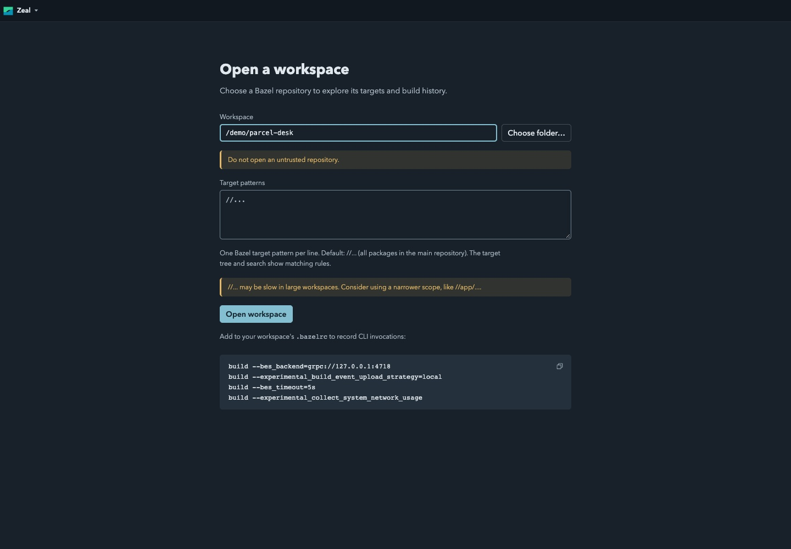
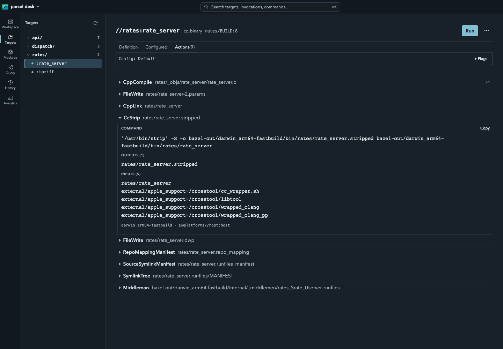

<p align="center">
  
</p>

<h1 align="center">Zelith</h1>

<p align="center">A local-first Bazel GUI client.</p>

<p align="center">Explore targets and dependencies, run builds and tests, and analyze build history.</p>

<p align="center">
  <a href="https://github.com/OhataKenji/zelith/actions/workflows/ci.yml"></a>
</p>

[](https://youtu.be/4RE5FgrUCo4?si=KmxKi0voqdBThoIC)

<p align="center">
  <a href="https://youtu.be/4RE5FgrUCo4?si=KmxKi0voqdBThoIC">Watch on YouTube</a>
</p>

## Getting Started

> [!WARNING]
> Zelith is in development. Expect breaking changes. Local data may not carry over to new versions.

### Step 1: Install

#### Option 1: Download a release

Prebuilt releases currently support **macOS (Apple Silicon) only**.

Download the app from [GitHub Releases](https://github.com/OhataKenji/zelith/releases).

#### Option 2: Build from source

Follow the [Development guide](docs/development.md#getting-started).

### Step 2: Open a workspace

**Requires:** Bazelisk or Bazel on your `PATH`.

1. Click **Choose folder…** and select the root of a Bazel workspace you trust.
2. Click **Open workspace**.

You're ready when your targets appear under **Targets**.

For large workspaces, set **Target patterns** to a smaller scope such as `//app/...` before opening.



## Features

### Workspace

Find your build output and test logs. Choose which packages Zelith scans. To record terminal builds too, copy the settings shown here into your `.bazelrc`.


### Targets

Browse packages or press `⌘K` / `Ctrl+K` to find a target. Build, test, or run it. Open **Definition** for rule attributes or **Configured** for resolved outputs and dependencies. **Actions** shows each action's command, inputs, and outputs.

Counts show targets discovered within your workspace's target patterns. Package actions pass the displayed pattern to Bazel: they can build or test targets that aren't listed. To run just one target, select its row instead.



### Modules

Select a Bzlmod module. Follow **Required by** to see what depends on it, or choose **Explain** to see why Bazel picked that version.


### Query

Use the visual query builder to write `query`, `cquery`, and `aquery` expressions without memorizing Bazel's query syntax.


### History

Follow builds across worktrees. If you started a build in Zelith, you can stop it from any worktree. After a run, check its logs and test results. Use **Timing** to see what took time or **Compare** to see which flags changed between runs.


### Analytics

See daily results and run times (p50 and p95) for builds and tests recorded on your machine. Filter the charts by workspace, command, or target pattern. The ranking lists target patterns by total build time.


## Record terminal invocations

Zelith records commands run in the app. To also record terminal commands, add to `.bazelrc`:

```bazelrc
build --bes_backend=grpc://127.0.0.1:4718
build --experimental_build_event_upload_strategy=local
build --bes_timeout=5s
build --experimental_collect_system_network_usage
```

While Zelith is open, run `bazel build //...`.

If port 4718 is already in use, Zelith listens on a different port — open the
Workspace page for a one-off `--bes_backend` flag to pass to Bazel for that
session instead of editing `.bazelrc`.

## Development

- [Setup and checks](docs/development.md)

## License

[Apache-2.0](LICENSE)
