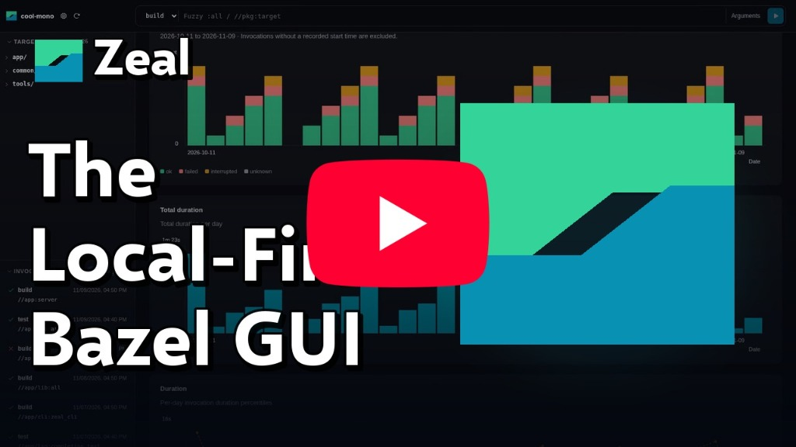
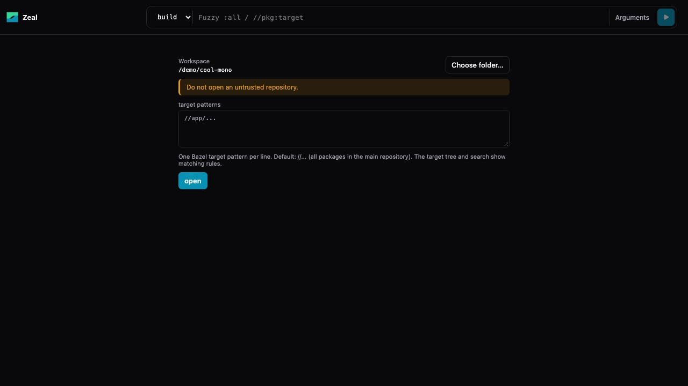
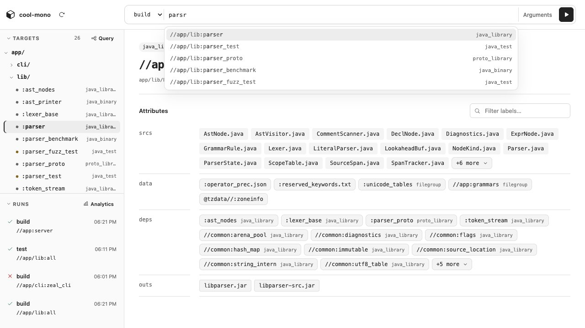
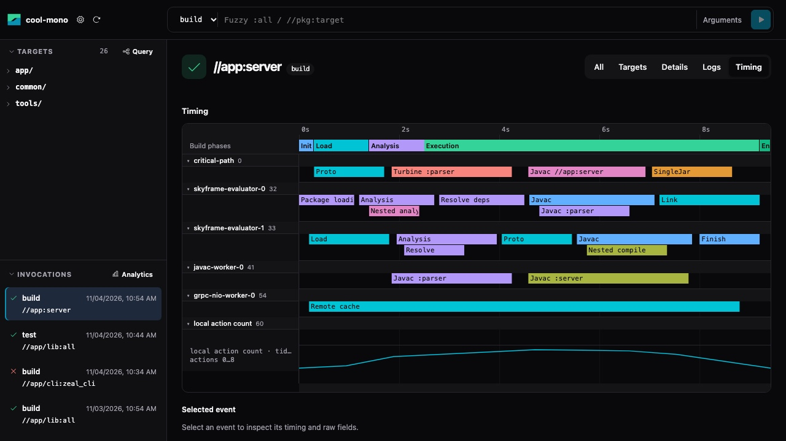
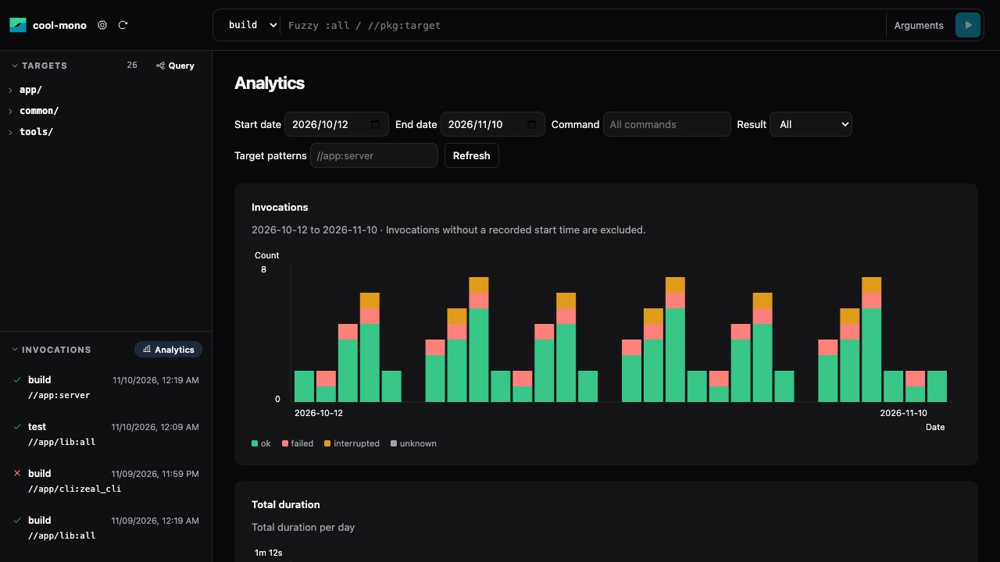

  

<h1 align="center">Zeal</h1>

A local-first Bazel GUI client.

Explore targets and dependencies, run builds and tests, and analyze build history.

  

## Getting Started

> [!WARNING]
> Zeal is in development. Expect breaking changes. Local data may not carry over to new versions.

Run Zeal from source: [Development guide](docs/development.md#getting-started).

### Open a repository

**Requires:** Bazelisk or Bazel on your `PATH`.

Open only trusted repositories.

1. Enter your Bazel workspace path in **Workspace** and select **open**.
2. Find a target and run `build`, `test`, or `run`.

Zeal records commands run in the app. To also record terminal builds,
[connect Bazel to Zeal](docs/terminal-builds.md).

## Features

### Find and Run Targets

Find targets with fuzzy search. Run `build`, `test`, or `run`.

### Invocation Page

View logs, results, details, and available timing data.

### Analytics Page

See build trends and compare durations.

## Development

- [Setup and checks](docs/development.md)

## License

[Apache-2.0](LICENSE)
