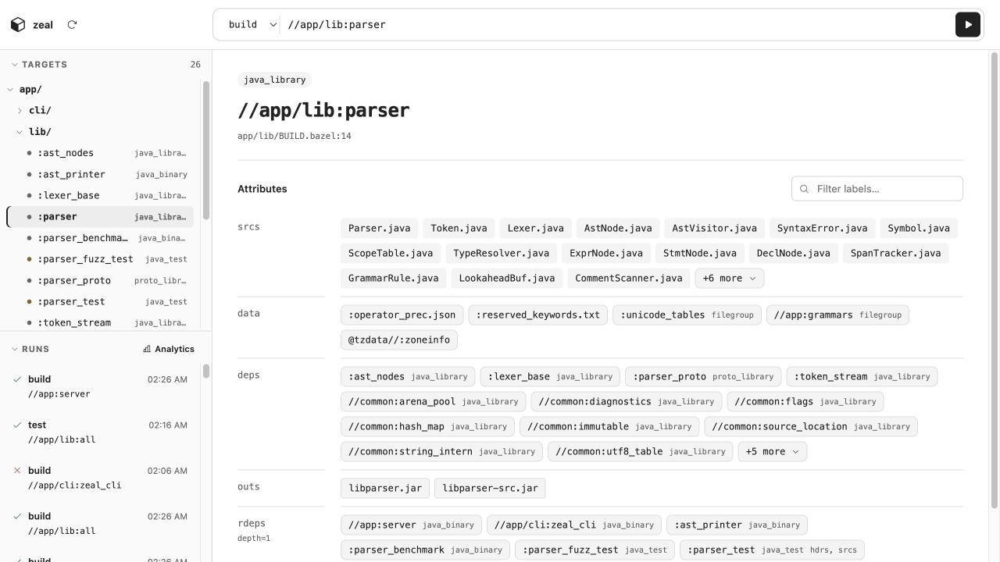
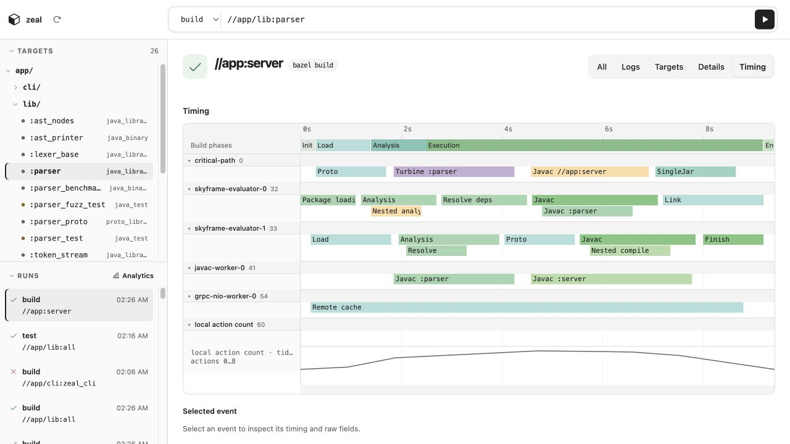
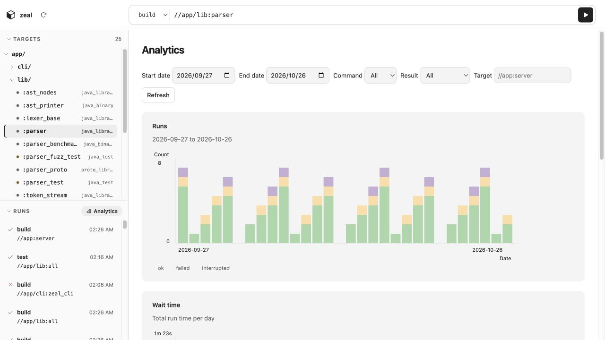

# Zeal

A local first Bazel GUI client.



## Getting Started

Tauri v2 (Rust + system WebView) app. Frontend is Vite + Svelte 5 + TypeScript.

Tool versions are pinned with [mise](https://mise.jdx.dev/).

```sh
mise install   # installs the pinned tools (trusts mise.toml on first run)
pnpm install
pnpm tauri dev    # run the app in dev mode
pnpm tauri build  # build a release bundle
```

Commits are scanned for secrets by [gitleaks](https://github.com/gitleaks/gitleaks)
via [lefthook](https://lefthook.dev) (installed on `pnpm install`).

## Features

### Fuzzy Search Target and Run

Find Bazel targets by fuzzy-searching their full labels, then choose `build`, `test`, or `run`.

### Run Page

Inspect a run's logs, target results, details, and per-thread timing trace from the history.



### Analytics Page

Filter local build and test history from the GUI and recorded terminal runs to compare run counts, outcomes, total run time, and p50/p95 durations.



## Checks

Checks are defined as [mise tasks](https://mise.jdx.dev/tasks/) in `mise.toml`.

```sh
mise run check           # all checks (frontend, then rust)
mise run check:frontend  # type check, tests, format check, lint, build
mise run check:rust      # cargo fmt --check, clippy, test (src-tauri/)
mise run fmt             # auto-format (oxfmt + cargo fmt)
```

All of the above run in CI (`.github/workflows/`).

See [docs/prd.md](docs/prd.md) and [docs/design/](docs/design/) for more details.

## Record terminal builds

Add to `.bazelrc` and use `bazel build --config=zeal //...` while Zeal is open:

```bazelrc
build:zeal --bes_backend=grpc://127.0.0.1:4718
build:zeal --bes_timeout=5s
```

## Development traces

Start [Jaeger](https://www.jaegertracing.io/docs/2.22/getting-started/) with OTLP/HTTP on port 4318, then run:

```sh
ZEAL_OTLP_ENDPOINT=http://127.0.0.1:4318 pnpm tauri dev
```

View native timings under `zeal-dev` in [Jaeger](http://localhost:16686).
Export is debug-only and opt-in. Inputs, artifacts and inherited OTLP credentials stay local.
Background threads use separate traces; exit may drop traces.

## License

[Apache-2.0](LICENSE)
