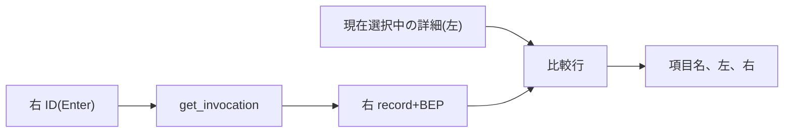

# Zeal 設計: 二回の invocation の diff

_Devin_
_Last update: 2026/11/07_
_Status: Draft_

## Goal

利用者が二件の invocation を明示的に選び、記録済みの条件と結果の違いを項目ごとに確認できる。
差がないことと、差を判定できないことを区別して表示する。

### Non Goals

- 差の原因推定と、取るべき action の提示
- action と execution log の比較、cache miss の原因説明
- target/test の結果比較。データは保存済みだが、configuration 単位の対応付けが未設計のため初期対象外とする
- phase/profile の比較と、ログの diff
- Git の状態や commit など、比較のための追加収集
- 実装の細部はコードレビューで扱う

## Background

- SQLite の record が command、pattern、開始終了時刻、exit code を持つ。**BEP** (Build Event Protocol) は Bazel が報告するイベント列であり、保存した event file から options、command line、target/test を読み取る([M4](./m4-invocation-history.md)、[detail.rs](../../src-tauri/src/detail.rs)、[types.ts](../../src/lib/types.ts))。これは [PRD](../prd.md) が次版に挙げる「二回のinvocationを選ぶdiff」への提案である。
- `get_invocation` は `record` と状態付きの `log`、`bep`(ok、incomplete、missing、parse_error、read_error)を返す([session.ts](../../src/lib/session.ts)、[lib.rs](../../src-tauri/src/lib.rs))。`InvocationView` は All、Targets、Details、Logs、Timing の表示切替を既に持つ([InvocationView.svelte](../../src/lib/InvocationView.svelte))。
- 先行例の BuildBuddy は compare view で command line と startup options を facet として並べ([compare_invocations.tsx](https://github.com/buildbuddy-io/buildbuddy/blob/0ca572258f0eecd479a7a4df644ccdbae4c94cca/app/compare/compare_invocations.tsx))、項目内の文字列差分に diff-match-patch を使う([diff.tsx](https://github.com/buildbuddy-io/buildbuddy/blob/0ca572258f0eecd479a7a4df644ccdbae4c94cca/app/util/diff.tsx))。

## Overview

既存の `get_invocation` を使い、frontend で左右比較する。
新しい IPC、DB、receiver、依存は加えない。

## Detailed Design

### Compare view

- `InvocationView` の表示ボタン行(All、Targets、Details、Logs、Timing)に `Compare` を足す独立した表示で、All section の描画には含めない。左には現在選択中の invocation の詳細をそのまま使い、比較のために左を再読込しない。

### 右側の ID 入力と読込

- 「Invocation ID」と label 付けした入力欄を置き、Enter で確定する。keystroke ごとの fetch はしない。
- submit で既存 transport から `get_invocation({ id })` を呼ぶ。`selectInvocation` は呼ばず左の選択を維持し、workspace の一致は既存 backend が保証する。同一 ID の指定も許可する。
- 入力は trim し、UUID 検証は既存に任せる。submit で旧右データを消し、loading の後に record と BEP を表示する(log は保持しない)。
- 送信中は submit を無効にして in-flight を一件に絞り、左の detail 読込中も submit を待たせる。失敗(未知の ID、別 workspace、不正、busy)は右側に inline error として出し、利用者が修正して再 submit する。自動 retry、polling、queue、新しい backend は設けず、worker の busy が起きても error として表面化するだけとする。

### 比較項目

比較行は BuildBuddy の compare view の FACETS に合わせ、項目名と値の対応は次の通り。

| 項目 | 値の由来 |
| --- | --- |
| Invocation ID | `record.id` |
| Command | `record.cmd` |
| Pattern | `record.pattern` |
| Exit code | `record.exitCode` |
| Start date | `record.startedAt` |
| Duration | `record.finishedAt − record.startedAt`(両端が記録され非負のとき) |
| Explicit command line | `bep.options.explicitCmdLine` |
| Full command line | `bep.options.cmdLine` |
| Explicit startup options | `bep.options.explicitStartupOptions` |
| Full startup options | `bep.options.startupOptions` |

`originalCommandLine` と `canonicalCommandLine` は explicit/full の options 配列とは別の文字列で、対応する facet がないため行に出さない。
Host、Git、cache、remote execution、metrics など BuildBuddy にある項目は Zeal の現在の projection にないため対象外とし、target/test の件数も Non Goals のままとする。

### 表示と欠損

- 表は項目名、左、右の三列で全行を表示し、値が変わった行全体を強調する。項目内の文字列 diff は行わず、options は一引数一行で順序と重複を保つ。
- 等価は raw な値で比較し、map 化や sort などの正規化はしない。delta や増減率は出さず、duration も左右に並べるだけとする。
- 値がない項目は「Not recorded」と表示し、その行の比較は unknown とする。空の options 配列は既知の空として扱う。
- BEP section が ok 以外のときは options 由来の行を比較不可とし、section の状態を併記する(record 由来の行は独立して比較する)。右側の request 全体の失敗は右側の error であり、欠損項目を捏造しない。

### 状態と寿命

- 右側の状態は Compare 表示に閉じ、入力値、読込済みの record と BEP、loading、error だけを持つ。workspace と左 invocation の組で作り直し、Compare からの離脱や破棄で消し、遅れた応答は捨てる。
- 左の detail が選択中の ID と一致し、loading でも error でもないときだけ diff を計算する。それ以外は既存の loading、error、待機表示を使う。active と分かる invocation が左右のどちらかにあるときは、完了まで比較できない旨を既存の known-active 情報で示す。polling や網羅的な完了判定はしない。

### 構成と導入

- `InvocationView.svelte` の表示ボタン行に `Compare` を足し、Compare の描画を既存 view と独立に行う。
- `src/lib/invocation/ComparisonPanel.svelte` を追加し、右 ID の入力、`get_invocation` の呼出、行の表示を担う。比較行の組み立ては `src/lib/invocation-diff.ts` のような純粋関数に分け、transport や callback は既存の境界をそのまま使う。
- 比較元の固定や履歴行の操作は追加しない。既存 transport を渡す接続だけを必要に応じて変更する。右側の読込に profile は含めず、左の既存表示も変えない。

## Alternatives Considered

採用案は、選択中の詳細を左、入力した ID を右に既存 IPC で並べる方式である。右側の読込状態だけを Compare 表示に持ち、永続化しない。

| 案 | 採用しない理由 |
| --- | --- |
| pin して基準側を保持する方式(前版) | 基準の固定、保留操作、世代管理などの状態が要り、都度の再読込で足りる |
| 比較専用の backend API | 既存の `get_invocation` が返す事実で行の組み立てが足り、新しい IPC と worker 変更を増やす |

## Caveats

並べた差は記録された値の違いであり、原因や実行環境の同一性は分からない。projection にない項目(Host、Git、cache など)の差は推測しない。

## Security Concerns

- ID は既存の UUID 検証と workspace 確認を通り、表示は text のみで shell 実行や外部 URL を増やさない。
- options には秘密情報が含まれ得る。値は local に留め、log や telemetry に出さない。

## Privacy Concerns

- 比較は local の保存済みデータの読取だけで、新しい外部送信を増やさない([overview](./overview.md#privacy-concerns)の既存方針を維持する)。
- この文書は公開リポジトリに置くため、機微情報を含めない。

## Test Plan

- 行の対応と等価: 10 項目の mapping、配列の順序と重複、欠損と空、duration の負と零、raw な値での比較を確認する。
- 右 ID フォーム: Enter 確定で keystroke ごとの読込がなく左の選択が維持されること、同一 ID でも比較できること、busy、未知、不正で inline error になり再 submit できることを確認する。
- 状態の安全性: 左の切替、workspace 切替、Compare 離脱、遅れた応答で右側が消えて古い値を出さないこと、左の読込中は submit が無効なことを確認する。
- UI: キーボードでの左右操作と、長い options 文字列が既存 styling で読めることを確認する。
