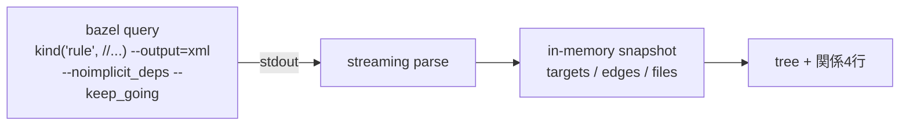

# Zeal 設計 M1: target と周辺の関係

_OhataKenji_
_Last update: 2026/10/17_
_Status: Approved_

## Goal

mock の tree と関係4行(deps / data / used by / files)を、対象 workspace の実データで表示できるようにする。
個別の案内なしに、普段使う target から関連 target とその用途・定義のつながりをたどれる画面の土台を作る(PRD シナリオ1・M1)。

### Non Goals

- BUILD file 変更のリアルタイム検知・差分更新
- 生成 target・aspect 由来 target の網羅
- 外部 repo(`@maven//` 等)の内部展開

## Background

共通用語は [overview](./overview.md#background) に従う。
対象となる画面要素は mock の二箇所である。
sidebar の tree は label → package → file の階層で対象を見つける入口で、content の target 状態は選択した target の label・rule class・関係4行を表示する。
関係4行の各行は用途が異なる: `deps →` と `data →` はこの target が依存する先、`used by ←` はこの target を使う側、`files` は入力ファイルと出力の対応である。

データ源はすべて `bazel query` の結果に求める。
BUILD file の自前 parse は行わない。rule の属性・rule class・BUILD file 上の位置は、bazel が解釈した結果として得るのが正確であり、部分構文解析で見せると偽の精度になるためである。

## Overview

構造データは起動のたびに取り直し、メモリ上の snapshot として持つ。
`bazel query 'kind("rule", //...)' --output=xml --noimplicit_deps --keep_going` を workspace 単位で実行し、結果の XML を parse してインメモリの構造体に置く(`--keep_going` で構文エラーのある package を飛ばして部分結果を得る)。

snapshot は永続化しないため、起動直後には前回値がない。
最初の取得に失敗した場合は空の画面にエラーと retry を出す。

同じ起動内の refresh は、取得が終わってから snapshot を一括で置き換える。
失敗や中断では直前のメモリ上の snapshot と取得時刻を残し、新旧の取り込み結果を混ぜない。

## Detailed Design

### 取り込み

取り込みの流れは「query 実行 → XML parse → インメモリ構造の全置換」である。
`kind("rule", //...)` の XML には各 rule の name・class・location(BUILD file と行)・属性値が含まれ、srcs・deps・data 等の属性から label 参照が取れる。
label 参照は `<rule>` 配下の label 型**属性要素**から取る。
フラット化された `<rule-input>` 要素は暗黙依存を含み attr 名も失われるため、edges の源には使わない。
file target は別途 query せず、file を指す label(srcs・data 等の属性経由)を入力、各 `<rule>` の `<rule-output>` 要素を出力として導出する。
`<rule-output>` は宣言済みの出力のみを含むため、出力を宣言しない rule class では files の出力側が空になり得る。

label の行き先は次の規則で分ける: targets に存在する label と `@`/`@@` で始まる label は edges、それ以外は file として files に入る。
照合の前に label を canonical 化する(`//app` → `//app:app`。XML の出力は絶対 label なので相対形はここに現れない)。
`@@` 形は repo mapping が取れる範囲で apparent 名へ正規化して比較し、変換できない場合は raw のまま比較・表示する(手段は spike で確かめる)。
`select()` の分岐 key(`//conditions:default` 等)は除外する(key が XML の属性値に現れるかは spike で確かめる)。
query の stdout は streaming parser で逐次読み、全量をメモリに載せない。
`--noimplicit_deps` と implicit 属性の除外を併用し、暗黙依存が関係表示へ混入するのを防ぐ。
取り込みは workspace 単位で1本に限る。
取り込み中と run 実行中の要求は予約せず拒否し、利用者が完了後に refresh する([overview](./overview.md)の直列化)。
query にはタイムアウト(目安 5 分。初回は bazelisk の download と cold cache を含み得るため緩める)を設け、取り込み中・待機中は UI にその状態を出す。
grpc/grpc での実測では cache ありで約 56ms、clean 後の cold cache で約 19s だった(spike 済み)。この規模なら起動ごとの取り直しが実用的で、cold の間も「取り込み中」と出せばよい。
取り込みは workspace を開いたとき(バックグラウンド)と手動 refresh で行う。
run 完了後の自動取り込みは行わない。

新しい snapshot は構築が完了してから参照を一括で差し替え、取り込み途中の失敗・中断では直前のメモリ上の snapshot がそのまま残る。
新旧が混ざった状態は作らない。

### snapshot の構造

メモリ上には四つの構造を持つ。

- **targets**: label・package・name・rule class・location
- **edges**: 依存の有向辺(from_label・to_label・attr 名、同一組は重複を除く)。label 型属性から取るが、visibility のような依存を意味しない属性と、名前が `$` または `:` で始まる implicit 属性は除く(`:` 始まりの late-bound 属性の実 attr 名は spike で確認する)。依存以外を指す label 属性(exec_compatible_with 等)の混入は許容し、used by 側で attr 名により見分ける
- **files**: (path, owner_label, role) で一意。path は workspace 相対。role は入力側は属性名(srcs・data 等)、出力側は `out` とする
- **meta**: fetched_at・status(ok / partial / failed)・直近失敗の exit code と短い要約。exit 0 でないが `<rule>` を1件以上受理できた場合(--keep_going の部分成功。parser は末尾の欠けた XML も読める範囲で受理する)は partial として受理し、画面に注記する

package の階層は専用の構造を持たず、targets の package 値から構成する。

### 関係4行の導出

- `deps →`: edges のうち attr=deps のもの
- `data →`: attr=data のもの
- `used by ←`: 取り込み済み edges すべてを逆引きした直接の使用側。mock どおり rule class を併記し、deps→/data→ に出ない属性(tools・exports 等)由来は attr 名も併記する。transitive には遡らない(mock は直接関係の一覧である)
- `files`: files の入力を並べ、出力を「→ 出力」の形で示す。同じ path が producer の出力・consumer の入力の両方に現れうる

used by を query の `rdeps`(逆依存を返す query 関数)で取らない理由は二つある。
target ごとに全体 query を回すのは高コストであり、`rdeps` の結果は暗黙・toolchain 依存を含むため、「依存」を指す範囲が属性由来の `deps →` とずれ、同じ4行内で語彙が揃わない。
同じ snapshot の辺を逆引きするほうが、表示の一貫性と速度の両方で有利である。

### tree の構成

package のディレクトリ階層を骨格とし、package 内に rule と file を列挙する。
tree に出す file は入力 role のみで path で重複を除き、rule の兄弟として並べ、「→ owner」を付ける(mock の `Parser.java → :parser`)。owner が複数あれば併記する。
file は workspace 相対 path に最長一致する package の節に置き、その package が存在しなければ owner の package 節に畳む。
file を選択した場合は、その owner target(複数なら label 昇順の先頭)の target 状態(関係4行)を表示する。
関係4行の各 entry も選択でその target の状態へ遷移し、同じ見方で繰り返し辿れるようにする(PRD シナリオ1)。label の表示は選択した target の package に合わせて短形(`:name`)または `//pkg:name` 形にする。
mock の表記(label → package → file の一致)に従う。

### BUILD 定義への導線

targets の location(BUILD file と行)を保持し、画面から定義位置を OS 既定の app で開けるようにする。
行番号は snapshot 時点のものなので、stale な snapshot ではずれ得る。file を開くことを主眼とし、行指定は best-effort とする。

## Alternatives Considered

- **`--output=proto`**: 型付きで堅牢だが、proto 依存の compile が必要になり、XML で十分な範囲の情報しか M1 では使わない。
- **BUILD file の自前 parse**: マクロや load による target を正しく扱えず、bazel の解釈結果とずれる「偽の精度」になる。
- **表示のたびに query を実行**: query は workspace 規模で秒単位かかり得るため、表示のたびには使えない。
- **snapshot の永続化**: 前回値の表示やオフライン動作に使えるが、v1 では起動時に取り直せば足りると判断して削った。起動直後の空表示と query 所要時間は許容する。必要になれば cache として後から足せる。
- **tree の遅延ロード(expand ごとに部分 query)**: 初期描画は速くなるが、`used by` は全 package 分の逆引き、検索(m3)は全 label 集合が前提であり、未ロード範囲の結果を黙って欠落させる。正確性を保つには結局 `//...` のロードが必要で、遅延の効果は package loading の先送りに留まる。描画の遅延(expand 時に子を mount する lazy render)は UI 側で別途行うもので、データ取得とは別の話。大規模 repo への対応は遅延ロードではなく package 範囲の絞り込み(Caveats)で扱う。
- **used by を `rdeps` query で取得**: 上記のとおりコストと語彙のずれの問題がある。

## Caveats

- query が失敗する(BUILD の構文エラー等)場合は、直前の snapshot(あれば)と取得時刻を表示し続け、空の画面にしない。起動直後など snapshot がまだない間は「取り込み中」と表示し、失敗時はエラーと retry を示す。永続化しないため、起動のたびに取り込みが走り、その間は表示が空になり得ることを許容する。
- `@repo//` 形式の label は edges 先として存在だけを示し、内部には入らない。
- 削除済み target を指す label は振り分け規則上 file に落ち得る(targets にも `@` にも合致しないため)。実害は小さいとして許容する。
- macro 経由で生成された rule の location は BUILD ではなく .bzl file 内を指し得る。実出力は Test Plan の spike で確かめる。
- Bzlmod 環境では label が `@@repo//` の canonical 形で返る版があり得る。表示は apparent 名に正規化するか、版差として Test Plan で実出力を確かめる。
- configurable な属性(`select()`)は XML 上は全分岐の和集合で出るため、現在の設定で有効でない依存が edge に混ざる。M1 では設定による絞り込みはしない。
- 巨大な repo では cold cache の初回取り込みに数十秒かかり得る(grpc で実測 19s)。その間は「取り込み中」を出し、表示が空であることを許容する。それを超える規模では対象 pattern を絞る設計に見直す。
- さらに大きい monorepo では `//...` 自体が非現実的になる。roadmap には入れないが、workspace 選択時に package 範囲(例 `//src/...`)を絞る構想はここに置く。query の対象 pattern 化はその延長にある。
- どの rule の属性にも現れない source file は files に載らず、tree にも出ない。孤立した file を拾うかは M1 の検証後に判断する。
- `srcs`/`data` が他 rule の生成 file の label を指す場合、その関係は producer の `<rule-output>` と path が一致すれば files 行で見えるが、`deps →`・`used by ←` には現れない(label→producer の辺は作らない)。
- run 完了ごとの取り込みは BUILD が変わっていなくても全量 query を打つ。計測後に mtime 等の差分検知を検討する余地を残す。

## Security Concerns

query は利用者が選んだ workspace で、[overview](./overview.md#security-concerns) の引数配列による起動に従って実行する。
query XML の label や定義位置はデータとして扱い、shell の式として実行しない。
定義位置を開くときは、対象の file path を確認できるようにする。

## Privacy Concerns

label、依存関係、file path はメモリ上の snapshot に置き、外部へ送らない。
公開 fixture には検査したリポジトリのサンプルだけを使う。
共通方針は [overview](./overview.md#privacy-concerns) に従う。

## Test Plan

- 実際のリポジトリで XML を取り込み、関係4行が補足説明なしに表示できるかを確かめる(M1 の到達基準そのもの)。あわせて `--noimplicit_deps` と `<rule-output>` の実出力を確認する spike とする。
- XML parser に golden file test を用意する。fixture には select()・macro 生成 rule・外部 repo label・data 属性の file label・`<rule-output>` を持つ rule と持たない rule・複数 owner の file を含める。
- 取り込み途中の kill や BUILD を壊した状態での refresh で直前の snapshot が残ること、refresh 連打で query が1本に収束することを確かめる。
