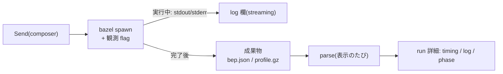

# Zeal 設計 M2: 一回の run の説明

_OhataKenji_
_Last update: 2026/10/16_
_Status: Approved_

## Goal

一回の run について、phase(loading / analysis / execution)の流れと、実際に実行された action の時系列を提示し、利用者が自分のコマンドと Bazel の内部処理を結びつけられるようにする(PRD シナリオ2・M2)。

### Non Goals

- remote cache・remote execution の詳細な内訳
- action の内部ログ(stdout/stderr の中身)の再生
- 「実行され得たが起きなかった action」の提示(action graph の候補集合との照合)
- action の一覧、target と action の往復、再利用(action cache hit)の表示

## Background

Bazel の一回の呼び出しは、定義を読む loading、処理を組み立てる analysis、出力を得る execution の phase で進む(Bazel の評価モデル)。
この build が内部で何をしたかを示す観測源は役割が異なる。

- **BEP**: 呼び出し単位のイベント列。呼び出しの成否と target ごとの結果を与える
- **profile**: phase の区切りと時系列の計測結果(action ごとの位置と所要時間を含む)

見せるのは「実際に実行された action」の時系列だけであり、どの action が実行を免れたか(再利用)は示さない。観測できないものは推測せず「不明」とするのがこの文書の核である。

## Overview

run の起動時に観測用の flag を付けて bazel を spawn し、成果物を run の dir に残す。run の詳細を開くたびに BEP・profile を parse する。
実行中は timing を出せないため(mock どおり `not available`)、stdout/stderr の log だけを streaming する。



## Detailed Design

### Send の範囲(M2)

M2 の Send は `build` / `test` だけを起動する。stop・中断・`bazel run` は [m3](./m3-find-and-run.md) で扱う。
bazel が使用中(snapshot の query 中か run 中)の間は Send を disabled にし、待ち行列は持たない。

### 付与する flag

run 起動時に以下の固定セットを付与する(必須/optional の区別はしない)。成果物は run の UUID ディレクトリ(`<app data dir>/ws-<fnv64>/runs/<uuid>/`)に出力させる。

- `--build_event_json_file=<dir>/bep.json`
- `--profile=<dir>/profile.gz`
- `--experimental_profile_include_primary_output`
- `--noslim_profile`
- `--tool_tag=zeal`

失敗の扱いは一本に絞る。`unknown option` 等で run が起動しない場合(exit 2)も含め、失敗は失敗の run として記録するだけで、自動リトライも観測 flag を落とした再実行も行わない。flag が受理されない version は v1 の対象外であり、実際に発生したら Zeal 側のバグとして対応する。
v1 の対象は Bazel 8.7 以上を目安とし、この flag 群が受理されることを前提とする。flag の旧名対応や version ごとの対応表は持たない。parse 側も version 差の読み分けは持たない。

### 実行中の表示

log 欄は spawn した子プロセスの stdout/stderr を runner が常時 drain し、1 行ずつ event で流す。
bazel 自身が進捗行(`[34 / 120] …` 系)を stderr に出すため、mock の実行中画面はこれだけで足り、BEP file の tail のような構造化経路は別途持たない。
timing 欄は profile が完了後にしか出ないため、実行中は `not available` と表示する。

### 保存と parse

M2 では SQLite を入れない。run ごとに次の file を置き、run の詳細を開く(`get_run`)たびに 2 成果物を parse する。parse 結果は保存しない。

```
<app data dir>/ws-<fnv64(正規化した workspace path)>/runs/<uuid>/
  run.json  log.txt              # Zeal が書く
  bep.json  profile.gz          # bazel が書く。手を加えない
```

- `run.json`: id・workspace・cmd・target・開始/終了時刻・exit code。run の成否は exit code で決める
- BEP: target ごとの結果(test 結果を含む)。行単位で parse し、末尾が欠けていても読める範囲を採用する
- profile: phase marker と、スレッドごとの計測 event(`ph: "X"`)の位置・所要時間

成果物ごとの状態(ok / incomplete / missing / parse error)は parse のたびに決め、詳細画面のセクションごとの可用性に反映する。
DB への run record の保存と lifecycle(retention・導出記号)は [m4](./m4-run-history.md) が持つ。

### timing 表示

mock の frame chart は profile の自然な可視化で、profile だけで描く(BuildBuddy の timing 相当)。
スレッド(`thread_name`)ごとに 1 行を作り、そのスレッドの全計測 event(`ph: "X"`)を bar として並べる。execution スレッドや action event には限定しない。
bar の tooltip には名前・mnemonic・所要時間・位置を出し、event が `out` field を持つ場合は出力 path も出す。
phase の帯は profile の phase marker を Bazel の名前のまま並べる。Bazel 8 の既定(Skymeld)では marker が `Evaluate target patterns` → `Load, analyze dependencies and build artifacts` → `Complete build` となり、analysis と execution は重なって進むため分けられない。帯にはその旨を注記する。
フィールドが欠けた場合は、該当部分だけを落として timing 表示を degrade する。

## Alternatives Considered

- **exec log で action の一覧を出す**: mock に対応する画面がない。個々の action の cache hit を示せるのも disk/remote cache 使用時だけで、そのために flag と parser が 1 つずつ増える。
- **BEP や profile から再利用を出す**: BEP の `actionCacheStatistics.hits` は件数だけで内訳が無く、action 実行イベント(`--build_event_publish_all_actions`)にも cache hit の判別情報が無い。profile は hit でも miss でも `check cache hit` が出て、違いは後に `subprocess.run` が続くかだけであり、内部の event 名からの推測になる。
- **aquery で候補集合を取り「実行されなかった action」を分類する**: 「実行され得た vs 実際起きた」の対比は再利用の理解に資するが、完了後に別呼び出しで action graph を再推定する機構(quote・config 再現・照合・ずれ検出)は設計全体で最も複雑であり、mock にも対応する画面がない。実装の単純さを優先して v1 では削った。

## Caveats

- profile は呼び出し完了後にしか得られない。中断時の成果物の扱いは [m3](./m3-find-and-run.md) で確かめる。実行中の画面は log のみになる。
- 観測 flag が受理されない場合 run は失敗として記録される(v1 の対象外。実際に発生したら Zeal 側のバグとして対応する)。
- 観測 flag には overhead がある(profile の計測)。M2 では常時付与とし、肥大が問題になれば run 単位で off にする選択肢を検討する。

## Test Plan

- cache hit のフィールド、profile の event、disk cache 使用時の挙動は spike(Bazel 8.7.0)で確かめ、本文に反映した。
- BEP・profile の各 parser に golden file test を用意する。fixture には末尾が欠けた BEP、execution 未到達の run、成果物の一部が欠けた run を含める。
- 観測 flag 付きで build を回し、成否と所要時間への影響(overhead)を確認する。

## spike 後の改訂(2026/10/16)

Bazel 8.7.0 での spike の結果とオーナーの決定に合わせて、次を改めた。

- timing は profile だけで描き、exec log と join しない(`args.out` の記述を削除)
- action の所要時間は timing の tooltip でだけ見せ、action 一覧には出さない
- exec log の `walltime` / `metrics` の presence による読み分けと、「cache 判別不能」の注記を削除(field 17 は reserved)
- cache hit の判定を 1 条件にし、local の action cache hit は BEP の件数だけを「内訳は不明」として出す
- phase の帯は Bazel の marker 名のままにし、分けられない旨を注記する
- M2 では SQLite を入れず、run dir の file を表示のたびに parse する。DB は m4 で扱う
- M2 の Send は build / test だけ。stop・中断・`bazel run` は m3 で扱う

## action 一覧の削除(2026/10/16)

mock の run 画面は timing と log だけであり、オーナーの決定で action 一覧と再利用の表示をやめた。

- action の一覧、target と action の往復、再利用の表示を Non Goal にした
- exec log(`--execution_log_binary_file`)を観測 flag と parse の対象から外した
- 再利用の件数(BEP の `actionCacheStatistics.hits`)も出さない。D3 の「N 件(内訳は不明)」の表示はやめた

## timing の可視化範囲(2026/10/17)

オーナーの決定で、timing の詳細度を BuildBuddy の timing 相当に引き上げ、「profile の自然な可視化」とした。

- lane は execution スレッド限定・`exec-N` への採番し直しをやめ、`ph: "X"` の event を持つ全スレッドを `thread_name` のまま並べる
- bar も `action processing` event 限定をやめ、スレッドの全 `ph: "X"` event にした
- event の `out` field を読む(以前は「profile の `out` は読まない」としていた)
- lane のキーは `tid` とする。同名のスレッドが複数 `tid` に分かれて出ることがあるため
