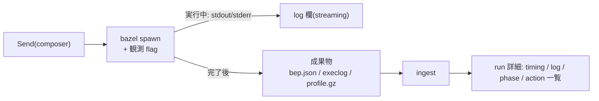

# Zeal 設計 M2: 一回の run の説明

_OhataKenji_
_Last update: 2026/10/15_
_Status: Draft_

## Goal

一回の run について、phase(loading / analysis / execution)の流れと、実際に実行された action の記録を提示し、利用者が自分のコマンドと Bazel の内部処理を結びつけられるようにする(PRD シナリオ2・M2)。

### Non Goals

- remote cache・remote execution の詳細な内訳
- action の内部ログ(stdout/stderr の中身)の再生
- 「実行され得たが起きなかった action」の提示(action graph の候補集合との照合)

## Background

Bazel の一回の呼び出しは、定義を読む loading、処理を組み立てる analysis、出力を得る execution の phase で進む(Bazel の評価モデル)。
この build が内部で何をしたかを示す観測源は役割が異なる。

- **BEP**: 呼び出し単位のイベント列。呼び出しの成否と target ごとの結果を与える
- **exec log**: 実際に起こった spawn の記録。action 単位の所要時間・runner・cache 情報を持つ
- **profile**: phase 内訳と時系列の計測結果

重要な前提として、local のみの環境では action cache hit は spawn に至らず、exec log には出ない。
「再利用」が cache hit として観測できるのは remote/disk cache 使用時に限られる。
したがって local 環境で見せられるのは「実際に実行された action」のみであり、cache や最新状態で実行を免れた action は観測できない。観測できないものは推測せず「不明」とするのがこの文書の核である。

## Overview

run の起動時に観測用の flag を付けて bazel を spawn し、完了後に BEP・exec log・profile を ingest する。
action の表示は exec log の spawn 記録(実際に実行されたもの)に限定し、cache hit は spawn 記録が示す場合にのみ付記する。
実行中は timing を出せないため(mock どおり `not available`)、stdout/stderr の log だけを streaming する。

## Detailed Design

### 付与する flag

run 起動時に以下の固定セットを付与する(必須/optional の区別はしない)。成果物は run の UUID ディレクトリ(`<app data dir>/<workspace>/runs/<uuid>/`)に出力させる。

- `--build_event_json_file=<dir>/bep.json`
- `--execution_log_binary_file=<dir>/execlog`
- `--profile=<dir>/profile.gz`
- `--experimental_profile_include_primary_output`
- `--noslim_profile`
- `--tool_tag=zeal`

失敗の扱いは一本に絞る。`unknown option` 等で run が起動しない場合(exit 2)も含め、失敗は失敗の run として記録するだけで、自動リトライも観測 flag を落とした再実行も行わない。flag が受理されない version は v1 の対象外であり、実際に発生したら Zeal 側のバグとして対応する。
v1 の対象は Bazel 8.7 以上を目安とし、この flag 群が受理されることを前提とする。flag の旧名対応や version ごとの対応表は持たない。parse 側の version 差(フィールドの有無・名前)は optional field の presence で読み分ける。

### 実行中の表示

log 欄は spawn した子プロセスの stdout/stderr を runner が常時 drain して流す。
bazel 自身が進捗行(`[34 / 120] …` 系)を stderr に出すため、mock の実行中画面はこれだけで足り、BEP file の tail のような構造化経路は別途持たない。
timing 欄は exec log/profile が完了後にしか出ないため、実行中は `not available` と表示する。

### ingest

ingest の書き込み先は workspace の SQLite(`<app data dir>/<workspace>/zeal.db`)である。生の成果物 file 自体は DB に入れず dir に残し(再 ingest・デバッグ用)、parse した行だけを書く。

- BEP → **run record**: invocation id、run の成否、target ごとの結果(test 結果を含む)を写す。JSON file は行単位で parse し、kill や中断で末尾が欠けていても読める範囲を採用する
- exec log → **`run_actions`**: spawn ごとの行(owner target・mnemonic・出力・所要時間・runner・cache 情報)。所要時間のフィールドは version 差がある(`walltime` / `metrics`)ため、存在する field を presence で読み分ける
- profile → **`run_phases`**: phase 別の所要時間。action の絶対時刻は timing 表示用に併せて取り出す

成果物は単位ごとに ingest の状態(ok / incomplete / missing / parse error)を run record に記録し、詳細画面ではセクションごとの可用性に反映する。
run record の列定義と lifecycle(retention・導出記号)は [m4](./m4-run-history.md) が持つ。

### action の記録(exec log)

action の一覧は exec log の spawn 記録だけで作る。「実行され得たが起きなかった action」は観測源がなく示さない。
exec log は巨大になり得るため streaming で読み、spawn ごとに `run_actions` 行(owner target・mnemonic・primary output の exec path・所要時間・runner・cache hit の有無)を作る。

- **cache hit**: spawn 記録が cache hit を示す場合(`cache_hit` 系フィールドまたは `runner` 値)に付記する。disk/remote の区別まではしない(Non Goal 参照)が、判別に使った runner の生値は詳細に残す。local のみの環境ではこの表示は発生しない(Background 参照)
- **判別不能**: 記録はあるが判別に必要なフィールドがその version で読めない場合は cache hit を付けず、「この run では cache 判別ができなかった」旨を run 単位で注記する
- 同一 exec path に複数の spawn 記録が来ることがある(flaky test の retry 等)。行はまとめず記録どおりに残し、実行回数として数えられるようにする

action 間を入力/出力の artifact で結ぶグラフ(PRD の「入力と出力を結ぶ Action のグラフ」)は M2 の表示対象に含めない。spawn 記録と owner target の往復までを提供し、action 間の辺を辿る UI は後続の検討とする。

### timing 表示

mock の frame chart(exec-0..3 の行と bar)は、profile の trace event が絶対位置を、exec log が所要時間を与える形で構成する。
profile event と action の join には、`--experimental_profile_include_primary_output` で載る event の `args.out`(primary output の exec path)を使い、exec log の spawn 記録と同じキーで揃える。
`args.out` が profile event に載らない場合でも frame chart は profile の ts/dur で描き、action への結び付けだけを落とす。
その他のフィールド欠損時も同様に、該当部分だけを落として timing 表示を degrade する。

### target・phase・action の結び方

run の詳細では、target から関連する action 一覧へ、action から owner target へ遡れる。
phase 内訳と action 一覧を同じ run に紐づけることで、「loading→analysis→execution」の流れと個々の action の記録を行き来できる。

## Alternatives Considered

- **BEP だけで完結させる**: BEP の action 実行イベントはデフォルトで失敗分しか出ず(全件には `--build_event_publish_all_actions` が要る)、cache hit の判別情報も持たない。exec log のほうが per-action の計時と判別に必要な情報を網羅しており、二本立てとした。
- **profile から action を推定する**: profile は計測用であり網羅的でない。「観測できないものは不明と示す」原則に反して精度を偽ることになる。
- **aquery で候補集合を取り「実行されなかった action」を分類する**: 「実行され得た vs 実際起きた」の対比は再利用の理解に資するが、完了後に別呼び出しで action graph を再推定する機構(quote・config 再現・照合・ずれ検出)は設計全体で最も複雑であり、mock にも対応する画面がない。実装の単純さを優先して v1 では削り、「再利用」は exec log で観測できる cache hit(remote/disk cache 使用時)に限定して示す。local のみの環境では再利用は観測できないことをそのまま表示する。

## Caveats

- exec log と profile は呼び出し完了後にしか得られない。exec log は完了時に書き出されるため、中断・強制終了では file 自体が出ないことが多い。実行中の画面は log のみになる。
- build が loading/analysis で失敗して execution に達しない run では exec log が出ず、action 一覧は作れない。「phase 未到達」として action なしの部分 detail にする。
- cache hit の記録方法は version 依存(`remote_cache_hit` / `cache_hit` の改名等)であり、Test Plan の spike で確かめる。
- 観測 flag が受理されない場合 run は失敗として記録される(v1 の対象外。実際に発生したら Zeal 側のバグとして対応する)。
- 観測 flag には overhead がある(profile の計測、exec log の書き出しサイズ)。M2 では常時付与とし、肥大が問題になれば run 単位で off にする選択肢を検討する。

## Test Plan

- cache hit の記録有無とフィールド名(`remote_cache_hit` / `cache_hit` 等)、profile event の `args.out`、disk cache 使用時の挙動を spike で確かめる。
- exec log・BEP・profile の各 parser に golden file test を用意する。fixture には末尾が欠けた BEP、execution 未到達の run、成果物の一部が欠けた run を含める。
- 観測 flag 付きで build を回し、成否と所要時間への影響(overhead)を確認する。
