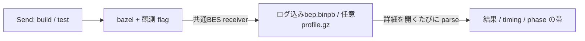

# Zeal 設計 M2: 一回の run の説明

_OhataKenji_
_Last update: 2026/10/31_
_Status: Approved_

## Goal

一回の run の profile を可視化し、自分のコマンドと Bazel 内部の処理の時系列を結びつけられるようにする。
phase の区切りとスレッド上の event を示し、観測できる範囲で処理の流れを説明できるようにする([PRD](../prd.md) シナリオ2と M2)。

### Non Goals

- action の一覧、target と action の往復、再利用や cache hit の表示
- exec log の取得と parse、実行されなかった action の推定
- action の内部ログ(stdout/stderr)の再生
- remote cache と remote execution の詳細な内訳
- 二回の run の diff。比較用の追加の条件収集と合わせて次版で扱う
- stop、中断、`bazel run`

## Background

run、snapshot、BEP などの共通用語は [overview](./overview.md#background) に従う。
**BEP**(Build Event Protocol)は、Bazelが報告するイベント列である。
targetとtestの結果を含み、Zeal内のBuild Event Service(**BES**) receiverが受信する。
**profile** は Bazel の JSON trace 形式の計測記録で、phase の marker とスレッドごとの event を持つ。
runの終了結果にはBEPのBuildFinishedのexit codeを使う。

Bazel の loading、analysis、execution は、常に独立した時間帯として観測できるとは限らない。
Bazel 8 の既定の Skymeld では analysis と execution が重なり、profile の marker は `Evaluate target patterns`、`Load, analyze dependencies and build artifacts`、`Complete build` などになる。
そのため、phase の帯には元の marker 名を使い、重なった処理を独自に分割しない。

再利用は profile から分類しない。
Bazel 8.7.0 の spike では、hit と miss のどちらにも `check cache hit` event が現れた。
内部の event 名や後続 event からの推定は、今版の可視化には持ち込まない。
Bazel server、解析済みの情報、既存出力の維持も速度に関わるが、各層の再利用率は表示しない([BuildBuddy Remote Runners](https://www.buildbuddy.io/docs/remote-runner-introduction/))。

## Overview

SendでBazelを起動し、共通BES receiverがログを含むBEPをrunのUUIDディレクトリに残す。
profileは任意の計時fileとして保存する。

入力と結果はSQLiteの元事実から表示し、詳細を開くたびに保存したfileをparseする。
計算済みの表示データを永続化しないことで、取り込み結果と生 file の整合を管理する状態を増やさない。

profile は全スレッドの event を原形のまま可視化し、加工をスレッドへの集約と metadata の反映に留める。
BEP や profile が欠損した場合は、利用できるセクションだけを表示する。

## Detailed Design

### 起動と保存

M2 では snapshot の query 中か run 中なら Send を disabled にし、実行待ちの queue を持たない。
保存先とDBの規則は[M4](./m4-run-history.md)に従う。

- `attempt/<number>/bep.binpb`：receiverが保存するログ込みBuildEvent
- `profile.gz`：Bazelが書く計時情報
- `terminal.log`：PTYで取得する端末出力

イベント送信には次のflagを付ける。

- `--bes_backend=<自分のreceiver>`
- `--bes_upload_mode=wait_for_upload_complete`
- `--bes_proxy=`

計時とtoolの識別には次のflagを付ける。

- `--profile=<dir>/profile.gz`
- `--experimental_profile_include_primary_output`
- `--noslim_profile`
- `--tool_tag=zeal`

対象は Bazel 8.7 以上を目安とし、基準環境は spike を行った Bazel 8.7.0 とする。
flag や出力形式の version 別の対応表、parser の field 名の読み替えは持たない。
非対応flagでBEPの結果が届かなければ、履歴の結果は不明とする。flagを落とした自動再実行は行わない。

### ログの表示

実行中はPTYのConsoleを表示する。
保存済みのログは、詳細要求時にBEPのProgressをstderr、stdoutの順で取り込み、末尾512 KiBを表示する。
BEP表示データとログを一度の逐次parseで組み立て、別のログfileへ保存しない。
実行中の timing は `not available` とする。

### 表示時の parse

`get_run` でBEPとログを一度に読む。
`get_run_profile` ではprofileを別途読み、いずれも解析結果を保存しない。

BEP は length-delimited protobuf event として parse し、末尾の frame が欠けた場合も受理できた結果を使う。
frame は 16 MiB まで読み、長さ prefix の overflow や不正 protobuf も incomplete とする。
profile は gzip と JSON が完結していることを前提とし、完結していなければ parse error とする。

各成果物の状態(ok / incomplete / missing / parse error)は parse 時に決める。
BEP表示は8 MiBまでとし、項目の省略や部分的なBEPはincompleteとして理由を示す。
表示上限に達しても後続ログのために走査を続ける。

### timing と phase の帯

lane のキーは `tid` とし、ラベルには `thread_name` metadata を使う。
同じ名前でも異なる `tid` はまとめず、event を持つ全スレッドを表示する。
表示スレッドは `tid` の昇順に並べる。
描画 event は file の順序と field を保ち、`ph` や `cat` で execution に限定しない。

表示は trace viewer の作法に従う。
同じ lane の重なる span は段に積み、`ph: "i"` は mark、`ph: "C"` の counter は name と数値 field ごとの系列として描く。
counter は全スレッドの下へまとめ、アクション数、Bazel の CPU・メモリ、システムの CPU・メモリ・負荷、送受信の順に表示する。
未知の系列はその後へ name と field の順に並べ、同名でも異なる `tid` の系列はまとめない。
span と mark の色は `cname`、なければ name をキーにした hash で決める。Chrome 固有の色表は再現しない。
counter の線は読みやすい濃い灰色に統一する。
event を選ぶと、チャートの下に通常の HTML で元の field を表示する。
floating panel や外枠で囲む表示は使わず、action ごとの所要時間を別の一覧へ複製しない。

phase の帯は、profile の `build phase marker` を時刻順に並べ、次の marker までを一区間にする。
最後の区間は `Finishing` event までとする。
現在の parser は `Finishing` がなければ profile 全体を parse error とし、timing を表示しない。
Skymeld で analysis と execution が重なることを注記する。
スレッド上の span を合計して run の経過時間や短縮可能時間とは扱わない。

### 観測の負担と追加検証

現在の profile parser は全体を展開して読む。
通常 build と広い target pattern の両方で、profile サイズ、展開後のメモリ、parse 時間、UI への転送量を測定する。
`--noslim_profile` の有無も比較し、現在の可視化に必要な event を残せるか確かめる。

展開後 bytes、受理する event 数、一回の UI 送信 bytes の上限は、この測定で値を決めて導入する追加設計とする。
これは未実装であり、現在の parser が無制限な展開を防げるとは扱わない。
上限超過時は incomplete と理由を示し、完全な profile として表示しない。
送信を分割する場合も event の field やスレッドの範囲を変えず、データの欠損とは区別する。
[BuildBuddy の設定一覧](https://www.buildbuddy.io/docs/config-all-options/)にあるイベント数や profile サイズの制限も、この境界を設ける根拠とする。

## Alternatives Considered

- **exec log で action 一覧を出す**：action と target の対応を詳しく出せるが、mock に対応する画面がなく、flag と parser が増える。オーナーの判断により採用しない
- **BEP や profile から再利用を出す**：BEP の cache 統計は件数だけで、profile の event 名からの判別は内部実装の推定になる。再利用の表示を採用しない
- **aquery で実行されなかった action を分類する**：設定の再現と別呼び出しの結果との照合が必要になる。今版では profile の可視化に絞る
- **SQLite に parse 結果を保存する**：再表示を速くできるが、生 file と保存値の整合を管理する必要がある。今版は表示のたびに parse する

## Caveats

- profile の可視化は計測された event の範囲を示す。記録が少ないことを、処理がなかったことや cache の不調とは解釈しない
- BEPの開始終了時刻の差は壁時計上の差であり、monotonicな計測値ではない
- 中断や強制終了では成果物が欠損するか、gzip/JSON の末尾が欠け得る
- 観測 flag 自体に負担がある。profile の採用セットと解析上限の確定は Test Plan の実測を残して行う
- 観測のために clean、shutdown、別の output base を強制せず、既存の Bazel の状態を維持する

## Security Concerns

子プロセスの起動は [overview](./overview.md#security-concerns) の引数配列による実行に従う。
profile や BEP の文字列は HTML や実行コードとして解釈しない。
圧縮 profile の展開量と UI への転送量の制限は、追加検証に記した未実装の対策として追跡する。

## Privacy Concerns

生の BEP、profile、log にはパス、引数、環境に由来する情報が含まれ得る。
保存と表示は local に限り、Zeal から自動送信しない。
生 file に秘密値がないとは保証せず、公開リポジトリの fixture には検査したサンプルだけを置く。
共通方針は [overview](./overview.md#privacy-concerns) に従う。

## Test Plan

- Bazel 8.7.0 の spike で確認した phase marker と再利用判別の限界を、既存 fixture と照合する
- BEP と profile の golden test に、末尾の欠けた BEP、壊れた gzip/JSON、`Finishing` の欠損、成果物欠損を含める
- 同名で異なる `tid`、重なる span、instant、counter を含む profile で、event を実行スレッドに限定せず可視化できることを確かめる
- 観測 flag の有無、slim/noslim、snapshot 更新の有無を分けて、生成サイズ、追加時間、parse メモリ、UI 転送量を測定する
- 追加の解析上限を導入する際は、超過が incomplete と理由付きで表示されることを fixture で確認する
