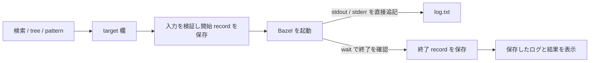

# Zeal 設計 M3: target を見つけて実行する

実行中のログ、stdin、BES受信の現行仕様は [M6](./m6-live-runs-and-bes.md) を参照する。
この文書の完了後ログ表示とGUI起動限定の制約は、M6で更新した。

_OhataKenji_
_Last update: 2026/10/18_
_Status: Approved_

## Goal

既知の一つのリポジトリで、検索、tree、pattern から対象を見つけ、`build` / `test` を実行できる試作を作る。
PRD シナリオ3の「label を覚えていなくても対象を見つけて実行できる」を先に確かめる。

### Non Goals

- `bazel run`、常駐プログラム、対話的なプログラムの実行
- 子孫プロセスの完全な回収と終了不明からの自動復旧
- 実行中のログ表示とイベントによるログ配信
- 実行後の自動 refresh、query の予約、実行キュー
- bazel flag、プログラム引数、複数 label/pattern の指定
- query 言語全般、Windows、複数リポジトリでの動作保証

## Overview

実行の入口は composer(cmd 選択、target 欄、Send)のみとする。
tree と dropdown は target 欄を置き換え、cmd は利用者が `build` / `test` から選ぶ。
入力の展開と対象の最終判断は Bazel に委ねる。

## Detailed Design

### 索引と検索

[M1](./m1-targets.md) の snapshot を Fuse.js に渡す。
`ignoreLocation: true` と `includeMatches: true` を使い、照合、スコア、一致位置を自作しない。
label と入力 file を候補にし、rule class または owner を添える。
file の owner が複数なら label 昇順の先頭を挿入する。

↑↓で候補を選び、Enter で target 欄全体を置き換える。
Enter は候補の確定だけに使い、矢印キーを操作した履歴を持たない。
label と pattern の実行は Send に統一する。
候補が閉じている場合と候補がない場合、入力欄の Enter は何もしない。
Esc は候補を閉じる。
IME 変換中のキー操作では確定や送信を行わない。

### 入力と起動

target 欄は label または pattern を表す1文字列とする。
空文字、空白文字、制御文字、先頭が `-` の入力を UI と core で拒否する。
cmd は `build` / `test` のみ受け付ける。
対象全体を shell を介さず `Command.arg` の1引数で渡し、分割、trim、quote の解釈をしない。
`//...` / `:all` / `:*` の意味と構文エラーは Bazel に委ねる。

workspace と bazel が利用可能で、取り込みと実行のどちらも動いていなければ Send を受け付ける。
snapshot がなくても手入力で実行できる。
開始 record の保存とログファイルの準備に失敗したら spawn しない。
cwd は workspace root、stdin は閉じ、観測 flag は Zeal が組み立てる([M2](./m2-run-detail.md))。

### ログと更新

stdout と stderr は同じ追記用 `log.txt` へ直接接続する。
Zeal は出力の pipe、読取スレッド、ログイベント、行バッファを持たない。
Bazel client の `wait` が終了を確認したら record を保存し、実行枠を解放して UI へ状態を通知する。
ログ、BEP、profile は実行枠が解放された後に読む。
実行中は「ログは完了後に表示」と示し、初回出力の有無を判定しない。

target の取り込みは workspace を開いたときと手動 refresh のみ行う。
query または run の実行中の refresh は予約せず拒否し、run が終わっても自動取り込みしない。
workspace 切替も処理中は拒否する。
古い snapshot と部分結果は状態と時刻を示す。

### 中断と不明な結果

stop は現在保持しているプロセスグループへ SIGINT を送り、3秒後も run を保持していれば SIGKILL を送る。
さらに2秒経っても終了を確認できなければ「停止を確認できません」と示し、実行枠を解放する。
wait エラーでも理由を示して実行枠を解放する。
この場合、record は未完了のまま残し、成功や停止完了と表示しない。
自動再実行、自動 query、無期限の復旧ループを持たず、残存プロセスへの対処を利用者に任せる。
以前のセッションのプロセスには signal を送らない。
アプリ終了時も現在の run に限り SIGINT と短い猶予後の SIGKILL を試みる。

## Caveats

- build/test の子孫が残る場合もある。停止は best-effort であり、client の終了は子孫すべての終了を意味しない。
- 子孫が残ると、client の終了後もログへ追記される場合がある。詳細を開いた時点の内容を表示し、ログの固定や全出力の保存を保証しない。
- 実行枠を解放しても残存プロセスは止まらない。再実行と refresh は利用者が状況を確認して行う。
- 外部の Bazel が lock を持つ場合も原因を推測しない。他クライアントを止める `bazel shutdown` は行わない。
- 大きな snapshot と大量のログの表示は、この試作の保証範囲に含めない。

## Security and Privacy

入力制約と shell を介さない引数渡しは [overview](./overview.md#security-concerns) に従う。
成果物は local の run ディレクトリに保存し、Zeal から外部へ共有しない。
対象のコード自体を隔離するものではないため、既知のリポジトリで試す。

## Test Plan

- 検索、tree、pattern から対象を選び、build/test の結果を確認する。
- 入力制約、IME 操作、cmd 選択保持、取り込み失敗後の手入力を確認する。
- stdout と stderr の同一ファイルへの記録、ログ準備失敗時の spawn 抑止を検証する。
- 子孫が出力先を保持しても client の終了確認を妨げないことを検証する。
- SIGINT と SIGKILL、wait エラー、停止未確認時の不明表示と枠解放を検証する。
- 実行後と停止未確認時に query や再実行を自動で起動しないことを検証する。
- Enter は候補確定だけを行い、確定後の再入力や候補なしの Enter で実行しないことを検証する。

## 追加変更の範囲と検討メモ

今回の追加変更は M3 の検索入力に限る。
build/test のみ、ログは完了後に表示、取り込みは workspace を開いた時と手動 refresh だけという縮小方針を維持する。
Enter は候補確定、実行は Send に統一し、矢印キーを操作した履歴の状態を削除する。
以下の案は未実装のメモとして残す。

| 案                                                | 対象                      | 扱い                                                                     |
| ------------------------------------------------- | ------------------------- | ------------------------------------------------------------------------ |
| query の XML と stderr を一時ファイルへ出す       | M1 の取り込み             | 今回の範囲外。読取スレッドの削減と一時ファイル管理の負担を M1 で比較する |
| 過去の run 一覧を廃止し、直近1件だけ表示する      | M2 の結果表示と M4 の履歴 | 今回の範囲外。既存の一覧と選択を維持する                                 |
| UI の状態通知と invoke の同期方法を全面的に変える | 共通の session 管理       | 今回の範囲外。既存の競合対策を維持する                                   |
| stop を SIGINT 1回に限定する                      | M3 の中断                 | 保留。止まらない場合の手動対処が増えるため、現行の段階的な停止を維持する |
| run ID、pgid、stopping を ActiveRun にまとめる    | M3 の実行状態             | 保留。今回の検索入力の変更には不要                                       |

M4 設計書に残る、wait エラー後も実行を抑止する方針と child handle の扱いは、M4 で整合させる。
今回の PR では M4 設計書を変更しない。
