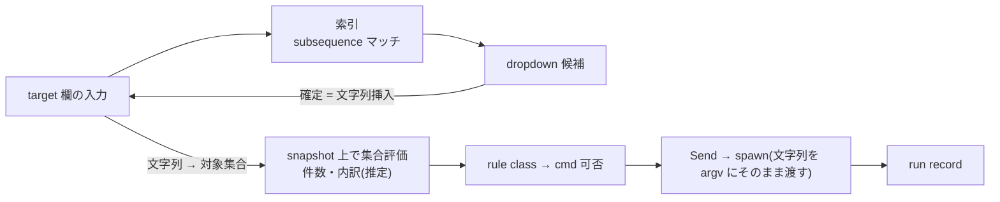

# Zeal 設計 M3: target を見つけて実行する

_OhataKenji_
_Last update: 2026/10/15_
_Status: Draft_

## Goal

target の label を正確に覚えていなくても、fuzzy 検索と pattern で対象を見つけ、その場で `build` / `test` / `run` を実行できるようにする(PRD シナリオ3・M3)。
実行のたびに、rule の型が使える操作を決めていることを画面で確かめられるようにする。

### Non Goals

- bazel flag の編集 UI
- bazel query 言語全般のサポート
- 複数 run の並列実行と実行キューの公開
- 対話的な `bazel run`(stdin は渡さない。対話が要る binary は非対応)
- Windows(SIGINT とプロセスグループを前提とするため)

## Background

CLI では target の指定が記憶と shell 補完頼みであり、存在を知らない target は発見できない。
mock はこの問題に、toolbar の composer(cmd 選択・target 欄・Send)と、入力中の dropdown(label の部分一致と file 名から owner への導線)で応える設計になっている。
実行の入口は composer のみで、実行は CLI と同じ記録として残す。

## Overview

利用者の操作は「入力 → (候補から確定) → cmd を選ぶ → Send」の一連である。確定は任意の挿入操作であり、cmd の選択は入力の途中でも行える(対象が変わるたびに再評価する)。
target 欄は常に「対象を指す一つの文字列」であり、単一 label も pattern も同じ入力の別解釈にすぎない。
tree や dropdown での選択はすべてこの欄への文字列挿入であり、別の実行モードは作らない。
対象は [m1](./m1-targets.md) の snapshot 上の label/file 索引への subsequence マッチで見つけ、`//...` `:all` `:*` の pattern は対象集合として解釈する。
選べる cmd は対象の rule class から決まり、Send で bazel を spawn して run record に記録する。

## Detailed Design

### 索引と検索

検索の対象は [m1](./m1-targets.md) で取り込んだ targets と files である。
マッチは **subsequence**(連続しない文字の並び一致)で行い、mock どおり一致文字を highlight し、候補には rule class を併記して出す。
スコアリングは簡易なものでよく、マッチの密度と prefix 一致への加点で並べる。
file 名の候補は file そのものではなく owner target への導線として表示する(`Parser.java → //app/lib:parser`)。owner が複数ある file は label 昇順の先頭を挿入する(tree と同じ規則)。

### pattern の解釈

target 欄の内容は空白区切りの target pattern 列であり、正 pattern の和集合として評価する(単一 label は要素1の列。負 pattern による減算は扱わない)。
Zeal が意味を解釈して評価するのは次の形である(代表例であり、ここにない形は未解決として扱う)。

- `//path/...`(path が空の `//...` を含む): package 再帰(rule のみ。DB 評価は package 境界での前方一致で行う)
- `//path/...:all` / `//path/...:*` / `//path/...:all-targets`: 再帰に加えて target を限定する形も同様に評価する
- `//path:all` / `//path:all-targets`: package 内の全 rule
- `//path:*`: package 内の全 target(rule + file)

snapshot 照合のために canonical 化する: `//path` は `//path:path`(最終セグメント名を target 名とする)、`:x` は `//:x` と読む。
`//`・`:`・`@` で始まらない token は `//` を補って解釈する(`foo` → `//:foo`、`foo/bar` → `//foo/bar:bar`)。cwd=workspace root で解釈するため、bare の `:all` `:*` は `//:all` `//:*` と同じである。
負 pattern(`-//x/...`)は拒否し、Send も不可とする。`@repo//` 形は解釈の対象外とし、未解決として警告付きで送れる。
上記以外で snapshot で解釈できない label/pattern は拒否せず、「snapshot 上で未解決」として警告付きで送れる。構文的に不正な文字列も同様に bazel のエラーに委ねる(最終判定は常に bazel である)。

実行時には tokenize した各 token を argv の各要素として bazel に渡す(shell は介さない)。
Zeal 側で label に展開して並べることはしない。展開の意味(package 境界・file 混入)は bazel のものであり、stale な snapshot で再現すると表示と実行がずれるためである。
DB 上での集合評価は、件数と内訳(rule 数・test 数)のプレビューと cmd 可否の判定のためだけに使う。
件数は snapshot 上の推定であり、snapshot の取得時刻とともに「推定」と示す。
`:*` の件数は rule の属性に現れた file のみを数えるため、どの rule にも属さない file は含まれず過少になり得る。`test_suite` の推定も suite を展開しないため過少になり得る。
Send は推定でブロックしない。推定が示す事実(未解決の label・test 0件)は警告として表示し、対象集合が一定規模(目安 500 件)を超える場合のみ確認を挟む。

### rule class から cmd を決める

選べる cmd は対象の rule class で決まる。

- `*_binary` → build / run
- `*_test` および `test_suite` → build / test
- その他の rule、rule でない target(file)→ build

対象が集合のときは集合の内訳に従う: `allowed = {build} ∪ ({test} if 集合に test があれば) ∪ ({run} if 集合が binary 1個のみ)`。
`snapshot 上で未解決` の対象では cmd 可否を判定できないため、警告付きで全 cmd を送れる。
`alias` は `actual` を上限3回まで辿って実体の rule class で判定し、辿りきれなければ build のみ提示する。
`_binary` でない executable rule 等の例外は拾いきれない。この対応はヒューリスティックであり、誤判定した場合は cmd を選んだ上で bazel のエラーをそのまま見せる。
`*_test` への `bazel run` は可能だが、composer では意図的に選べない。

rule class の情報は m1 の snapshot にある。stale な snapshot では cmd 提示が実態とずれ得るが、最終判定は bazel 側のエラーに委ねる。

### composer と実行

composer は cmd select・target 欄・Send の三点だけを持つ。
target 欄の入力は空白区切りで tokenize し、`-` で始まる token は tokenize 時点で拒否する(flag 編集は Non Goal)。
dropdown での確定は現在入力中の token を置き換える文字列挿入であり、複数 target の組み立てを可能にする。
Send は cwd=workspace root で引数配列のまま spawn する。stdin は閉じる(対話的な run は Non Goal)。

composer の状態は {idle, running, stopping} の三つである。

- idle: 欄が空でなく `-` 始まり token がなければ Send 可能。snapshot にない label や空の集合でも警告付きで送れる(bazel がエラーを返すため)
- running: Send は ■stop に変わる。同時に実行できる run は一つ
- stopping: stop 後、プロセスの終了を待つ間。新たな Send は受けない。SIGKILL 後も終了が確認できなければ wait を放棄して idle に戻り、残骸は [m4](./m4-run-history.md) の reconcile に委ねる

cmd の選択は対象が変わるたびに rule class 規則で再評価し、選べなくなった cmd は無効表示とする(隠さず、理由を出して rule の型と操作の対応が見えるようにする)。

### 中断

stop は spawn 時に切ったプロセスグループへ SIGINT を送る。
bazel の中断は client 経由の interrupt が筋で、`bazel run` の対象 binary もグループに含めることで回収する。
応答がなければ数秒の猶予のあと、プロセスグループへ SIGKILL を送る。
hard kill は client を殺しても server 側の処理が残り得る既知の制約であり、最後の手段とする。
SIGKILL 後も終了が確認できなければ wait を放棄し、run は再起動時の reconcile([m4](./m4-run-history.md))に委ねる。

終了の判定は exit code と signal で行い、規則は [m4](./m4-run-history.md) の outcome 表が正本である(exit 8、または signal 終了かつ stop 要求済み → interrupted 等)。
中断で終わった run は ■ interrupted として記録する。

実行に使った文字列(cmd + target 欄の内容)はそのまま run record に保存し、「自分のコマンド」として履歴に見せる。
run record には実際に spawn した argv も別途残す。

composer は索引がまだない(初回取り込み中)ときは「索引を取得中」、snapshot が古いときは推定表示、bazel が未検出のときは Send 無効、というように状態に応じて degraded な表示をする。
workspace を実行中に切り替えることはできず、切替は run の完了か中断を待つ。

## Alternatives Considered

- **bazel query 言語をそのまま受ける**: 表現力は高いが、ターゲット選定のために query 言語を要求するのは「覚えていなくても見つけられる」目的に反する。将来の拡張として残す。
- **外部 fuzzy ツール(fzf 等)との連携**: 外部依存が増え、候補に rule class 等の情報を載せるのが難しい。snapshot 上の索引による内蔵検索とした。

## Caveats

- `//...` のような pattern が巨大な集合に展開され得る。件数と内訳の確認で誤実行を防ぐ。
- 同時に実行できる run は一つ。bazel server が直列化する以上、複数 run の並行は待ち行列を生むだけである。
- Zeal 外の bazel(terminal 等)が同じ server の lock を持つと run は待機する。「bazel server 待ち」は最初の出力が来るまでの無応答で検出する(lock 待ちの文言は version 間で安定しないため parse しない。検出は invocation 開始前に限り、`bazel run` の対象 binary が走り出したあとの無出力は対象外)。`bazel shutdown` で強制解放することは他クライアントを殺すため行わない。
- `bazel run` の対象が setsid/daemonize 系でプロセスグループを抜ける場合、グループ kill が届かず孤児が残り得る。
- 大規模集合の確認は推定件数に基づくため網羅的ではない(過少推定し得る。pattern の解釈参照)。

## Test Plan

- rule class→cmd の対応表を、実リポジトリに存在する rule 種で網羅できるか確かめる。`bazel test //pkg:*`・alias 経由の `bazel run` 等の境界を実際に試す。
- subsequence マッチと highlight の単体テストを用意する。
- SIGINT→エスカレーションがプロセスグループ単位で効くこと、`bazel run` で対象 binary が残らないことを確かめる。`alias` target が query XML に `actual` 属性つきで出るかは spike で確認する。
- 実行中にアプリを強制終了し、再起動で run が回収されること([m4](./m4-run-history.md)の reconcile)を確かめる。
