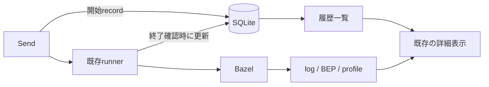

# Zeal 設計: M4 実行履歴の保存と再表示

_OhataKenji_
_Last update: 2026/10/18_
_Status: Approved_

## Goal

GUIから実行した履歴をSQLiteに保存し、過去の入力、終了結果、log、BEP、profileを再表示できるようにする([PRD](../prd.md)シナリオ4とM4)。
詳細fileが欠けても、保存済みの入力と終了結果を残す。
画面は[mock](../mock/)に従い、既存の詳細表示を使う。

### Non Goals

- BES受信、CLIからの収集、観測項目と画面の追加
- profile parserの変更、読込上限、解析workerの制御
- runnerの終了確認、停止処理、計時方法の改善
- 旧履歴の移行、未完了recordの復旧、DBの自動修復
- 容量監視、自動整理、共有、同期、export、run同士のdiff

## Background

M2とM3は、一回のGUI操作にUUIDを発行し、入力と終了情報を `run.json` に保存している。
logとBEPとprofileは同じrunのdirに置き、詳細を開くときに読む。
M4はこの要約の保存先をSQLiteへ置き換える。

- **run record**：GUIが発行したUUID、workspace、入力、開始時刻、終了時刻、exit codeからなる要約。
- **成果物**：既存の `log.txt`、`bep.binpb`、`profile.gz`。要約とは別に保存する詳細情報。
- **workspace**：Bazelを実行するcanonical path。別のworkspaceの履歴を混ぜないための識別に使う。

実行と中断は[M3](./m3-find-and-run.md)、BEPとprofileの解析および表示は[M2](./m2-run-detail.md)を引き継ぐ。
profile解析とrunnerの独立した改善は、それぞれ別PRで扱う。

## Overview

storeはworkspaceとrunの要約をSQLiteへ保存する。
既存のcreate、実行、finishという順序を保ち、開始recordを保存できた場合だけBazelを起動する。
終了を確認した場合は、同じrecordの終了時刻とexit codeを一つのtransactionで保存する。

一覧はDBからworkspaceごとに取得する。
詳細はDBのrecordと所属を確認してから、そのrunの成果物を既存のparserへ渡す。
成果物の欠損や解析失敗で、DBの終了結果を書き換えない。

UIのrecord形式と実行状態は変えない。
開始recordが未完了のまま残った場合も、既存の「結果不明」表示を使う。
再起動後の復旧と、以前のprocessへのsignal送信は行わない。



## Detailed Design

### 要約と成果物の保存先

DBはアプリ全体で一つの `<app data dir>/zeal.db` とする。
WAL、`synchronous=FULL`、foreign keyを有効にし、schemaは `PRAGMA user_version` で管理する。

```text
workspace(id PRIMARY KEY, canonical_path UNIQUE)
run(
  id PRIMARY KEY, workspace_id REFERENCES workspace(id),
  cmd, target_raw, started_at_ms, finished_at_ms, exit_code
)
```

workspaceのcanonical pathを完全一致で照合し、保存用のUUIDを割り当てる。
成果物は `workspaces/<workspace_id>/runs/<run_id>/` に置く。
runのUUID、入力、Unix msの時刻、終了情報は既存のrecord形式を保つ。
経過時間と結果の表示規則は今回変更しない。

### 保存と読込

`create` は新しいrunのdirと空logを排他的に作り、開始recordをcommitして返す。
これに失敗した場合はspawnしない。
spawn失敗時は今回の未完了recordと既知のfileだけを削除し、未知の内容を再帰削除しない。
削除や保存に失敗した場合は、不完全なrecordや孤児dirが残り得る。

`finish` は要求workspaceに所属する未完了recordだけを更新する。
終了時刻とexit codeを一つのtransactionで保存し、完了済みrecordは上書きしない。
waitエラーや停止打切りでは、既存runnerと同じく終了情報を補完しない。

`list` は要求workspaceのrecordを開始時刻の新しい順に返す。
`read_record` と成果物の読込も同じworkspaceの所属を確認する。
成果物を削除しても、要約の読込と履歴一覧は維持する。
BEPとprofileの読込および解析は既存の動作を保ち、解析結果はDBへ保存しない。

### DB障害と互換性

新規DBから始め、旧 `run.json` と開発中の旧schemaは取り込まない。
破損、permission、disk full、新しすぎるschema、busyを区別してエラーを返す。
自動修復、DBの削除、fileへの代替保存は行わない。
DBがなくsidecarだけ残る場合も初期化しない。
DBを利用できなければ新規runを起動せず、生存するprocessのstopはDBから独立させる。

## Alternatives Considered

- **fileのまま保存する**：依存を増やさずに済むが、一覧の取得をfile走査に依存させ、M5の検索もfile管理で担う必要がある。要約の正本をSQLiteへ移す。
- **parserとrunnerも同時に変更する**：資源上限と終了確認をまとめて改善できるが、履歴保存のレビュー範囲が広がる。独立したPRへ分ける。
- **成果物から一覧を再構築する**：DBを省けるが、詳細削除後に既知の入力と終了結果を保持できない。

## Caveats

未完了recordは終了不明のまま残り、crash後のprocess照合や復旧は行わない。
既存のfile履歴は新しい一覧へ移行しない。
workspaceの移動は別workspaceとして扱う。

既存の詳細解析と作業fileには、今回新しい容量上限を加えない。
履歴の自動整理も行わず、手動整理は全Zealと残存processを停止した後に行う。
DBとsidecarの手動初期化では全workspaceの要約を失い、成果物からは復元しない。

## Security Concerns

保存領域は所有者を確認してdirを0700、新規DBとlogを0600にする。
UUIDとworkspace所属を確認し、dirfdとnofollowによるアクセスでsymlinkと特殊fileを拒否する。
Bazelのumaskは変えず、BEPとprofileは保護dir内の既存の出力方法を使う。
SQLはbound parameterを使い、UIは入力と成果物をtextとして表示する。
同じOSユーザーで実行するリポジトリコードの隔離は行わない。

## Privacy Concerns

入力と成果物には秘密値やlocal pathが含まれ得る。
履歴と成果物はlocalに保存する。開発版の任意のtrace送信も、履歴の生の入力と成果物を含めない([README](../../README.md#development-traces))。
Bazel自身の通信は既存設定に従う。
公開fixtureへ秘密値を含めない。

## Test Plan

- create、finish、list、詳細の再表示を通し、再接続後も入力と終了結果が一致することを確認する。
- workspaceの分離とcanonical pathの別名、完了済みrecordの上書き拒否を確認する。
- 詳細fileの削除後も要約が残り、欠損と解析エラーを既存の表示で区別する。
- spawn失敗時の削除、保存先の権限、symlinkと特殊file、DB障害とschema不一致を確認する。
- 既存のrunner、BEP、profile、UIのテストを維持し、SQLite接続以外の動作を変えない。
