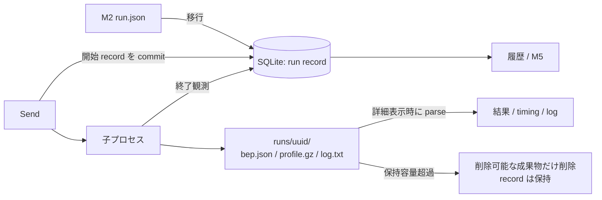

# Zeal 設計 M4: 実行履歴と profile

_OhataKenji_
_Last update: 2026/10/18_
_Status: Draft_

## Goal

GUI から起こした実行を local の履歴に残し、過去の入力、結果、呼び出しの経過時間、profile を振り返れるようにする([PRD](../prd.md) シナリオ4と M4)。
詳細を削除した後も、既知の成功や失敗を確認できるようにする。

### Non Goals

- Zeal 外で実行された build の収集
- phase 集計、解析結果の DB 保存、完了時と起動時の自動 parse
- action 一覧、target と action の往復、exec log、再利用の判別
- 再起動後の process の識別と自動停止
- DB の自動修復、履歴の再構築、manifest、backup、二重書き込み
- retention の設定 UI、直近 N 件の保護、記録がない dir の自動 sweep
- 履歴の共有、同期、手動メモ、タグ、二回の run の diff

## Background

共通用語は [overview](./overview.md#background) に従う。
**run record** は、一回の呼び出しで観測した入力、時刻、終了結果などの保存値である。
**outcome** は終了結果または観測喪失を、**detail** は詳細 file の有無を表す。
M2 は `run.json` を正本とし、BEP と profile は詳細表示のたびに parse する。
M4 は record の正本を SQLite に移し、成果物の保持容量を管理する。

再起動後の終了観測や DB の履歴復元までは実装しない。
[The Rise of “Worse is Better”](https://www.jwz.org/doc/worse-is-better.html)を踏まえ、対応範囲を絞って実装を単純にする判断である。
観測した終了結果の保持と、削除対象の限定は残す。

## Overview

workspace ごとの SQLite に run record を、生の BEP、profile、log は UUID ごとの dir に保存する。
一覧と M5 の集計は record を使い、詳細は file を開いたときだけ parse する。
phase 要約や表示用 event を DB に複製しない。

開始 record を commit してから子プロセスを起動し、観測した終了結果は一つの transaction で保存する。
再起動後の未完了 record は `lost` とし、以前の process には signal を送らない。
保持容量を超えたら、削除可能な古い run の成果物だけを削除し、record を残す。



## Detailed Design

### 保存する値

DB は `<app data dir>/ws-<fnv64>/zeal.db` に置く。
schema version と、保存領域に対応する canonical workspace path を DB 内の metadata に持つ。
path の hash だけで所属を決めず、不一致や照合不能なら、その領域での起動、移行、削除を拒否する。
新規 DB は sidecar がない場合だけ初期化し、既存の記録なし dir は引き継がない。

run record の値を次に限定する。

```text
run(
  id, workspace, cmd, target_raw,
  started_at_ms, finished_at_ms, process_elapsed_ms,
  outcome, exit_code, signal, spawn_error,
  bep_present, profile_present, log_present,
  purged_at_ms, log_truncated
)
```

id は UUID、時刻は Unix epoch からのミリ秒の整数とする。
`outcome` は NULL、`ok`、`failed`、`interrupted`、`lost` のいずれかとする。
NULL は観測継続中、`lost` は終了結果不明であり、process の終了を保証しない。
argv、Bazel version、BEP invocation id、入力の正規化形、pid、pgid、process 開始時刻、stop 要求は永続化しない。
生存する child handle、process group、stop 要求は M3 のメモリ上だけで管理する。

### 起動と終了の記録

1. 新しい UUID dir と出力 file を排他的に作成する。既存の dir を採用したり、中の file を上書きしたりしない。
2. 開始 record を `outcome = NULL`、終了情報を NULL として commit する。
3. commit 成功後に spawn する。保存準備や commit に失敗した場合は子プロセスを起動せず、今回作成したものだけを片付けてエラーを返す。
4. 子の終了を観測したら、outcome、exit code または signal、`finished_at_ms`、`process_elapsed_ms`、成果物の有無、`log_truncated` を一つの transaction で保存する。

dir 作成後から commit 前の crash では orphan が残り得る。
commit 後から spawn 前の crash では、実際には起動していない record が再起動時に `lost` になる。
この区別を復元するための追加状態は持たない。
spawn に失敗した場合は `failed`、理由、`finished_at_ms` を保存し、exit code、signal、`process_elapsed_ms` は NULL とする。

`started_at_ms` は開始 record を作る時点、`finished_at_ms` は子の終了を観測した時点の壁時計とする。
経過時間は spawn 呼び出しの直前から、wait により終了を観測するまでを monotonic clock で測る。
保存準備、DB commit、Zeal 内の query 待ち、終了後の pipe drain と詳細 parse は経過時間に含めない。
bazelisk の起動、外部の server lock 待ち、`bazel run` の対象プログラムの時間は含み得る。
画面名は「呼び出しの経過時間」とし、Bazel の build 時間や phase の合計とは扱わない。

wait のエラーは終了観測ではない。
`lost` を保存しても終了時刻、経過時間、exit code、signal は NULL とし、handle、stop、drain と次の run や query の抑止を維持する。
同じセッションで後から子の終了を観測できた場合だけ、実際の結果へ更新できる。
再起動後はこの更新を試みず、時刻差で経過時間を補完しない。

DB 書き込みに失敗したら保存失敗を表示し、新しい run を起動しない。
既に生存する子の stop と drain は続ける。
終了結果を画面で観測できても、永続化に成功したとは表示しない。
file への代替保存や自動再実行は設けない。

### 終了結果と詳細の有無

終了観測時に、次の優先順で outcome を決めて保存する。
一覧や M5 は保存値を使い、再導出しない。

| 観測した条件                             | outcome     |
| ---------------------------------------- | ----------- |
| spawn 失敗                               | failed      |
| exit 8、または stop 要求後の signal 終了 | interrupted |
| exit 0                                   | ok          |
| その他の非0 exit、または signal 終了     | failed      |
| wait エラー、再起動後の未完了 record     | lost        |

NULL の間は M3 の running / stopping を表示する。
wait エラーで `lost` になっても、終了未確認の runtime は idle に戻さない。
BEP の成功や成果物の欠損で、保存した呼び出し全体の結果を上書きしない。
記号は running → ●、ok → ✓、failed → ✗、interrupted → ■、lost → ○ とする。

| 条件                                            | detail    |
| ----------------------------------------------- | --------- |
| `purged_at_ms` がある                           | purged    |
| 記録時に BEP、profile、log のいずれかが存在した | available |
| その他                                          | none      |

表示は「詳細削除済み」「詳細ファイルあり」「詳細なし」とする。
available は存在の記録であり、parse 成功を保証しない。
外部での削除や途中の purge による欠損は、詳細を開いたときに各セクションで示す。
詳細の解析結果は DB に保存せず、M2 の表示契約を引き継ぐ。
一回の profile の phase の帯は残すが、purge 後は表示できない。

### M2 からの移行

workspace を開くときに、DB にない `runs/<uuid>/run.json` を上限付きで読む。
UUID 単位の insert とし、同じ record を再取り込みして上書きしない。
dir 名と JSON の id が一致し、workspace が開いている canonical path に一致するものだけを移行する。
開始時刻は有効な Unix ms の整数として検証し、読めない record は理由を示して他の移行を続ける。
run.json は最大 64 KiB、成果物は存在だけを調べ、parse しない。

| M2 の値                                     | 移行先                             |
| ------------------------------------------- | ---------------------------------- |
| 有効な終了時刻と exit code 0                | ok                                 |
| 有効な終了時刻と exit code 8                | interrupted                        |
| 有効な終了時刻と、その他の exit code 1..255 | failed                             |
| 終了時刻なし、code が -1、不明または範囲外  | lost。終了時刻と exit code は NULL |

M2 の `-1` には signal 終了と wait エラーの両方が含まれる。
終了時刻が記録されていても、終了を確認できたとは扱わず NULL にする。
型が壊れた JSON や不正な開始時刻は移行しない。
signal、spawn_error、`process_elapsed_ms` は NULL とし、壁時計の差で埋めない。
旧 run.json は更新せず、以後の正本は DB に限る。

### 再起動後の扱い

workspace の single instance を確保してから、前のセッションの `outcome IS NULL` を `lost` にする。
終了時刻と経過時間は NULL のままにし、以前の process の照合や signal 送信は一切行わない。
未完了や orphan の成果物は、経過日数だけで自動 parse / purge / sweep しない。
残った Bazel が lock を保持し、新しい呼び出しが待つことは許容する。
利用者が外部で停止や整理を行う必要があることを示す。
正常なアプリ終了時の stop は [M3](./m3-find-and-run.md#中断)に従う。

### 保持容量と purge

workspace の `runs/` は固定の目安 5,000,000,000 bytes とし、設定 UI と直近 N 件の保護は設けない。
容量を超えたら、通常の exit code を観測した run、または spawn 失敗を観測した run のうち、開始時刻と UUID の古い順に成果物を削除する。
以下は削除対象から外す。

- outcome が NULL または lost、あるいは終了時刻が NULL の record
- signal 終了の record。子が消えても、Bazel server などの書き込みが残る場合がある
- Zeal の log writer / drainer または詳細 reader が run dir を使用中のもの
- DB に record がない dir、所属や path の安全性を確認できないもの

保護された領域も使用量に含め、symlink は追わず、測れない領域は測定不能と示す。
上限内に整理できない場合は容量超過と理由を表示し、利用者による手動整理に委ねる。
手動整理は Zeal を閉じ、残存 process の停止を利用者が確認してから行う。
orphan の自動削除機構は作らない。

store の run 単位の共有 lease を reader と writer が持ち、purge は排他 lease を使う。
子の終了を記録しても、log の writer / drainer が閉じるまでは lease を保持する。
purge 開始後は新しい詳細 reader を入れず、DB transaction を長時間保持したまま parse しない。
dir を削除した後に `purged_at_ms` を transaction で更新し、record は残す。

途中の crash では一部の file だけが欠けてもよく、次の容量整理で同じ候補を選べば再試行する。
dir が既になければ削除成功扱いにする。
削除後の DB 更新前に crash した場合、原因や削除時刻を復元しないため、詳細で「file がない」と表示される場合がある。
これを直すための purge intent や復旧用 manifest は持たない。

### DB の障害

破損を検出しても、DB と sidecar を自動削除しない。
破損した DB からは workspace の所属を確認できない場合があるためである。
`SQLITE_CORRUPT` / `SQLITE_NOTADB` は履歴利用不能と表示し、新規 run を抑止する。
permission、disk full、新しすぎる schema version は別の理由で表示し、初期化を勧めない。
DB がなく `-wal` / `-shm` だけ残っている場合も、自動初期化しない。

修復は利用者が Zeal を閉じ、残存 process の停止と対象 workspace を確認した後、`zeal.db`、`zeal.db-wal`、`zeal.db-shm` をまとめて退避または削除して再起動する手順とする。
新規 DB には安全に読める M2 run.json だけを再移行する。
M4 以降の履歴は失われ、生の成果物からは復元しない。
残った記録なし dir は保護された orphan として扱う。

### log と解析の上限

log は run あたり固定 16 MiB まで保存し、UI に累積する出力にも同じ上限を適用する。
超過後は出力を捨てて drain を続け、`log_truncated` と省略した旨を表示する。
`log_truncated` は一度 true になったら false に戻さず、上限、queue 飽和、書き込み失敗による省略時に保存する。
終了結果の commit 後の drain で初めて省略しても更新し、終了 transaction も既存の true を上書きしない。
この更新の失敗にも DB 障害の扱いを適用する。
drain は最大 64 KiB の chunk で扱い、無制限に一行を組み立てない。
待ち行列と UI 送信も有界にし、満杯なら省略として扱い、子の drain を続ける。
保存失敗でも drain は止めず、旧 M2 log の詳細読み込みにも 16 MiB の上限を使う。
旧 log の読み込み上限ではその表示を incomplete とし、保存 file が切り詰められたとは記録しない。

詳細 parse の初期上限を次に固定する。
値の実測による変更はできるが、設定 UI は作らない。

| 対象                                          | 上限          |
| --------------------------------------------- | ------------- |
| profile の圧縮 file                           | 32 MiB        |
| profile の展開後 bytes / BEP の読み込み bytes | 各 64 MiB     |
| 受理する profile / BEP event                  | 各 250,000 件 |
| 一回の詳細結果の IPC JSON                     | 32 MiB        |

読み込み、展開、event の受理、結果の構築中に制限し、全量確保してから判定しない。
上限超過は incomplete と理由を返し、完全な profile として表示しない。
一回の詳細内で上限に収まる event の field と thread の範囲は M2 の契約を保つ。
parse worker はアプリ内で同時に一つとし、要求を無制限に queue しない。
他の解析中は busy を返し、不要になった処理は読み込みと event の境界で協調的に中止する。
この上限と log 制限は M4 の完了条件であり、現在の M2 実装に導入済みとは扱わない。

## Alternatives Considered

- **file だけを使う**：新しい DB 依存は減るが、record の原子的な更新、成果物削除後の保持、M5 の検索を file 管理へ移す必要がある。SQLite を小さな正本として残す
- **再起動後の process 回収と DB 復元**：利用者の手間を減らせるが、OS ごとの process 同一性や別の復元用状態が要る。終了不明と手動修復を許容して省く
- **詳細の解析結果を DB に保存する**：再表示を速くできるが、file と保存値の整合が増える。表示時だけ parse する

## Caveats

- 保持容量は hard limit ではない。実行中、終了未確認、signal 終了、orphan、測定不能の領域だけで超え得る
- DB 障害時に結果の保存が失敗すること、手動の DB 初期化で M4 の履歴が消えることを許容する
- 任意の対象プログラムや daemonize した子孫の終了を保証しない。以前の process の停止は利用者に委ねる
- 空き容量不足は Bazel 自身の出力にも影響する。自動再実行や `bazel shutdown` は行わない

## Security Concerns

保存領域の canonical workspace 対応と UUID を検証し、path を入力から連結しただけで削除しない。
移行時は dir 名と record id の一致も確認する。
削除対象は canonical containment を確認した app data の対象 workspace の `runs/<uuid>` に限る。
確認と削除の間の path 差し替えを避けるため、信頼した directory descriptor を起点に各階層を nofollow で開き、その descriptor に対して操作する。

purge は `bep.json`、`profile.gz`、`log.txt`、旧 `run.json` の通常 file だけを削除し、空の UUID dir を除去する。
未知の file、subdir、symlink があれば、その候補を理由付きで skip し、再帰削除しない。
移行と詳細読み込みも symlink を追わず、DB の open 時にも symlink を拒否する。
workspace 領域、runs、UUID dir の 0700 を他の OS ユーザーからの読み取りを防ぐ境界とし、既存の dir も安全な descriptor 経由でこの権限に狭める。
Zeal が作成する DB、log、出力 file は作成時から 0600 とし、出力は排他的に先に作る。
新しく起動する client の umask は 077 とするが、既存の Bazel server には継承されない。
server が置換した出力や SQLite の sidecar は、安全な descriptor 経由で権限を検証して 0600 に狭めてから利用する。
確認済みの旧 M2 file の権限も安全な descriptor 経由で狭め、確立できない file は移行と表示の対象外とする。
新規出力の権限を確立できなければ spawn しない。

SQL は bound parameter を使い、入力と event の文字列は HTML や実行コードとして解釈しない。
容量制限と安全な削除は、正常系の後回しにしない。
任意のリポジトリコードを同じ OS ユーザーで実行するため、その process に対する sandbox や完全な改竄防止は保証しない。

## Privacy Concerns

入力、BEP、profile、log には秘密値や local path が含まれ得る。
保存と表示は local に限り、共有や自動送信を設けない。
core の動作ログには UUID、処理種別、エラー分類だけを残し、raw 入力、argv、成果物の生の値を出さない。
公開 fixture は秘密値のないものに限る。

## Test Plan

- 排他的な UUID dir 作成と commit 前後の crash、commit 失敗、spawn 失敗を確認し、既存 orphan を上書きせず、未保存のまま spawn しない
- 成功、非0、exit 8、要求済み / 未要求の signal、wait エラーを確認する。wait エラー後も stop、drain、実行抑止が残り、終了確認後だけ結果を更新する
- 再起動時に NULL outcome が lost になり、signal を一切送らない。既知の結果と NULL の経過時間を保持する
- M2 の重複、`-1`、code 欠損、終了時刻欠損、不正 code、過大 JSON、壊れた record を移行し、不明な終了時刻は NULL のまま保護する
- 通常 exit と spawn 失敗だけを purge し、実行中、lost、signal 終了、reader、writer / drainer、orphan を削除しない
- purge 中の crash と DB 更新失敗後も record と既知の結果を残し、一部欠損を詳細に表示して、後の整理で削除を再試行できる
- UUID 不一致、workspace 不一致、hash 衝突、path traversal、各階層の symlink と差し替え、未知の file / subdir を削除せず、app data の対象領域外を変えない
- DB 破損、sidecar だけの残存、permission、disk full、新しすぎる schema を区別し、自動削除しない。手動初期化後は M2 だけが再移行され、M4 の生 dir は orphan のまま保護される
- 各上限の直前と超過、巨大な一行の log、queue 飽和、gzip の過大展開、巨大 event、同時の詳細要求を確認し、drain の継続と incomplete / busy を検証する。終了 commit 後に log 上限を超える場合も、log_truncated が true になり、false へ戻らない
- 0700 / 0600 と既存 server による出力の置換を確認し、0700 の境界を維持して置換 file の権限を狭める。core log に raw 入力や秘密値を出さず、詳細の文字列を実行しない
- 完了時、移行時、起動時に BEP と profile を parse せず、詳細 parse の失敗が outcome を変えない
