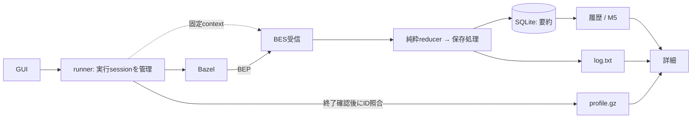

# Zeal 設計: M4 実行履歴と profile

_OhataKenji_
_Last update: 2026/10/18_
_Status: Approved_

## Goal

GUIの `build` / `test` の履歴から、過去の入力、Bazelの結果、実行時間、log、profileを振り返れるようにする([PRD](../prd.md)シナリオ4とM4)。
詳細fileを削除した後も、既知の成功や失敗を確認できるようにする。
画面の構成は[mock](../mock/)に従う。

### Non Goals

- CLI向けの設定導線、並列収集、外部BESへの転送
- `bazel run`、実行中のログ表示
- BEP自体の保存、target/test別結果、action/cache/phaseの集計
- 旧履歴の移行、未完了の復旧、DBの自動修復
- 容量監視、自動整理、共有、同期、export、run同士のdiff

## Background

GUIが起動するBazel clientのprocessと、Bazel内部の実行単位は区別する。
一回のGUI操作から複数の実行単位が生じることがあり、BESへの送信障害もclientの終了コードに影響する。
共通用語は[overview](./overview.md#background)に従い、この文書では次の意味で使う。

- **invocation**：BazelがUUIDを発行する一回の実行。
- **BEP**(Build Event Protocol)：入力、開始、進捗、終了結果などを表すBazelのevent列。
- **BES**(Build Event Service)：BEPをgRPCで受信し、保存完了したsequenceへACKを返す受信口。
- **run record**：invocationの入力、時刻、結果などをSQLiteに保存した要約。
- **profile**：Bazelが出力するgzip圧縮されたJSON trace。詳細画面で処理の時系列を示す。
- **実行session**：runnerが一回のGUI操作について保持するchild、固定context、RPC受付状態、commit済みID。

M2とM3の開始recordとfile収集を、この設計のBES記録へ置き換える。
profileの可視化規則は[M2](./m2-run-detail.md)、期限付きの停止は[M3](./m3-find-and-run.md)を引き継ぐ。

仕様参照: [BES RPC](https://github.com/googleapis/googleapis/blob/master/google/devtools/build/v1/publish_build_event.proto)、[Bazel 8.7のflag](https://github.com/bazelbuild/bazel/blob/8.7.0/src/main/java/com/google/devtools/build/lib/buildeventservice/BuildEventServiceOptions.java)、[profile ID](https://github.com/bazelbuild/bazel/blob/8.7.0/src/main/java/com/google/devtools/build/lib/profiler/JsonTraceFileWriter.java#L244-L247)。

## Overview

runnerは一つの実行sessionを所有し、固定したworkspaceと入力でBazelを起動する。
BESはそのsessionに対するBEPを受信する。
reducerはeventの検証と解釈を一度だけ行い、要約更新とlog断片を返す。
file書込とDB操作はreducerの外で行う。

受信完了したinvocationだけを保存し、IDはBazelが発行したUUIDを使う。
logの配置とSQLiteへのcommitを終えてからACKすることで、再送時も保存済みの記録を置き換えずに応答できる。
要約を詳細fileから独立させ、fileの欠損が結果やM5の件数に影響しないようにする。

runnerはprocessの終了を確認してから、profileのIDを同じsessionの保存済みIDと照合して添付する。
履歴と実行画面は同じ保存済みlogとprofileを参照し、表示時の読込と解析に上限を設ける。



## Detailed Design

### 保存する値

DBはアプリ全体で一つの `<app data dir>/zeal.db` とする。
WAL、`synchronous=FULL`、`PRAGMA user_version` を使い、新規DBから始める。

```text
workspace(id PRIMARY KEY, canonical_path UNIQUE)
run(
  id PRIMARY KEY, workspace_id NOT NULL REFERENCES workspace(id),
  cmd, target_raw, started_at_ms, finished_at_ms, bazel_elapsed_ms,
  outcome, exit_code, log_truncated
)
```

workspaceはcanonical pathの完全一致で識別し、UUIDを割り当てる。
正規化失敗は拒否し、全接続で `foreign_keys=ON`、全取得と更新で要求workspaceの条件を使う。
保存後の要約は変更せず、詳細fileの欠損や読込失敗でも結果とM5の件数を変えない。
cmdとtarget_rawはStartedとchild Pattern IDから取る。

時刻はStarted/FinishedのUnix msを使う。
有効範囲は `0..253402300799999`、開始不正は記録対象外、終了不正はNULLとする。
経過時間は終了が開始以降の場合だけ差を保存し、他はNULLとする。
結果はFinishedのexit codeから `0=ok`、`8=interrupted`、その他は `failed` とする。
これらをprocessの結果や時計、profileで補完しない。
「Bazel実行時間」はbazelisk起動とBES upload待ちを含まない。

成果物は `workspaces/<workspace_id>/runs/<invocation_id>/` に置く。
pathは検証済みUUIDから作り、開く前にDBで所属を確認する。

### 起動と実行session

BESはRust core内のtonic/prostで実装し、起動時に `127.0.0.1:0` へbindする。
gRPC-Webとreflectionは公開せず、終了時に閉じる。

runnerが一つのslotに実行sessionを所有する。
sessionにはchild、process group、RPC受付状態、commit済みIDを置く。
workspace/root、cmd、単一の対象文字列、一時profile dirは起動前に固定し、RPC開始時に捕捉する。
BESは別sessionを作らず、実行終了の判断とslot解放もしない。
slotなし、受付終了後、同時streamにはUNAVAILABLEを返す。
処理中の次の起動、workspace切替、queryは拒否する。

runnerは保護したprofile dirを準備し、stdout/stderrをnullへ接続する。
開始record、作業log、pipe、読取taskは作らない。
観測flagは固定する。

```text
--bes_backend=grpc://127.0.0.1:<port>
--nobes_lifecycle_events
--bes_upload_mode=wait_for_upload_complete
--bes_timeout=10s
--profile=<一時dir>/profile.gz
--experimental_profile_include_primary_output
--noslim_profile
--tool_tag=zeal
```

BES宛先とproxy設定は継承せず、remote cache/RBE設定は変えない。
`--invocation_id` とBEP file出力は付けず、queryも観測しない。
`--bes_timeout` はupload待ちの上限であり、process全体のtimeoutではない。

### 受信と保存

`PublishBuildToolEventStream` だけを処理し、lifecycle RPCにはUNIMPLEMENTEDを返す。
新規記録には次の4条件をすべて求める。

| 確認   | 条件                                                                        |
| ------ | --------------------------------------------------------------------------- |
| stream | TOOLの同一StreamId、1から欠番なしのsequence                                 |
| ID     | 有効なUUIDを正規形にし、Started.uuidと一致                                  |
| 入力   | Startedの有効時刻、固定contextとroot/cmd/child Pattern IDの対象文字列が一致 |
| 完了   | exit code付きFinished、最終 `component_stream_finished(FINISHED)`、正常EOF  |

条件を満たした後に保存する。

1. 一時logをflush/syncし、IDのdirへ排他的に配置して親dirもsyncする。
2. 要約を一つのtransactionでINSERT/commitし、IDと末尾sequenceをsessionに保持する。
3. 受信した番号ごとに順にACKする。途中ACKと、wait/profile完成待ちは行わない。

切断前の未保存状態は捨て、新しい一時fileで最初から受け直す。
commit後の再送は、同じ生存sessionでcommitを確認したIDだけ受け付ける。
開始sequenceは `1..保存済み末尾` を許す。
同じStreamId、連続sequence、保存済み末尾、最終marker、EOFを確認し、今回受けた番号だけACKする。
record/fileを置換せず、手動削除されたfileも復元しない。
別sessionの既存ID再利用は拒否し、DBに行があるだけでは再送と認めない。
一回のGUI操作から複数IDが生じた場合は、完了したinvocationごとに保存する。

Progressは受信順、event内はstdout→stderrの順でtext追記し、改行を追加しない。
出力なしでも空の `log.txt` を作る。
上限ではUTF-8境界で切り、`log_truncated` を立て、残りを捨てて受信検証は続ける。
実行画面と履歴は同じ保存済みlogを使い、実行画面では終了処理後に読む。
記録なしならlog利用不能と示し、未完了logやraw stderrで補完しない。

### 終了とprofile添付

停止は[M3](./m3-find-and-run.md)に従う。
SIGINT後3秒でSIGKILL、さらに2秒で打ち切り、waitエラーでも終了確認を待ち続けない。
runnerはRPC受付を閉じ、未完了RPCを中止し、開始済みcommitの結果を確認する。
commit前の取消は未保存分を破棄する。
commit開始後は結果確認を中断せず、成功したrecord/fileは残し、失敗確定時だけ今回の未保存fileを削除する。

非0終了を含め、process終了を確認できた場合だけprofileを添付する。
gzip先頭の `otherData.build_id` を同じsessionのcommit済みIDと照合する。
recordのworkspaceも一致した場合だけ、`profile.gz` を排他的に添付する。
最後のinvocationと推測せず、不明、不一致、recordなしなら添付しない。
照合では全traceをparseせず、破損は詳細表示時に示す。
添付失敗の理由は表示するが要約を変更せず、event内のURIは辿らない。

終了確認済みとspawn失敗時はprofile dirを片付ける。
終了不明時は添付せずdirを残し、停止と整理を利用者に任せる。
receiverは自身の一時dirだけを片付ける。
削除失敗は表示し、自動再試行しない。
runnerが後始末後にslotを解放し、回収済みprocessと解放後の残存processにはsignalを送らない。

### 詳細表示と資源上限

| 対象                             | 上限                                 |
| -------------------------------- | ------------------------------------ |
| gRPC metadata / message / stream | 16 KiB / 8 MiB / 64 MiBかつ250,000件 |
| log保存と読込                    | 16 MiB                               |
| profile圧縮 / 展開 / event数     | 32 MiB / 64 MiB / 250,000件          |
| profile照合用の展開header        | 64 KiB                               |
| 詳細結果のIPC JSON               | 32 MiB                               |

未知eventとenvelopeも数え、messageは復号前、展開と結果構築は途中で制限する。
待ち行列とUI送信も有界にし、全量確保後の判定にしない。
profileは上限超過をincomplete、破損をparse errorとして示す。
logの欠損、読込失敗、保存時と読込時の省略も区別する。
profile workerは一つ、同時要求はbusy、待ち行列と途中取消なしとする。
UIは選択と要求の世代で古い結果を捨てる。
profileの表示は[M2](./m2-run-detail.md)の契約を保つ。

### DB障害

DB障害では新規起動を抑止するが、現在のprocessのstopは維持する。
破損、permission、disk full、新しすぎるschemaは区別し、自動修復や代替記録はしない。
permission、disk full、新しすぎるschemaでは初期化を勧めない。
DBなしでsidecarだけ残る場合も自動初期化しない。

## Alternatives Considered

| 案                                                           | 利点                         | 採用しない理由                                                                                                           |
| ------------------------------------------------------------ | ---------------------------- | ------------------------------------------------------------------------------------------------------------------------ |
| 起動時にrecordを作り、processの結果とstdout/stderrを保存する | BEPが出ない早期失敗も残せる  | GUI操作とinvocationが一致せず、Bazelの結果や時刻とprocessの観測値が混ざる。Bazel由来の完了記録に揃える                   |
| BEPを正本にして表示のたびに再解析する                        | 保存後に別の項目も解析できる | BEPを削除すると要約の根拠も失われ、詳細の欠損と履歴の件数を独立させられない。要約はSQLiteを正本とし、BEP自体は保存しない |
| 外部BESへ送信して履歴を得る                                  | 既存の収集基盤を利用できる   | 接続設定と外部へのデータ転送が必要になる。localだけで完結する今版では、Rust core内の受信口を使う                         |

## Caveats

BES完了をprocess終了扱いせず、process結果と記録成否は別に示す。

crashの孤児dirは採用も上書きもせず、再起動後の復旧や過去processへのsignal送信もしない。
手動整理は全Zealと残存processを停止し、詳細fileと一時dirだけを対象にする。
同じ停止確認後、DBとsidecarを退避して手動初期化すると全workspaceの履歴を失う。
保存後ACKでもBES障害はclientのupload待ちや終了コードに影響し得る。

## Security Concerns

local processを信頼し、token認証と偽装防止は設けない。
UIから任意backend/root/pathを受け付けず、受信pathを保存先へ連結しない。
app data以下は所有者を確認してdirを0700、新規DB/fileを0600にする。
dirfdとnofollowで辿り、非ブロッキングopen後に同じFDで通常fileか確認する。
symlink/FIFO/deviceを拒否し、DB/sidecarも保護dir内の通常fileに限定する。
リポジトリroot、既存artifactの権限、Bazelのumaskは変えず、安全な保存先を用意できなければspawnしない。

SQLはbound parameter、入力とlog/profileのeventはtext表示とする。
リポジトリコードの隔離と完全な改竄防止は保証しない。

## Privacy Concerns

入力、log、profileには、対象のパスや実行内容に由来する情報が含まれ得る。
記録はlocalに限り、転送とtelemetryは設けない。
coreログはUUID、処理種別、エラー分類だけとし、metadata/argv/生値や秘密入りfixtureを公開しない。

## Test Plan

受入では次の5群を確認する。

1. 実Bazelの受信→commit→ACK。切断、ACK全喪失/一部喪失、seq1/suffix再送、同時streamを含む。
2. spawn/wait失敗、停止打切り、RPC取消とcommitの競合、古いRPCと次の実行の分離。
3. workspace/ID衝突、時刻欠損と負差、DB障害と各crash境界、詳細削除後の結果とM5件数の不変。
4. 空log、UTF-8境界と省略、profileのID不一致/欠損/破損/添付失敗、workerのbusyと古い表示要求。
5. 全資源上限、権限と特殊file、所属とpath検証、不要event非保持とログ秘匿。

実測はrepo revision、Bazel/OS/CPU/RAM、入力、cold/warm、反復回数を記録する。
通常build、広いpattern、巨大event、上限付近profileでflag負担、受信/保存bytes、最大メモリ、parse/IPC量とworker待ち時間を測る。
bytesと実メモリを同一視せず、BESの実測とM2表示を確認して完了とする。
固定SLOと常設の計測基盤は作らない。
