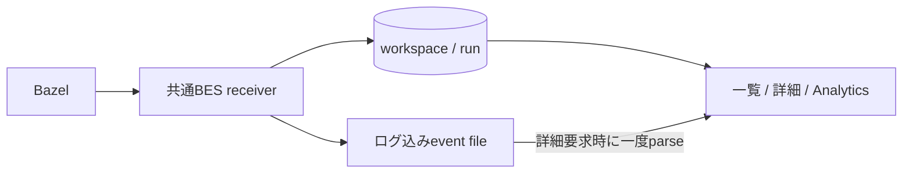

# Zeal 設計: M4 実行履歴の保存と再表示

_OhataKenji_
_Last update: 2026/10/31_
_Status: Approved_

履歴の入力とビルド結果はDBから表示し、詳細は保存したイベントから読む。
受取確認の順序は[正常受信](#正常受信)、表示上限は[詳細の読込](#詳細の読込)を参照する。

## Goal

一回のBazel呼び出し(**invocation**)を保存し、入力、ビルド結果、ログ、BEP、profileを再表示する([PRD](../prd.md)シナリオ4とM4)。
詳細fileが欠けても、DBの入力とビルド結果を維持する。

### Non Goals

- 自動修復、未完了runの復旧
- 容量監視、自動整理、共有、同期、export、run同士のdiff
- profile parserの変更、cloud保存、remote execution

## Overview

Bazelは入力、時刻、結果をBuild Event Protocol(**BEP**)のイベントとして報告する。
アプリや端末が起動したBazelは、Zeal内のBuild Event Service(**BES**) receiverへ送る。
保存と表示は同じinvocation IDを使い、起動元を分類しない。
receiverはBEPの入力、時刻、build exitをDBへ保存し、ログを含むイベントをfileへ書く。
一覧、結果表示、所要時間、集計用データはapplicationがDBの事実から組み立てる。



## Detailed Design

### 保存する事実

DBはアプリ全体で一つの `<app data dir>/zeal.db` とする。
WAL、`synchronous=FULL`、foreign keyを有効にし、`PRAGMA user_version=3` で管理する。
表は次の2つだけとする。

```text
workspace(id TEXT NOT NULL PRIMARY KEY, canonical_path BLOB NOT NULL UNIQUE)
run(
  id TEXT NOT NULL PRIMARY KEY,
  workspace_id TEXT REFERENCES workspace(id),
  cmd TEXT, target_raw TEXT,
  started_at_ms INTEGER, finished_at_ms INTEGER, exit_code INTEGER,
  attempt INTEGER NOT NULL DEFAULT 0 CHECK(attempt >= 0),
  received_complete INTEGER NOT NULL DEFAULT 0 CHECK(received_complete IN (0, 1))
)
```

workspaceは可能ならcanonicalizeしたpathで照合し、不可能ならBEPの絶対pathを使う。
runの入力と時刻はBEPで観測するまでNULLとする。
`attempt` は現在の受信回、`received_complete` は最後のイベントと正常EOFを確認し保存した事実である。

成功表示や所要時間、画面へ返すデータ(**DTO**)、イベント本体はSQLへ保存しない。
indexは `run(workspace_id, started_at_ms DESC, id)` とする。

#### 起動時の予約

Bazelを起動するときはUUIDだけを予約してcommitし、そのIDを渡す。
既存IDとの衝突はspawn前に拒否する。
Consoleのコマンド表示にはメモリの入力を使い、DBのBEP時刻や入力へ代入しない。
起動失敗時は未受信の予約と既知の一時fileだけを取り消す。

### event fileと受信

保存先は `<app data dir>/runs/<invocation_uuid>/attempt/<number>/bep.binpb` とする。
BuildEventをlength-delimited protobufで順に書き、Progressのstdout/stderrもそのまま残す。
ログはevent内に一度だけ保存し、`log.txt` や `bep.json` は作らない。
任意の `terminal.log` は擬似端末(**PTY**)の出力、`profile.gz` は計時情報として `runs/<invocation_uuid>/` に置く。
これらの有無を起動元の判定に使わない。

### 正常受信

**EOF**は、この接続での送信終了を示す。
受取確認を**ACK**、buffer内のデータをfileへ書き出す処理を**flush**と呼ぶ。

1. イベントを順にbufferへ書く。この時点ではACKしない。
2. 正常EOFを受け取る。
3. fileをflushし、現在のattemptを条件にDBを更新する。
4. 受信番号を順にACKする。

`received_complete=1` にするには、最後のBEPイベントを示す `last_message` も必要である。
last_messageがなければ、正常EOFをACKしても `received_complete=0` とする。

| 報告          | 意味                  |
| ------------- | --------------------- |
| BuildFinished | ビルド終了とexit code |
| last_message  | BEPの最後のイベント   |
| EOF           | この接続での送信終了  |

BuildFinishedがなければビルド結果は不明である。
flushは電源断後のfile保持を保証しない。

### 失敗と再送

| 状態                  | 受信動作                                                         |
| --------------------- | ---------------------------------------------------------------- |
| 未確定runの再送       | 新しいattemptへ番号1から全部送る                                 |
| 受信確定済みrunの再送 | 保存を繰り返さず、正常EOF後にACKする。末尾だけの再送も受け付ける |
| fileやDBの失敗        | ACKしない                                                        |
| 切断やidle期限切れ    | 可能な範囲を保存するがACKしない。次の接続の全送に委ねる          |

古いattemptからの更新が拒否された場合もACKしない。
接続内の受信番号は連続昇順とする。
同じIDの既知のworkspaceや入力と矛盾する報告は拒否する。
途中更新と確定はすべて現在のattemptを確認し、古い接続が新しい記録を変更することを防ぐ。

lifecycle unaryはBEPとは別の通知APIであり、保存せず成功応答だけを返す。

### 詳細の読込

`get_run` は、DBのworkspace所属を確認して現在のattemptのfileを一度だけ逐次parseする。
同じ走査でBEPの表示データとログを組み立て、全イベントや全ログをメモリへためない。
Progressのログはstderr、stdoutの順に取り込む。
任意のprofileは `get_run_profile` で別途読む。

#### 上限とメモリ

一つのイベントを長さ付きで格納した単位を**frame**と呼ぶ。

| 対象          | 上限と動作                                     |
| ------------- | ---------------------------------------------- |
| ログ          | 末尾512 KiB。Unicode文字を分断しない           |
| BEP表示データ | serialize後8 MiB。項目を省略したら不完全と示す |
| 一つのframe   | 16 MiB。長さとfile残量をbuffer確保前に確認する |
| 解析worker    | 同時1件。処理中の追加要求は待たせず拒否する    |

表示上限後も走査を続け、後続ログの末尾を取り込む。
8 MiBは表示用の上限であり、受信できるイベントの保存条件には使わない。
解析結果のfile、永続cache、offset表は作らない。

#### 読めない場合

file欠損、読込失敗、解析失敗は該当sectionへ表示する。
読めた部分を返す場合も不完全と示す。
DBの入力やビルド結果は維持する。

### 履歴とlive process

一覧はworkspaceが判明したrunをBEP開始時刻の新しい順に返す。
未観測の入力や時刻は表示でも不明のままにする。
成功はBuildFinishedのexit、所要時間はBEP開始終了時刻から求める。
子processのexitや停止操作からビルド結果を補わない。

`bazel run` のプログラムは、ビルド結果の送信後も動き続ける場合がある。
Console、stdin、停止はCoreがメモリで保持するlive processを使う。
履歴が確定してもその操作を続けられる。

process終了後も最後のConsoleを保持して末尾を読む。
詳細画面から戻って端末出力を確認できる。
終了後のConsoleは読取だけを許し、workspace切替でその読取権限を破棄する。

workspace未判明の予約が一覧に出ない間も、live processからConsoleを開ける。
再起動後の以前のprocessへのsignal送信は行わない。

### DB障害

対応するschemaと一致しないDBは、DBとfileを変更せず利用を拒否する。
自動削除、再作成、fileからの履歴復元は行わない。
DBがなくWAL/SHMの補助file(sidecar)だけ残る場合も初期化しない。

破損、permission、disk full、新しすぎるschema、busyは区別する。
DBを利用できなくても、生存するprocessのstopは維持する。

過去attemptや孤児fileの自動整理も行わない。

## Security and Privacy

UUIDと正整数だけを保存先名に使う。
保存領域は所有者を確認し、dirfdとnofollowでsymlinkと特殊fileを拒否する。
dirは0700、新規DBとevent fileは0600とする。
SQLはbound parameter、UIはtext表示を使う。
入力と成果物はlocalに保存し、公開fixtureへ秘密値を含めない。
Bazelの通信設定とアプリ起動時のBES上書きは[overview](./overview.md#privacy-concerns)に従う。

## Test Plan

### 保存と再表示

- 同じBEPから同じDB事実、詳細、DTO、Analyticsが得られること。
- ログ込みeventだけを保存し、一度の走査でBEPとUnicode末尾ログを返すこと。
- 表示上限後の後続ログ、巨大frame、欠損、不完全なfileが一覧と集計を変えないこと。
- BEP結果確定後もプログラムのstdinとstopが動き、process終了だけでは結果を補完しないこと。

### 失敗と安全性

- EOF前ACKなし、全送retry、確定済み再送を確認する。
- 並行attemptで古い接続が更新できず、file/DB失敗時にACKしないこと。
- 保存先の権限、symlink、特殊file、非対応schemaの非破壊拒否を確認する。
