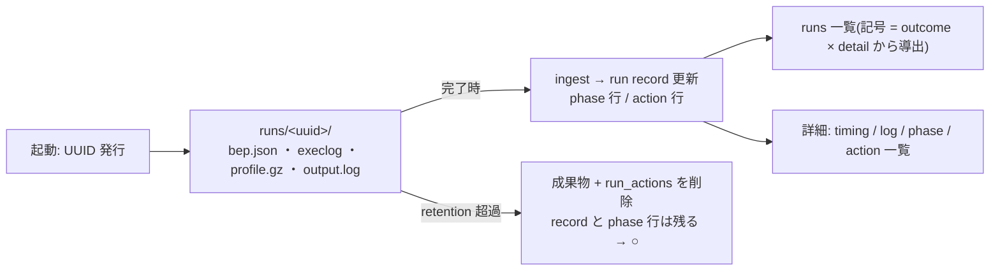

# Zeal 設計 M4: 実行履歴と profile

_OhataKenji_
_Last update: 2026/10/15_
_Status: Draft_

## Goal

GUI から起こした実行を local に記録し、過去の run を一覧から選んで phase の内訳・所要時間・実行と再利用の内訳を振り返られるようにする(PRD シナリオ4・M4)。
「再利用」が観測できるのは remote/disk cache 使用時に限られ、local のみの環境では実行した action の記録のみになり、再利用は観測できない旨を示す([m2](./m2-run-detail.md)参照)。

### Non Goals

- Zeal 外(terminal の `bazel` 等)で実行された build の収集。存在を知る術がない
- 履歴の共有・同期
- 履歴への手動メモ・タグ付け

## Background

mock の sidebar には runs 一覧があり、各 run は ● running / ✓ ok / ✗ failed / ■ interrupted / ○ no detail の記号を持つ。
観測源(BEP・exec log・profile)の役割と取得方法は [m2](./m2-run-detail.md) で定めたとおりで、本設計はそれを「蓄積と再生」に適用する。
PRD の指示どおり、観測できない実行は履歴に詳細を持たないことを明示し、推測で埋めない。

## Overview

run の起動時に UUID を発行し、観測用の成果物をその UUID のディレクトリに保存する。
完了時に成果物を ingest して record を更新し、一覧と詳細は常に DB と成果物から再生する。
記録の対象は Zeal が起動した run に限る。

## Detailed Design

### run record

record は観測した事実だけを持ち、表示用の状態は持たない。

- id(UUID)、workspace、cmd、target 欄の文字列とその正規化形(集計キー用。[m5](./m5-analytics.md)参照)、実際に spawn した argv
- pid / pgid / プロセス開始時刻(回収対象の同一性確認のため)、bazel version、BEP の invocation id(デバッグと BEP 由来データの対応づけ用)
- started_at / finished_at、exit code、signal、stop 要求の有無
- 観測成果物(BEP・exec log・profile)ごとの ingest 状態(ok / incomplete / missing / parse error)。purge 済みの印(purged_at)と `output.log` の切り詰め印(output_log_truncated)

spawn が成功した直後に、pid・pgid・プロセス開始時刻を含む record を書き込む(spawn と record の間に crash して孤児の bazel が残るのを防ぐため)。
spawn 自体に失敗した場合(bazel 未検出の競合等)は、その時点を finished_at として終端の record を即座に記す。
stop 要求の印は、利用者の ■stop・アプリ終了時の SIGINT・reconcile での interrupt のすべてで立てる。

exit code と signal を残すのは、結果を後から確かめられるようにするためである。
`bazel test` の失敗(exit code 3)と build 失敗の区別は、導出される記号ではなく exit code が担う。

### 結果と詳細は別の軸

run には二つの独立した事実がある。

- **outcome**(終了結果): running / ok / failed / interrupted / lost
- **detail**(詳細の有無): full / partial / purged / none

一覧の記号 ●✓✗■○ はこの二軸からの表示上の導出である。
detail がない run は outcome に関わらず ○ と表示するが、record から成功・失敗の事実が消えるわけではない。

outcome の判定は次の順で行う。

| 条件                                                           | outcome     |
| -------------------------------------------------------------- | ----------- |
| finished_at がなく、自プロセスが handle を持つ                 | running     |
| finished_at がなく、生存 handle がない(再起動で発見された残骸) | lost        |
| exit 8、または signal 終了かつ stop 要求済み                   | interrupted |
| exit 0                                                         | ok          |
| その他(exit code NULL を含む)                                  | failed      |

detail の導出は次のとおりである。

| 条件                                                              | detail  |
| ----------------------------------------------------------------- | ------- |
| purged_at がある                                                  | purged  |
| 期待される成果物(BEP・exec log・profile)の ingest 状態がすべて ok | full    |
| 一部が ok で残りが ok 以外(incomplete / missing / parse error)    | partial |
| それ以外                                                          | none    |

判定の分母は観測成果物(BEP・exec log・profile)のみで、`output.log` は含めない(log は常に残るため)。
ingest 状態は成果物名(bep / execlog / profile)を key にした map として record に持つ。

記号の導出も同じく順に行う。

| 条件                     | 記号                                                          |
| ------------------------ | ------------------------------------------------------------- |
| outcome = running        | ●                                                             |
| detail ∈ {full, partial} | outcome の記号(ok → ✓、failed → ✗、interrupted → ■、lost → ✗) |
| detail ∈ {none, purged}  | ○                                                             |

「lost」は起動時の reconcile で付く。
`finished_at` が NULL の record を起動時に走査する。
pid の生存は pgid・プロセス開始時刻・cmdline の UUID dir 引数で同一性を確認してから判断する(PID reuse で無関係なプロセスを殺さないため。観測 flag は常に付与されるため、UUID 引数は必ず argv に存在する)。
run 本体が生きていれば [m3](./m3-find-and-run.md) の規則で interrupt して(このとき stop 要求の印を record に立てる)成果物を回収する。
終了は `wait` で実際に観測した時刻を finished_at、signal を record に記す。SIGKILL 後も終了が確認できなければ finished_at は立てず、確認不能のまま残す。
死んでいれば残存成果物を ingest 試行する。
また finished_at は記録済みだが成果物の ingest 状態が確定していない run(finished 直後・ingest 途中に crash したもの)も起動時に再試行する。再 ingest は `run_phases`/`run_actions`/状態更新をひとつの transaction で `DELETE` + `INSERT` し冪等とする。
finished_at は取れないまま(NULL)残し、lost は「finished_at がなく生存 handle もない」ことでその都度導出する。

成果物が record なしに残る逆向き(dir はあるが行がない)は、起動時の sweep で削除する。対象は起動時点より十分古い(mtime が猶予時間より前の)dir に限り、作りかけの dir を誤って消さない。

### 成果物の管理

成果物は `<app data dir>/<workspace>/runs/<uuid>/` に `bep.json`・`execlog`・`profile.gz`・`output.log`(stdout/stderr 合流)として保存する。
`output.log` は容量上限を持ち、超過分は切り詰めて、切り詰めた旨を record に記す。

保持は `runs/` 配下の合計容量の上限とする(workspace あたり目安 5GB、設定変更可)。超えたら上限を下回るまで古い run から「成果物 dir と `run_actions` 行」のセットを削除する。
record と `run_phases` 行は残す(phase 行は run あたり数行しかなく容量を圧迫しないため、履歴集計の期間集計は全期間で有効なままになる)。
削除された run の detail は purged となり、一覧には ○ として残る。
削除は ingest 完了後と起動時にバックグラウンドで行う。起動時は reconcile の ingest 試行と孤児 dir の sweep のあとに回す(lost run の残存成果物が取り込み前に消えないようにする)。
各 run では成果物 dir の削除を先に行い(dir が既にない場合は成功扱い)、`run_actions` 行の削除と record の purged_at 更新をひとつの transaction に畳む。途中で crash しても `purged_at` が NULL のまま残り、次回の起動時に同じ対象として再挑戦し収束する。
実行中の run と直近の N 件(完了直後の当該 run を含む)は対象にしない(単一 run が上限を超えても、直後に自身が purge されないようにする)。

### 詳細画面の再生

run を選ぶと、record のメタ情報(cmd・入力・時刻・exit code)は常に表示し、その上で成果物由来のセクションを利用可能な分だけ出す。

- timing: profile + exec log があれば表示、なければ `not available`
- log: `output.log` があれば表示
- phase 内訳: `run_phases` 行があれば表示(purge 後も残る)
- action 一覧と cache hit の内訳: exec log 由来の `run_actions` 行があれば表示。local のみの環境では cache hit は観測できない([m2](./m2-run-detail.md))

○ の run でも record が持つ事実は隠さない。
「詳細がない理由」(flag 非対応・成果物欠損・parse 失敗・purged・ingest 未到達の lost)は、成果物ごとの ingest 状態と purged_at から表示時に導出して示す。

## Alternatives Considered

- **status を一つの列として保存する**: outcome と detail は独立に変わる(retention が detail を消しても outcome は消えない)ため、一つの enum に畳むと「失敗したのに ○ になる」ような情報の喪失と、外部イベントによる retroactive な書き換えが起きる。観測事実を持ち表示を導出する形を選んだ。
- **CLI の出力や bazel の cache から事後に推定する**: bazel の内部出力レイアウトは安定した API ではなく、推定は不安定になる。
- **BEP を gRPC で直接受ける**: file 出力を採用した理由とともに [overview](./overview.md) の代替案に集約した。

## Caveats

- DB が破損した場合 run record は復元できない(構造 snapshot はメモリのみで DB に入っていないため被害対象は run 側のみ)。破損した DB file を退避し、空の DB で起動する([overview](./overview.md)の store 運用)。
- per-run の成果物サイズは桁違いに変動する(通常 build で数十 MB、`//...` 級では exec log が GB に及び得る)。容量上限の根拠としてこの目安を置く。
- spawn 前に app data dir の空き容量を確認し、逼迫していれば警告する。観測用の書き込み失敗が build 本体を落とすことがないよう、成果物の失敗と run の失敗は分けて記録する。
- ○ の run の内訳を、同じ target の過去の run から推測して埋めるようなことはしない。

## Test Plan

- 成功・失敗・中断(exit 8)・強制終了・成果物欠損の各ケースを実際の run で再現し、outcome と detail の判定が規則どおりになるか確かめる。
- outcome・detail の導出表は全条件パターン(purged_at あり・ingest 状態 partial/missing/parse error の混在を含む)を fixture で網羅する。
- 実行中にアプリを kill し、再起動で run が lost として回収されること、孤児の bazel プロセスが残らないか interrupt されることを確かめる。
- retention の上限を超えた run が record と phase 行を残して detail=purged になることを確かめる。purge 途中の kill で `purged_at` が NULL のまま残り、次回起動で再挑戦・収束すること、再 ingest が冪等であることを確かめる。
