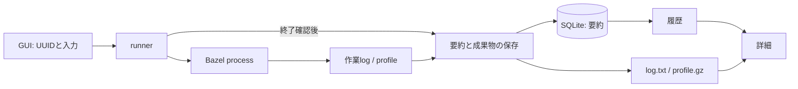

# Zeal 設計: M4 実行履歴と profile

_OhataKenji_
_Last update: 2026/10/18_
_Status: Approved_

## Goal

GUIの `build` / `test` の履歴から、過去の入力、実行結果、経過時間、log、profileを振り返れるようにする([PRD](../prd.md)シナリオ4とM4)。
詳細fileを削除した後も、既知の成功や失敗を確認できるようにする。
画面の構成は[mock](../mock/)に従う。

### Non Goals

- BES受信、BEP収集、CLIからの履歴収集
- `bazel run`、並列実行、実行中のログ表示
- target/test別結果、action/cache/phaseの集計
- 旧履歴の移行、未完了の復旧、DBの自動修復
- 容量監視、自動整理、共有、同期、export、run同士のdiff

## Background

履歴の単位は、composerから起動する一回のBazel呼び出しとする。
共通用語は[overview](./overview.md#background)に従い、この文書では次の意味で使う。

- **run**：GUIがUUIDを発行して起動する一回のprocessと、その記録。
- **run record**：runの入力、時刻、経過時間、終了結果をSQLiteに保存した要約。
- **log**：processのstdoutとstderrを一つのfileにまとめたtext。
- **profile**：Bazelが出力するgzip圧縮されたJSON trace。詳細画面で処理の時系列を示す。

processの結果と経過時間には、bazeliskの起動やBazel serverのlock待ちも含み得る。
Bazel内部の実行単位やphaseの所要時間とは区別する。
profileの可視化規則は[M2](./m2-run-detail.md)、期限付きの停止は[M3](./m3-find-and-run.md)を引き継ぐ。
BESは受信処理とprotocol管理を伴うため、M4から分離する。

## Overview

runnerはworkspaceと入力を固定し、GUIのUUIDを発行してBazelを起動する。
M3と同じくstdoutとstderrを作業logへ直接接続し、profileも一時dirへ出力する。
BES受信口とBEP収集は追加しない。

processの終了を確認した後、上限付きのlogを複製し、要約をSQLiteへcommitする。
profileは同じGUIのrunへ添付する。
履歴の要約を詳細fileから独立させ、欠損や解析失敗で既知の結果が変わらないようにする。

実行画面と履歴は同じ保存済みlogとprofileを参照する。
詳細の読込と解析は表示時に行い、入力と返却する結果に上限を設ける。
M5は将来、この保存済み要約を集計に使う。



## Detailed Design

### 保存する値

DBはアプリ全体で一つの `<app data dir>/zeal.db` とする。
WAL、`synchronous=FULL`、`PRAGMA user_version` を使い、新規DBから始める。

```text
workspace(id PRIMARY KEY, canonical_path UNIQUE)
run(
  id PRIMARY KEY, workspace_id NOT NULL REFERENCES workspace(id),
  cmd, target_raw, started_at_ms, finished_at_ms, elapsed_ms,
  outcome, exit_code, log_truncated
)
```

workspaceはcanonical pathの完全一致で識別し、UUIDを割り当てる。
正規化失敗は拒否し、全接続で `foreign_keys=ON`、全取得と成果物参照で要求workspaceの条件を使う。
runのIDはGUIが発行したUUID、cmdとtarget_rawは起動時の入力とする。
成果物は `workspaces/<workspace_id>/runs/<run_id>/` に置く。
保存後の要約は変更せず、一覧とM5で使う結果を詳細fileから再導出しない。

開始と終了の時刻はprocessの起動前と終了確認時のUnix msとする。
有効範囲は `0..253402300799999`、開始不正は起動拒否、終了不正はNULLとする。
`elapsed_ms` は起動前から終了確認までをmonotonic clockで測り、壁時計の差で補完しない。
保存準備と終了後の保存、添付、解析は含めない。
画面には「実行時間」と表示し、profileのphaseの合計とは扱わない。

結果は次の優先順で決める。
signal終了は、通常のexit codeと区別するため `-1` として保存する。

| 観測結果                                    | outcome     |
| ------------------------------------------- | ----------- |
| exit 0。stop要求があっても優先する          | ok          |
| exit 8                                      | interrupted |
| その他の非0またはsignal終了で、stop要求あり | interrupted |
| その他の非0またはsignal終了で、stop要求なし | failed      |

### 起動と終了後の保存

runnerは一つの実行枠を持ち、実行またはquery中の次の起動、workspace切替、queryを拒否する。
起動前にDBを確認し、保護した一時dirと0600の出力fileを排他的に用意する。
stdoutとstderrは同じfile offsetを共有する作業logへ接続する。
観測flagは次に限り、Bazelの既存のBES、proxy、remote cache、RBE設定は変えない。

```text
--profile=<一時dir>/profile.gz
--experimental_profile_include_primary_output
--noslim_profile
--tool_tag=zeal
```

spawn失敗時は今回作った一時fileを片付け、履歴は作らない。
停止はSIGINT後3秒でSIGKILL、さらに2秒で打ち切り、waitエラーも同じ期限付きの停止へ進む。
終了未確認なら履歴を作らず、作業fileを残して実行枠を解放する。
利用者へ終了不明を示し、解放後の残存processにはsignalを送らない。

終了確認後は、非0終了を含めて次の順で保存する。

1. 作業logの先頭を上限付きで読み、別fileに複製する。不正UTF-8は置換し、出力も16 MiBに収める。
2. 複製logをflush/syncし、runのdirへ排他的に配置して親dirもsyncする。
3. workspaceとrunの要約を一つのtransactionでINSERT/commitする。
4. 同じrunへ32 MiB以下のprofileを排他的に添付する。BazelのIDとの照合や全traceの解析は行わない。
5. 一時fileを片付けて実行枠を解放する。

複製先を分けるため、子孫processが作業logへ追記しても保存済みlogは変わらない。
上限で省略した場合は `log_truncated` を保存する。
要約の保存失敗とprofileの添付失敗は画面で示し、processの終了結果と区別する。
添付失敗やfile欠損で保存済み要約を変更しない。
DB commitの成否が不明なら、存在を再確認できた記録を残し、未保存と確認できたfileだけを削除する。
一時fileの削除失敗も表示し、自動再試行しない。

### 詳細表示と資源上限

| 対象                         | 上限                        |
| ---------------------------- | --------------------------- |
| 保存済みlogとその読込        | 16 MiB                      |
| profile圧縮 / 展開 / event数 | 32 MiB / 64 MiB / 250,000件 |
| 詳細結果のIPC JSON           | 32 MiB                      |

読込、展開、eventの受理、結果の構築中に制限し、全量確保後の判定にしない。
profileの上限超過はincomplete、破損はparse errorとして示す。
logの欠損、読込失敗、保存時と読込時の省略も区別する。
profile workerは一つ、同時要求はbusy、待ち行列と途中取消なしとする。
UIは選択と要求の世代で古い結果を捨てる。
profileの表示は[M2](./m2-run-detail.md)の契約を保つ。

### DB障害

DB障害では新規起動を抑止するが、現在のprocessのstopは維持する。
破損、permission、disk full、新しすぎるschemaは区別し、自動修復や代替記録はしない。
permission、disk full、新しすぎるschemaでは初期化を勧めない。
DBなしでsidecarだけ残る場合も自動初期化しない。

## Alternatives Considered

- **BESでBazelのイベントを受信する**：BazelのID、入力、時刻を直接記録できるが、受信口、再送、保存と応答の管理が増える。M4は既存のprocess実行を使う履歴保存に絞る。
- **BEP fileから同じ値を解析する**：受信口を省けるが、収集と解析の変更が必要になる。BEPも別の変更で扱う。
- **要約もfileだけに保存する**：DB依存を省けるが、一覧とM5の検索、詳細削除後の要約保持をfile管理で担う必要がある。SQLiteを要約の正本にする。

## Caveats

終了未確認、spawn失敗、保存前のcrashは履歴に残らない。
残った一時dirを再起動後に採用したり、過去のprocessを照合したりしない。

16 MiBは保存後のlogの上限であり、実行中の作業logには容量制限を設けない。
profileの作業fileと全履歴の合計容量も制限しない。
M3と同じfile出力を使い、容量監視と自動整理は別の変更で扱う。
子孫processの完全回収は保証せず、手動整理は全Zealと残存processを停止した後に行う。
DBとsidecarを退避して手動初期化すると、全workspaceの履歴を失う。

## Security Concerns

app data以下は所有者を確認してdirを0700、新規DB/fileを0600にする。
dirfdとnofollowで辿り、非ブロッキングopen後に同じFDで通常fileか確認する。
symlink/FIFO/deviceを拒否し、DB/sidecarも保護dir内の通常fileに限定する。
成果物を開く前にUUIDとDB上のworkspace所属を確認する。
リポジトリrootとBazelのumaskは変えず、安全な出力先を用意できなければspawnしない。

SQLはbound parameter、入力とlog/profileのeventはtext表示とする。
同じOSユーザーで動くリポジトリコードを信頼し、その隔離と完全な改竄防止は保証しない。

## Privacy Concerns

入力、log、profileには秘密値やlocal pathが含まれ得る。
Zealの記録はlocalに限り、転送とtelemetryは設けない。
Bazel自身は既存設定に従って外部へ通信し得る。
coreログはUUID、処理種別、エラー分類だけとし、argvや成果物の生値を出さない。
公開fixtureは秘密値のないものに限る。

## Test Plan

- 実Bazelのbuild/testで、BESなしの実行、stdout/stderrの保存、SQLiteの一覧、profile表示を通す。
- 成功、非0、exit 8、stop要求の有無とsignal、spawn/wait失敗、停止打切りを確認する。
- workspaceとIDの衝突、時計の変化、DB障害、保存失敗、詳細削除後の要約保持を確認する。
- logのUTF-8境界、不正bytes、省略、保存後の作業logへの追記を確認する。
- profileの欠損、破損、添付失敗、各資源上限、workerのbusyと古い表示要求を確認する。
- 保存先の権限、特殊file、pathと所属の検証、入力をtextで表示することを確認する。
