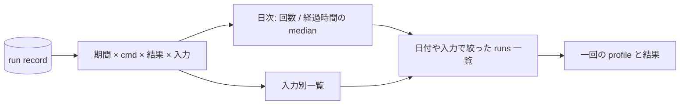

# Zeal 設計 M5: 履歴の傾向

_OhataKenji_
_Last update: 2026/10/18_
_Status: Draft_

## Goal

local の履歴から回数と呼び出しの経過時間の推移を確認し、調べたい run の profile へたどれるようにする([PRD](../prd.md) シナリオ5と M5)。
集計の対象件数と欠損を示し、時間の変化だけから原因を断定しない。

### Non Goals

- action 一覧、exec log の取得、action や mnemonic ごとの集計、cache hit の判別と分布
- profile の phase 集計
- 二回の run の diff と比較用の追加の条件収集。次版で扱う
- 異常検知、アラート、チーム横断の比較、外部への export

## Background

共通用語は [overview](./overview.md#background) に従う。
**series** は日単位に並べた回数や経過時間の値、**対象件数**はその指標に使えた run の数を表す。
データ源は M4 の run record だけで、新しい観測は増やさない。

M3 の入力は単一の label または pattern であり、pattern は複数 target を表し得る。
本設計では一覧名を「呼び出しの経過時間が長い入力」とし、入力別に集計する。

## Overview

期間、cmd、結果、入力で run の集合を絞り、日単位の series と期間集計を Rust で作る。
SQL の結果から表示用の値を計算し、事前集計テーブルは持たない。

日付や入力別一覧から runs 一覧を絞り、一回の詳細を開けるようにする。
集計は調べる run を選ぶ手がかりとし、二回の差分表示は作らない。

回数と経過時間では使える記録が異なるため、対象件数と除外件数を別々に示す。
画面には「Zeal から起動した run n 件」と明記する。

## Detailed Design

### filter と日次 series

基本フィルタは期間(30日等)、cmd(build/test/run)、outcome(ok/failed/interrupted/lost)とする。
入力別一覧の選択で `(cmd, target_raw)` の条件も加え、適用中の条件を表示して解除できるようにする。
すべての query に対象 workspace の条件を入れる。

outcome は M4 の保存値を使い、NULL の record を除外する。
runner の live run id 集合や終了結果の再導出には依存しない。
lost は process が終了未確認でも回数に含め、経過時間がなければ時間の集計には含めない。

日付の基準列は `started_at_ms` とし、表示時の OS のローカルタイムゾーンの日単位でまとめる。
day の算出は一箇所に揃え、SQL では `date(started_at_ms / 1000, 'unixepoch', 'localtime')` を使う。
期間の境界と日付表示も同じタイムゾーンに揃え、変更時は再集計する。
当日の値は未完として区別する。

### 指標と対象件数

経過時間は M4 の process_elapsed_ms を使い、NULL は集計から外す。
M2 から移行した record の壁時計の差で補完しない。
`bazel run` の対象プログラムの時間も含むため、指標名は「呼び出しの経過時間」とする。

profile の有無や解析結果は集計条件に使わない。
M4 の purge 後も、run record があれば回数と経過時間の集計に利用できる。

| 指標               | データと対象                                                             |
| ------------------ | ------------------------------------------------------------------------ |
| 呼び出し回数       | filter 後、outcome が非 NULL の run record。lost や詳細がない run も含む |
| 呼び出しの経過時間 | process_elapsed_ms がある run の日次 median。件数を併記する              |

対象件数の例は「run 20件 / 経過時間 18件」とし、経過時間が欠損している件数も示す。

### query と集計

run query は filter と NULL outcome 除外後の run_id、day、cmd、process_elapsed_ms、target_raw を返す。
回数、median、入力別一覧、対象件数を Rust で計算する。

想定スケールは個人の履歴数千件とする。
`run(started_at_ms)` に index を置き、計測で不足が分かるまでは事前集計表を追加しない。

### 入力別一覧と詳細への導線

入力は保存した raw の文字列をそのまま使い、`(cmd, target_raw)` の完全一致で分類して表示する。
M2 から移行した空白や不正な入力も書き換えず、別の raw 入力として扱う。
pattern の展開や実効設定の再現は行わず、同じキーでも同じ処理量とは保証しない。

一覧は経過時間の median 順に並べ、件数を併記する。
日次の値や入力行を選ぶと、その日付や入力の runs 一覧を表示して一回の profile を開く。

### chart

チャートは uPlot または手書き SVG で実装する。
回数と経過時間は単位を分けて表示し、軸、対象件数、期間を明記する。
計測値がない日を0秒と描かない。

## Alternatives Considered

- **事前集計テーブル**：再表示を速くできるが、record の更新や purge との整合が必要になる。個人の履歴規模では逐次 SQL を基準にする
- **action や cache hit の集計**：取得していないデータのために parser と保存形式を増やす必要がある。M2 の profile 中心の範囲に従い採用しない
- **外部への export**：他の分析に使えるが、履歴の共有を設けない今版の範囲から外す

## Caveats

- 個人の履歴は母数が小さい。件数を併記し、一回だけの値を安定した傾向と扱わない
- 同じ入力でも source、設定、Bazel server の状態が変わり得る。条件差を調べる二回の run の diff は次版で扱う
- 集計は Zeal から起動した run だけを表し、リポジトリのすべての build を表すものではない
- 経過時間がない run は回数だけに含め、他の run の値で補完しない

## Security Concerns

filter の値は SQL の bound parameter として渡し、SQL 文字列へ連結しない。
入力は実行コードや HTML として解釈しない。
共通方針は [overview](./overview.md#security-concerns) に従う。

## Privacy Concerns

集計と元の run への移動は local の対象 workspace 内で完結する。
入力や結果を外部の分析サービスへ送らず、公開 fixture には機微情報を含めない。
保存記録の扱いは [m4](./m4-run-history.md#privacy-concerns) に従う。

## Test Plan

- 成功、失敗、lost、NULL outcome、詳細なしを混ぜた fixture で、runner の状態を参照せず各指標の対象件数を確認する
- process_elapsed_ms がない M2 の移行 record と長時間の bazel run を含め、壁時計で補完せず、build 時間と誤表示しないことを確認する
- profile の欠損、解析失敗、purge によって回数と経過時間の集計が変わらないことを確認する
- 日付と入力から runs 一覧を絞り、一回の profile へ進めることを確認する
- Unix ms、日付境界、OS のタイムゾーン変更で、filter の期間と日次 series が同じ日付になることを確認する
- 単一 label、pattern、M2 の空白を含む入力を raw の完全一致で分類し、入力を正規化しないことを確認する
