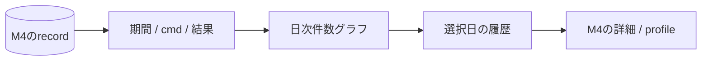

# M5: 日次の記録件数

_Last update: 2026/10/18_ · _Status: Approved_

M4の保存済みrecordを日付ごとに数え、日付からrun詳細を開けるようにする。
ランキング、実行時間の集計、新しい観測と保存状態は追加しない。

## 表示と操作

- filterは期間(既定30日、1〜366日)、cmd(build/test)、outcome(ok/failed/interrupted)。
- SVGで日付と件数の軸、対象件数、期間を表示する。当日は「集計途中」と示す。
- 日付を選ぶと、同じfilterに選択日を加えたruns一覧へ進む。詳細から戻ってもfilterを保つ。
- 日付はhover以外でも選べるようにする。zoom、crosshair、範囲選択、chartライブラリは追加しない。

## 集計ルール

workspaceはM4のcanonical pathとworkspace表で照合する。
全queryにworkspace_idとfilterのbound parameterを使い、別workspaceを混ぜない。

基準は `started_at_ms`、dayはSQLの `date(started_at_ms / 1000, 'unixepoch', 'localtime')` とする。
期間はlocalの開始日00:00以上、終了日の翌日00:00未満をUnix msへ変換して絞る。
固定86,400秒で日付境界を計算しない。
タイムゾーンと期間と表示を一致させ、OS設定変更はworkspaceを開き直したときに反映する。

SQLでdayごとの `COUNT(*)` を昇順に返し、recordなしの日は0件とする。
`run(workspace_id, started_at_ms)` にindexを置き、途中切詰め、事前集計表、cache、OLAPは使わない。
終了時刻と経過時間の欠損、詳細fileの有無や読込/parse状態は件数に影響させない。
M4の開始時刻を使い、終了コードがNULLの未完了recordは除外する。
結果は保存済みexit codeから `0=ok`、`8=interrupted`、その他は `failed` とする。
現行M4がsignal終了に保存する `-1` もfailedに含める。

画面には「Zealで記録した実行 n件」と示す。
現行M4のGUI実行単位のrecordを集計する。BES対応とinvocation単位の収集は今回追加しない。
BEPがない失敗も終了コードがあれば含め、全Bazel起動回数とは扱わない。
未完了recordの終了保存や過去のrecordの追加で件数は変わり得る。
runnerの状態と成果物のparseは参照しない。
安全性と保存記録の扱いは[M4](./m4-run-history.md)と[全体構成](./overview.md#security-concerns)に従う。

## 確認すること

1. 複数workspace、期間、cmd、outcomeごとの件数と詳細の所属。
2. 0件の日、複数record、未完了除外、時間欠損と詳細削除でも件数が変わらないこと。
3. Unix ms、local日付、DST、タイムゾーン変更、当日の途中表示と過去の遅着。
4. 日付→同じ条件の履歴→詳細→戻る操作とfilter保持、SQL値のbound処理。

5,000件の合成recordでworkspace/cmd/outcome/日付の分布、端末/OS、cold/warm、反復回数を残し、初期表示と再filterを測る。
切り詰めず正しい件数と導線を確認し、支障があれば取得/集計/描画を分けて調べる。
固定SLOと新しい計測基盤は作らない。
