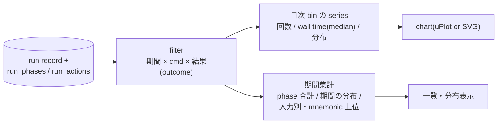

# Zeal 設計 M5: 履歴の傾向

_OhataKenji_
_Last update: 2026/10/15_
_Status: Draft_

## Goal

local に溜まった実行履歴を期間・コマンド・結果で絞り、実行回数・所要時間・実行と再利用の分布の推移を表示する。
「再利用」は exec log の spawn 記録に cache hit が残る場合(remote/disk cache 使用時)に限って観測でき、local のみの環境では再利用は観測できず実行した action のみになる([m2](./m2-run-detail.md)参照)。
「最近遅くなった」を自分の履歴で確認し、どの phase や action に効いているか当たりをつけられるようにする(PRD シナリオ5・M5)。

### Non Goals

- 異常検知・アラート
- チーム横断の比較
- 外部可視化ツールへの export

## Background

mock の analytics 状態は、期間・cmd・結果のフィルタ3種、「build の数」の棒チャート、「時間のかかった target」の一覧で構成される。
入力は [m4](./m4-run-history.md) の run record と、ingest 済みの phase 行(`run_phases(run_id, phase, duration)`)・action 行(`run_actions(run_id, mnemonic, owner_target, wall_time, cache_hit)`。exec log の spawn 記録)である。
新しい観測は増やさず、蓄積済みデータの集計だけで成立させる。

## Overview

画面の構成要素は、DB の query 結果を Rust で畳んだ集計である。
filter(期間の基準列は `started_at`)で run の集合を絞り、日単位の bin で series を作り、chart と一覧に流す。
action 行が残っていない run(purged・exec log 欠損・部分 ingest 含む)は分布系の集計から除外し、分母に含まれないことを画面で明示する。
集計の対象は Zeal が起動した run に限られるため、画面には常に「Zeal から起動した run n 件」を示す。

## Detailed Design

### 絞り込みと series

フィルタは期間(30日等)・cmd(build/test/run)・結果(outcome の ok/failed/interrupted/lost)の3軸で、run record に対する WHERE 句に落とす。
結果フィルタは outcome に適用する。○(detail なし)の run でも outcome は record に残っているため、回数と wall time の集計には入る。
outcome の導出は [m4](./m4-run-history.md) の規則を SQL/コード側で二重定義せず、共有の導出式を使う。
実行中の run は runner が持つ live の run id 集合を集計側へ渡して除外する(`finished_at IS NULL` では running と lost を区別できないため)。

series は日粒度の bin(ローカルタイムゾーン。bin の基準列は `started_at`。当日の bin は未完として区別して表示)で作る。
day の算出は一箇所に揃え、query では `date(started_at, 'localtime')` を使う。
集計の範囲は対象 workspace に限る(全 query に workspace の条件を入れる)。
指標ごとに分母が異なるため、分母とソースを名指しで定める。

分母判定には run ごとの coverage flag を使う(成果物ごとの ingest 状態から導出。[m4](./m4-run-history.md)参照)。

- `phase_ok`: profile の ingest が ok
- `action_ok`: exec log の ingest が ok で、かつ `purged_at` が NULL(action 行が残っている run。exec log 欠損・部分観測は分母に入れない)

指標と分母の対応は次のとおり。

- 回数: run record。filter 後・live 除外後の run(lost を含む)を数える。detail の有無は問わない
- wall time: run record の `finished_at − started_at`。finished_at を持つ run のみ(lost は自動的に外れる)。interrupted や spawn 即失敗も実績として分母に含める(結果フィルタで外せる)。Zeal 外の bazel が server lock を持つ間の待ちも wall time に含まれ得る。日次の値一覧を SQL で取り、median は Rust 側で計算する(SQLite に median はない)。件数を併記する
- phase 内訳: `phase_ok` の run の `run_phases` 行。期間全体の phase 別合計として出す(日次積み上げはしない)
- 実行 / cache hit の分布: `action_ok` の run の `run_actions` 行の、cache hit の有無の比を日次で出し、除外した run の件数を併記する。cache hit は remote/disk cache 使用時にのみ発生し、local のみの環境では全件が実行になる。所要時間を持たない行は所要時間集計の分母に含めない

分母は指標ごとに異なるため一つの件数では表せない。画面には「runs=n / wall=w / phase=p / action runs=a(filter 後・live 除外の run 数と、wall time・phase・分布それぞれの分母となる run 数)」の caption を常に出す。
分布のクラスは環境で表示構造を変えず、cache hit が0の環境でも同じ系列として描く。

集計は三種の query で構成し、畳み込みは Rust 側で行う。

- run query: filter 後の run ごとに `day・cmd・wall_ms・入力文字列(raw)・正規化した入力文字列・detail・phase_ok・action_ok` を返す(detail は「詳細がない理由」の表示に使う)。日次回数・wall time median・入力別上位・caption の件数はこれから計算する
- phase query: filter 後・live 除外のうち `phase_ok` の run に限り `run_phases` を phase で GROUP BY した合計
- action query: filter 後・live 除外のうち `action_ok` の run に限り `run_actions` を `day × mnemonic × cache_hit` で `COUNT(*)・SUM(wall_time)`。日次の分布・期間の分布・mnemonic 上位(mnemonic 集計にも `action_ok` を要求するのは保守的な単純化)はこれから計算する。所要時間の件数は `COUNT(wall_time)` で取り、NULL を分母から除く

想定スケールは run 数千・action 行で百万に届く程度までを想定し、`run(started_at)`・`run_phases(run_id)`・`run_actions(run_id)` の index を敷く。

### 遅さの帰属

「時間のかかった target」欄は、composer の入力をキーにした run wall time の上位を出す(欄名は mock に合わせるが、表示するのは実行時の入力文字列であり単一 label ではない)。
キーは `(cmd, 正規化した入力文字列)` とし、token の前後空白や並び差で分裂しないようにする。正規化形は record 保存時に run record の列として持つ([m4](./m4-run-history.md))。表示には同じキーの代表 run の入力文字列(raw)を使う。
上位は回数ではなく wall time(median)で並べ、件数を併記する。
帰属の細部として、run 内の phase 別所要時間(profile 由来)と mnemonic 単位の所要時間上位(exec log 由来)を出し、「どの phase・どの action に効いているか」の当たりをつけられるようにする。

### chart

チャートは uPlot または手書き SVG で実装する。
値の読み取りに必要な範囲(軸・件数・期間)に留め、装飾は置かない。

## Alternatives Considered

- **事前集計テーブルを持つ**: データ量は個人の履歴規模で小さく、逐次 SQL で十分。集計専用のテーブルは整合コストに見合わない。
- **外部ツールへの export**: M5 の範囲外。履歴を共有しない方針とも整合する。

## Caveats

- 個人の履歴は母数が小さい。「傾向」を誤読させないため、各集計には必ず件数を併記する。
- retention で `run_actions` を失った期間の run は分布系の集計から抜ける(除外件数は caption で示す)。`run_phases` は retention の対象外のため、phase の期間集計と回数・wall time の系列は全期間で有効なままである。
- 集計対象は Zeal 起動の run のみで、terminal など Zeal 外の実行は分母に入らない。その偏りは観測できないため、画面の件数表示で前提を示すに留める。
- 日次 series は異なる入力の run を合成する。「遅くなった」の見立てには入力を揃えた系列を見る必要がある。

## Test Plan

- ダミーの run データ(成功・失敗・detail なし・phase/action 行付き)を流し込み、各 series と上位一覧が意図どおり集計されるか確かめる。
- fixture には cache hit 有無が混ざる action 行、`wall_time IS NULL` の行、purged な run、`phase_ok` と `action_ok` が一致しない run、raw と正規化形が異なる入力文字列を持つ run を含め、除外件数の caption と空状態の表示を確かめる。
