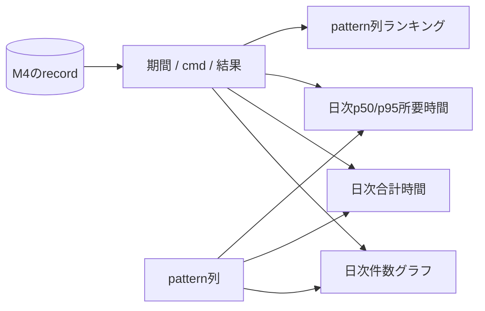

# M5: 日次集計グラフ

_Last update: 2026/10/31_ · _Status: Approved_

M4の保存済みrecordを日付ごとに集計し、件数・結果内訳・合計時間・所要時間の推移と、
target pattern列別のランキングを表示する。新しい観測と保存状態は追加しない。

## 表示と操作

- filterは期間(既定30日、1〜366日)、cmd、outcome(ok/failed/interrupted/unknown)、target pattern列(完全一致)。
- 画面見出しは「Analytics」、グラフ見出しは「Invocations」「Total duration」「Duration」「Target patterns」とする。
- Invocationsは日別件数をok/failed/interrupted/unknownの積み上げ棒で表示する。
- Total durationは日別の合計実行時間、Durationは日別のp50/p95所要時間を表示する。
- Target patternsはtarget_pattern列別の合計時間ランキング(上位10)を一覧にする。複数patternは結合した列全体で集計し、行の選択でpattern列フィルタを切り替える。
- SVGで日付と値の軸、期間を表示する。当日は「集計途中」と示す。
- 日別ブラウズと選択日の履歴取得は行わない。実行詳細はsidebarのInvocationsから開く。
- zoom、crosshair、範囲選択、chartライブラリは追加しない。

## 集計ルール

workspaceはM4のcanonical pathで照合する。
共通invocation表のworkspace_idで絞る。
workspaceとfilterはbound parameterを使い、別workspaceを混ぜない。

基準は `started_at_ms`、dayはSQLの `date(started_at_ms / 1000, 'unixepoch', 'localtime')` とする。
期間はlocal日付の開始日以上、終了日の翌日未満で絞る。
index用のUnix ms範囲は前後のcalendar日まで広く取り、同じSQLの日付条件で正確に絞る。
存在しない深夜0時や、日付をまたいで時計が戻る地域でも、日付ごとの件数を正確に数える。
固定86,400秒で日付境界を計算しない。
タイムゾーンと期間と表示を一致させ、OS設定変更はworkspaceを開き直したときに反映する。

SQLで対象期間の行を `(local日付, exit_code, target_pattern, 経過ms)` で返し、
日別集計とランキングはRustで行う。recordなしの日は0件とする。
`invocation(workspace_id, started_at_ms DESC, id)` にindexを置き、途中切詰め、事前集計表、cache、OLAPは使わない。
percentileは昇順列に対するnearest-rankとし、対象がない日・pattern列は0とする。
経過時間は `finished_at_ms - started_at_ms` とし、終了時刻がないrecordは件数と結果には含め、
時間集計からは外す。負の経過時間は0に丸める。
pattern列フィルタは日別系列だけに適用し、ランキングは常に期間全体の順位を返す。
詳細fileの有無や読込/parse状態は集計に影響させない。
BEPの開始時刻が既知のrecordを集計する。開始時刻がNULLなら日付を決められないため除外する。
結果は保存済みexit codeから `0=ok`、`8=interrupted`、その他は `failed`、NULLは `unknown` とする。
pattern列がないrecordは日別集計に含め、pattern列ランキングには含めない。
子processの終了やsignalからビルド結果を補完しない。

共通invocation表のすべてのcommandを一度ずつ集計する。
受信回の確定状態は集計条件に使わない。
起動元による優先や重複排除も行わない。

BEPの結果送信後も動くプログラムの待ち時間は、ビルド時間へ加えない。
イベント本体とログは読み直さない。
未完了recordの終了保存や過去のrecordの追加で件数は変わり得る。
runnerの状態と成果物のparseは参照しない。
安全性と保存記録の扱いは[M4](./m4-invocation-history.md)と[全体構成](./overview.md#security-concerns)に従う。

## 確認すること

1. 複数workspace、期間、cmd、outcome、pattern列ごとの件数と時間。
2. 0件の日、複数record、結果不明、時間欠損と詳細削除でも件数が変わらないこと。
3. Unix ms、local日付、DST、タイムゾーン変更、当日の途中表示と過去の遅着。
4. 再集計時のfilter保持、SQL値のbound処理。
5. 日別とpattern列別の合計、p50/p95、ランキング順位とpatternフィルタの独立性。
6. 共通invocation表の一回の集計、BES再送、ビルド結果とprocess終了の独立性。

5,000件の合成recordでworkspace/cmd/outcome/日付の分布、端末/OS、cold/warm、反復回数を残し、初期表示と再filterを測る。
切り詰めず正しい件数を確認し、支障があれば取得/集計/描画を分けて調べる。
固定SLOと新しい計測基盤は作らない。
