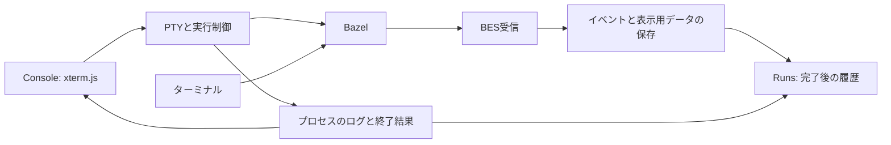

# M6: 実行中のログとBESによる記録

## 要件と採用する構成

Zealから起動したbuild/test/runは、一時的なConsoleでPTYを通して操作する。
Runsは終了後のログ・結果・Timingを確認する画面とする。
ターミナルから起動したBazelも、`.bazelrc` でZealをBES送信先に設定すれば記録する。
受信と実行制御はTauriアプリ内の別モジュールとし、保存した結果を同じ履歴画面で参照する。

| 案        | 構成                                 | 利点                                   | 費用と制約                                               |
| --------- | ------------------------------------ | -------------------------------------- | -------------------------------------------------------- |
| A（採用） | アプリ内に受信、保存、実行制御を置く | 配布と起動を一つに保てる               | アプリプロセスの終了で受信も止まる                       |
| B         | 記録だけを常駐サービスへ移す         | アプリの終了中も外部ビルドを記録できる | サービス管理と通信APIが増える                            |
| C         | 記録と実行制御を常駐サービスへ移す   | 画面の再起動後に実行へ再接続できる     | 出力保持、再接続、サービス更新時の実行管理まで必要になる |

アプリ終了中の受信と、終了後の実行再接続は今回の要件に含めない。
M2からM5の「完了後だけログを読む」「build/testだけを起動する」「GUIからの実行だけを記録する」という制限は、この文書の範囲で更新する。

## 所有する状態

`runner` はZealが起動した子プロセスとPTYを所有する。
`terminal` はPTYの作成、制御端末の設定、サイズ変更、キー入力、出力の保存を担当する。
全コマンドの標準入出力をPTYのslaveへ接続し、独立したsessionとforeground process groupを作る。
キー入力はrun IDが一致し、子プロセスを所有している間だけ受け付ける。
書込みはnonblockingとし、部分書込みや一時的な入力待ちでは残りのbytesを順番どおり再送する。
入力キューは1MiB、1回のIPC入力は最大64KiBに制限する。
画面サイズの変更はPTYへ伝える。
Stopはforeground groupとBazelのgroupへsignalを送り、猶予時間はM3を引き継ぐ。

別の画面に移るとConsoleを隠し、同じ端末インスタンスを保持する。
出力の取得とログ保存は続く。
次の実行かworkspaceの変更で一時的なConsoleを破棄する。
実行終了時に、表示中のConsoleからRunsの該当runのAllへ直ちに遷移する。
Allの先頭にLogsを置き、Consoleには同じ高さの見出し用の余白を置く。
両画面は状態アイコン、target、commandの見出しと出力位置を共有する。
実行中に別の画面へ移動した場合は、終了時もその画面を維持する。
サイドバーにConsole項目は置かない。完了後はRunsから記録を開く。
アプリ終了時は実行中の処理を停止する。
Consoleの読取り・入力・リサイズのエラーは、それぞれ同じ処理が成功した時に解消する。
履歴アクセスのエラーには元の原因を保持し、DBを開く段階の失敗には対象も付記する。

`bes` は `127.0.0.1:4718` でgRPCを受け付ける。
ポートを確保できなければ画面に理由を表示し、既存のプロセス操作は利用できる。
Zeal起動のBazelにはinvocation IDを明示し、受信口が動作していれば送信先も指定する。
外部起動のBazelは `.bazelrc` の設定に従う。

`store::events` はプロセス所有権を持たない。
BESのstream IDとsequenceで再送を識別し、同一内容の再送は表示用データへ再適用しない。
sequenceの欠落と同じsequenceの内容変更は拒否する。
元のBEP bytesと表示用データを同じSQLite transactionで保存し、commit後に受領応答を返す。
読取対象外のBEPフィールドも元のbytesに残す。
BEPはTOOL componentだけ受け付け、invocationとbuild IDを結び付ける。
完了後は同一イベントの再送だけ受け付ける。
受信は同時4件、1メッセージ16MiB、無通信または受領応答の停滞は5分までとする。
保存量はinvocationごとに512MiB、全体で4GiBまたは100万イベントまでとする。
上限を超えた新規イベントにはRESOURCE_EXHAUSTEDを返し、既存記録は残す。
表示用の結果が8MiBを超える場合は追加のtargets/testsを省き、不完全な結果として表示する。
受け付けた元のイベントは省略せず保存する。
loopbackは同じ端末の別ユーザーからも接続できるため、これらの上限を送信元にかかわらず適用する。

履歴は既存の実行レコードと外部の観測レコードをまとめて読む。
同じinvocation IDを持つZeal実行があれば、履歴の行を二重に作らない。
workspaceはBuildStartedから取得し、画面で開いているworkspaceと一致する記録を表示する。
既存DBのschema 1と2はschema 3へ移行し、既存の履歴とファイルを維持する。
アプリ内のStoreは接続を開いてから閉じるまで直列化し、SQLiteのsidecar削除と安全検査の競合を防ぐ。
別プロセスから同じDBを開く場合の排他までは提供しない。

## ビルドとプログラムの結果

BEPのBuildFinishedはビルドの終了を表す。
`bazel run` の対象プログラムは、その後も入力待ちや実行を続けられる。
Zeal起動のプログラムの終了結果には子プロセスのwait結果を使う。
実行中の処理はRunsへ表示せず、終了後に記録を表示する。
外部起動はBuildFinishedを受信した記録をRunsへ表示し、Consoleは作らない。
ターミナル起動のプログラムは操作対象に含めず、その標準入出力と終了結果をBESから推測しない。

## 表示と保存の範囲

Consoleは保存ファイルのbyte offsetから出力を読み、端末へ順番に渡す。
1回の読取りは最大64KiBとし、xterm.jsの描画完了後に次の読取りを行う。
新しい出力は50ms間隔で確認し、端末のscrollbackは5,000行に制限する。
出力の保存は画面と独立したreaderが行い、終了時に残りの出力を取り込んでから履歴を確定する。
子プロセス終了後のdrainは100msで打ち切り、子孫の出力が終了処理を止めないようにする。
履歴一覧は約1秒間隔で更新する。
外部実行の選択中の記録はBEP収集完了まで約1秒間隔で更新する。
Zeal起動の完了済み結果は実行後に解析した詳細を使い、部分的な受信データで上書きしない。
同時に複数のlive読取を発行せず、選択やworkspaceの変更前に開始した応答は破棄する。
profileの解析は実行終了後の詳細取得に分ける。
履歴からrunを選ぶとLogsタブを開き、実行直後の自動遷移ではAllを開く。
BazelのANSIカラーを表示する。
表示するログは末尾512KiBに制限し、切り詰めやBEP収集状態の案内は表示しない。
Zeal起動のログ全文はファイルに、BESで受けたログ断片は元のイベントに残る。

profileやtest.logの参照先をBES受信だけで取り込むことはしない。
外部実行のprofileは取得対象外と表示する。
既存のZeal起動のprofile表示は維持する。
Analyticsの集計対象はZeal起動のbuild/testのままとする。

## 検証

- 実行中のログ表示と、run選択変更後の古い応答の破棄。
- PTYでの端末判定、端末サイズ変更、Enterなしの矢印キー、Ctrl+C、Ctrl+D。
- 入力の部分書込みと再送、終了済みrunへの送信拒否。
- Consoleから別画面へ移っても実行が続き、完了した記録だけがRunsへ表示されること。
- 表示中のConsoleは終了時に直ちにRunsのAllへ移り、実行中に別画面へ移った場合は移動先を維持すること。
- gRPCの受領応答後に、保存したイベントを再読取できること。
- 再送の重複排除、sequence欠落と矛盾する再送の拒否。
- schema 1と2の履歴を維持した移行。
- 実際のBazelで、pipeとPTYの両方についてBEP収集完了後もプログラムが入力待ちを続け、`21` の入力で `42` を出力すること。

プロトコルの根拠は[BES定義](https://github.com/googleapis/googleapis/blob/master/google/devtools/build/v1/publish_build_event.proto)と[BazelのBEP定義](https://github.com/bazelbuild/bazel/blob/8.4.2/src/main/java/com/google/devtools/build/lib/buildeventstream/proto/build_event_stream.proto)を参照する。
