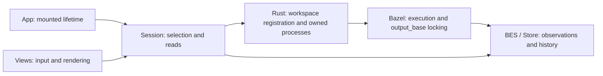

# Ownership and deletion audit

The acceptance boundary is the existing product: target exploration and queries,
concurrent Bazel invocations, interactive live Consoles, saved BEP results,
comparison, and analytics. Removing a feature would change that boundary.
The audit asks what observable behavior or resource guarantee each state holder
and control path serves. It does not claim a mathematically shortest program.

## Component boundary

Arrows are logical dependencies; WebView access to core and storage always uses
IPC. Console, query, analytics, and comparison requests belong to their mounted
views. They need not pass through a second session dispatcher.

## Removed representations

- `WorkspaceState` and its constructor/register wrapper: the native map now
  stores `canonical path -> Scope` directly.
- Session navigation counter: the already-owned content object's identity
  identifies a destination, including target/package selection. A pending start
  captures it and the workspace-open token.
- `subscribed` and `initializing`: the mounted root invokes `init` once and owns
  disposal. There is no supported reconnect or concurrent-init workflow.
- The `ready` projection flag already implied by `core`, and the one-call
  invocation-release forwarding function.
- The query editor's ten-entry result cache, cache keys, promotion, eviction,
  and redundant handwritten controller return type. Changing inputs clears the
  displayed result; execution remains explicit.
- Tests of cache policy and of bare `BTreeMap::insert` behavior.

These follow the earlier removal of Message/Effect dispatch, copied session
models, global session wiring, global artifact-read admission flags, completed
Console retention, and configurable BES capacity.

## Session state

| Remaining information                          | Owner and reason it cannot simply be dropped                                                                                                                                                                                                                                                                                   |
| ---------------------------------------------- | ------------------------------------------------------------------------------------------------------------------------------------------------------------------------------------------------------------------------------------------------------------------------------------------------------------------------------ |
| `core` and its `revision`                      | Session's latest received native snapshot. A revision rejects reordered IPC/event delivery.                                                                                                                                                                                                                                    |
| `workspace.path` and workspace object identity | Address requests and reject A→B→A replies from the first A.                                                                                                                                                                                                                                                                    |
| `snapshot`, `snapshotError`, `refresh`         | Display target data and partial/failing refreshes; request identity prevents an older refresh replacing a newer one.                                                                                                                                                                                                           |
| `target.selection`                             | User-selected target/package. Independent from the last data returned.                                                                                                                                                                                                                                                         |
| Target `detail`, `outputs`, `actions` readers  | Different Bazel outputs and failure policies. Outputs may fail while actions still succeed.                                                                                                                                                                                                                                    |
| `targetBusy`                                   | One automatic detail→outputs→actions chain per selected workspace. Without it, rapid selection launches competing `--noblock_for_lock` commands; the newest selection can fail behind the obsolete one. The old chain starts no further stale stages, then hands off to the latest selection. Another workspace does not wait. |
| `history`, `historyError`                      | Saved invocation rows and failure/retry feedback. Live entries cannot replace externally launched history.                                                                                                                                                                                                                     |
| `historyBusy`, `historyDirty`                  | Coalesce notifications during a read into one follow-up. Dropping dirty loses completion updates; dropping both admits an unbounded burst of redundant reads.                                                                                                                                                                  |
| `content.kind/id/page`                         | Current destination, selected invocation, and page to return to. Completion changes the projection, not the destination.                                                                                                                                                                                                       |
| `start`                                        | Pending foreground request, also disabling duplicate submission until acknowledgement. It captures content identity; workspace switches abandon it without stopping the native execution.                                                                                                                                      |
| `workspaceRequest`                             | Latest explicit-open identity and persistent intent. Failed opens must still prevent later preference snapshots from auto-selecting a workspace.                                                                                                                                                                               |
| `error`                                        | Start/Stop/connection failure feedback; failures cannot be fabricated as successful empty results.                                                                                                                                                                                                                             |
| `saved` and its detail/profile readers         | Independently arriving saved artifacts; replacing their owner invalidates old reads. Successful values remain visible alongside refresh errors.                                                                                                                                                                                |
| Reader `value/error/loading`                   | Separate facts: initial/empty, successful, failed refresh with retained value, and in-flight. A single nullable value cannot represent these behaviors.                                                                                                                                                                        |
| `disposed`, `unlistens`                        | Reject responses after unmount and release event subscriptions, including late listener registration.                                                                                                                                                                                                                          |

`SessionView` is a projection, not another mutable owner. `Transport` is the IPC
and event boundary. Named types for content, workspace, readers, and saved
artifacts describe these owners without adding a runtime protocol.
The public session tests exercise these through commands, arguments and visible
results, including target/page ABA navigation and an explicit open that fails.

## Native state and error paths

| Remaining information or path                          | Reason                                                                                                                                                                                                                                           |
| ------------------------------------------------------ | ------------------------------------------------------------------------------------------------------------------------------------------------------------------------------------------------------------------------------------------------ |
| Registered workspace map and `Scope`                   | Canonical address validation and user-selected discovery scope. `last_workspace` is only a saved preference.                                                                                                                                     |
| Bazel resolution and BES endpoint/error                | Commands require the resolved executable and this app's bound receiver; bind failure must not silently use another process's receiver.                                                                                                           |
| Invocation ID, workspace, command, pattern, start time | Address the owned operation and render it before BEP/history arrives. UI selection cannot supply ownership.                                                                                                                                      |
| `ActiveInvocation.terminal/pgid/stop_started`          | PTY input and foreground group access, revocable signal authority, idempotent Stop and escalation deadline. Grouping these capabilities avoids passing display/history metadata into signal handling.                                            |
| `OwnedInvocation.console`                              | Live output survives a view switch until its worker finishes draining. There is no completed-output cache.                                                                                                                                       |
| Mutex, shutdown flag, completion condvar               | Spawn/registration is atomic with shutdown; reap is serialized with signalling; exit can wait for all workers under one deadline.                                                                                                                |
| Capture `done/failed/worker`                           | Request final drain, stop a child whose output capture failed, join exactly once even on drop. These describe different facts.                                                                                                                   |
| Invocation guard and IPC join-error notification       | Guard releases ownership on unwind but deliberately skips event emission while panicking. With a usable state mutex, the IPC error arm publishes the resulting state; deleting it leaves a released invocation visible until an unrelated event. |
| PTY versus pipe capture                                | Interactive commands require terminal behavior; query parsers require separate stdout and stderr. Their output/error semantics differ.                                                                                                           |
| Stderr tail readers                                    | Ingest retains a partial diagnostic on read failure; ad-hoc query returns an I/O error. A shared result/error protocol would add coupling to save a short loop.                                                                                  |

Console read/input/resize and Stop all resolve an explicitly named workspace and
invocation. UUID/path validation, directory-relative no-symlink access, and
per-read parser limits remain security boundaries, not concurrency policy.
Native ownership, signal isolation, late Stop, console bounds, and panic cleanup
are covered by the existing `state`, `runner`, `terminal`, and `console` tests.
Panic cleanup is not a guarantee of continued application operation: most core
operations fail on a poisoned state mutex, and the detached interactive worker
has no IPC join-error publisher. A panic there can leave the UI stale until
another state publication. These pre-existing failure limits are outside the
normal completion/Stop model; this simplification does not claim to repair them.

## Other component families

| Types, state and paths                                                                  | Existing requirement                                                                                                                                                                        |
| --------------------------------------------------------------------------------------- | ------------------------------------------------------------------------------------------------------------------------------------------------------------------------------------------- |
| Query expression nodes, function catalog, validation and serialization                  | Build and edit Bazel expressions. One catalog supplies display and argument rules; no separate execution model is introduced.                                                               |
| Query `running/error/result`, `acceptResult`, `disposed`                                | Distinguish a still-running obsolete request from a usable reply, expose failures, and prevent publication after unmount.                                                                   |
| Console offset, input bytes, reading/writing/writable state and per-operation errors    | Incremental reads, lossless partial writes, backpressure and independent errors. Removing serialization duplicates bytes or loses input.                                                    |
| Target/index/action DTOs and proto parsing intermediates                                | Decode distinct Bazel formats and display labels, relationships, files and actions. Rust/TypeScript shapes cross a serialization boundary; replacing them with untyped maps loses checks.   |
| BES stream permit, receipt, sequence/attempt and observed facts                         | Bound concurrent reception to 32, keep stream ownership, reject conflicting/out-of-order writes, and acknowledge only committed artifacts. External CLI observations have no owned process. |
| BEP/detail/profile records, section errors, byte/event budgets and parser intermediates | Represent missing/partial artifacts honestly and bound parsing of untrusted files. Build success does not imply a live `run` process exited.                                                |
| SQLite records, workspace preferences, analytics filters and aggregates                 | Durable history, explicit startup preference, comparison and reporting. They are observations and user configuration, not a second execution ledger.                                        |
| View-local input, expansion, search, graph worker, timeline and comparison state        | Existing interactive presentation. DOM/worker resources and pending reads have mounted-view lifetimes; they do not own native executions.                                                   |

The remaining distinctions have an identified consumer or failure/resource
guarantee. Inlining a type, folding files together, or deleting a guard solely
to reduce line count would not remove the underlying information requirement.
This is a review conclusion under the stated feature boundary, not proof that
no alternative architecture can be smaller.

## Formal boundary

`InvocationLifecycle` checks invocation ownership, signal authority, release,
revision handling and display transitions. `StartNavigation` checks the
content/open identity rule replacing the navigation counter, including
target/page/workspace ABA and failed-open intent. Reproduction, bounds and
results belong in [the model-check report](./invocation-lifecycle-check.md).
Neither model checks query parsing, operating-system signal delivery, actual
Svelte scheduling, or the necessity of every source-level type.
