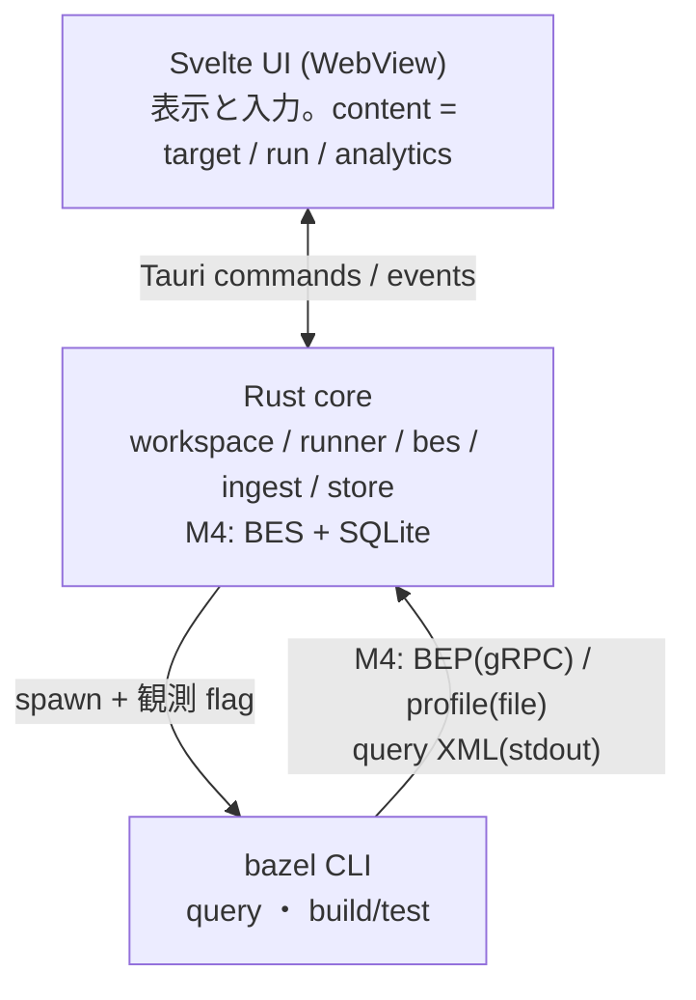

# Zeal 設計: 全体構成

_OhataKenji_
_Last update: 2026/10/18_
_Status: Approved_

## Goal

PRD の狙いは「Bazel に詳しい人が捉えている対象と関係を、GUI の構成と操作に反映する」ことである。
この文書は、[PRD](../prd.md)のマイルストーンに沿って Zeal を実装するための、システム構成と設計原則を定める。
個々の機能の詳細設計は M1〜M5 の各文書([m1](./m1-targets.md)・[m2](./m2-run-detail.md)・[m3](./m3-find-and-run.md)・[m4](./m4-run-history.md)・[m5](./m5-analytics.md))に分け、この文書はそれらが共通して従う土台を固定する。

### Non Goals

- RBE・cloud runner との連携
- bazel の解析・実行ロジックの再実装
- 複数 workspace の同時管理
- 画面ごとの細部設計(各 M 文書で扱う)

## Background

Zeal は Bazel を使う SWE 向けの local first GUI で、要件と体験目標は [PRD](../prd.md)、画面の形は [wireframe mock](../mock/)に定まっている。
画面と操作の設計基準は mock 冒頭の「残ったもの」表である: tree、関係4行(deps / data / used by / files)、composer、run、runs、target 欄。
この文書群は、これらの要素を実データで成立させるための設計を書く。
M3 までの試作、M4 の実装、未実装の M5 の設計を分けて記述する。

用語を以下に定める。

- **workspace**: Zeal が対象とする、Bazel workspace を持つローカルのリポジトリルート
- **target / label / package / rule class**: Bazel の通常の意味。`//app/lib:parser` の `java_library` が rule class
- **composer**: toolbar にある実行の唯一の入口。cmd 選択・target 欄・Send の三点
- **content**: ウィンドウ本体の3状態(target / run / analytics)
- **run**: M4 以降は一回の Bazel invocation とその観測記録。M2/M3 段階の起動と file 保存は、M4 の BES 記録で置き換える
- **snapshot**: `bazel query` の結果を workspace 単位でメモリに取り込んだ構造データの世代(永続化しない)
- **BEP**: Build Event Protocol。Bazel が出力する invocation 単位のイベント列。M4 からアプリ内 BES で受信する
- **BES**: Build Event Service。BEP を受け取り、保存済みのイベントへ ACK を返す gRPC の受信口
- **profile**: `--profile` で出力される、phase 内訳と時系列を持つ chrome trace 形式の計測結果
- **観測 flag**: run 時に bazel へ付けて成果物を得る flag 群(BEP・profile の出力指定と profile 用補助 flag。[m2](./m2-run-detail.md)参照)
- **run record**: run ごとの入力、時刻、終了結果などの保存値。M2 は run.json、M4 から DB を正本とする([m4](./m4-run-history.md))

## Overview

Zeal は Tauri v2 の単一ウィンドウアプリで、Rust core とシステム webview 上の Svelte 5 UI に分かれる。
対象 OS は POSIX 系(macOS を第一対象)とし、中断処理が SIGINT とプロセスグループを前提とする([m3](./m3-find-and-run.md))。

Rust core が workspace の管理、bazel の子プロセス起動、M4 の BES 受信と観測データの読み取りを担い、UI は表示と入力だけを担う。
bazel はライブラリとして組み込まず、常に子プロセスとして spawn する。

データは二系統に分かれる。
構造データのうち静的な部分(target・依存・file)は `bazel query` の結果を起動のたびに取り込み、workspace 単位の snapshot としてメモリ上に置く(永続化しない)。
M4 から観測データは BES で受信し、invocation id をキーに BEP から作った要約を SQLite に保存する。
Progress から log を text file に書き、profile は id を照合して後から添付する。
BEP event は保存せず、target / test ごとの結果一覧は作らない。
詳細表示では log を text として読み、profile だけを parse する。
phase の集計値や profile の parse 結果は DB に保存しない。
将来の CLI 記録も同じ BES を入口とし、送信設定の導線は今版に含めない。

設計全体を通じた判断基準は「構造と観測を区別し、観測できないものは不明と示す」である。
構造上存在する action が今回実行されたとは限らず、実行の事実は観測データがなければ分からない。
観測に欠損があるとき、UI は推測で埋めず「不明」または `not available` と表示する。
profile の marker 名を保ち、analysis と execution が重なる場合に別々の時間へ分割しない。
action 一覧、target と action の往復、cache hit の判別は今版に含めない。
二回の run の diff と、そのための追加の条件収集は次版で扱う([PRD](../prd.md))。
mock と記述が異なる箇所では、本設計の規則を優先する。

## Detailed Design

### コンポーネントと責務

| コンポーネント  | 責務                                                                                    |
| --------------- | --------------------------------------------------------------------------------------- |
| UI(Svelte)      | content 3状態(target / run / analytics)の表示、composer、tree、runs 一覧                |
| core::workspace | workspace の選択と検出、bazel 実行ファイルの解決                                        |
| core::runner    | bazel 呼び出しの直列化、spawn、中断、M4 の実行sessionと context の生成・終了・slot 解放 |
| core::bes       | runner の実行sessionに対する stream 受信、純粋 reducer、log 書込、commit と ACK         |
| core::ingest    | query XML と profile の有界 parse、log の有界 text 読込                                 |
| core::store     | run record と成果物の永続化。M2 は file、M4 から SQLite(rusqlite)                       |

M3 の実装では stdout と stderr を同じ追記用ファイルへ直接接続する([m3](./m3-find-and-run.md))。
M4 以降は stdout と stderr を null へ接続し、作業用 log file を持たない。
実行画面と履歴は BES が Progress から保存した同じ log を使い、終了処理後に表示する。
BEP が出ない失敗と受信未完了の実行は log を表示できず、raw stderr を別に収集しない。
出力の pipe、読取スレッド、実行中のログ配信を追加しない。
M4 の詳細は [m4](./m4-run-history.md) に従う。
UI が直接プロセスやファイルを触る経路は作らない。

### bazel 呼び出しの直列化とプロセス管理

bazel server は同一 output base 上で同時に一つのコマンドしか処理せず、後続の呼び出しは lock を待ってブロックする。
このため runner は同一 workspace の bazel 呼び出しを同時に一つに限る(mutex)。
M3 の試作では run または query の実行中の refresh は予約せず拒否する。
取り込みは workspace を開いたときと手動 refresh のみとし、実行後の自動取り込みと待ち行列を持たない([m1](./m1-targets.md))。
取り込み中は Send を disabled にし、実行中は「ログは完了後に表示」と示す。
出力の有無と待機原因は判定しない。

M3〜M5 は `build` / `test` に絞り、`bazel run` は今後の拡張とする。
spawn は独立したプロセスグループで行い、stop と hard kill をグループへ送る。
子孫の完全回収は保証しない。
M3 は wait エラーや停止未確認時に実行枠を解放し、自動再実行や自動 query は行わない。
中断の猶予時間とアプリ終了時の停止は [m3](./m3-find-and-run.md) に従う。

M4 でも期限付きの停止と終了不明時の実行枠解放を維持する。
BES 受信完了を process の終了確認には使わない。
M4 では runner が実行sessionと context の寿命を管理し、BES 側に別の実行終了状態を持たせない。
終了確認、停止打切り、wait エラー時の受付終了と成果物の後始末、slot 解放は [m4](./m4-run-history.md) に従う。
M4 は受信完了した invocation だけを履歴に残し、再起動時の未完了更新と以前の process の照合は行わない。

### run の定義

M4 の履歴 ID は Bazel が発行した invocation id とする。
起動前の一時 profile dir と実行 context は履歴 ID と分け、runner のメモリ上の実行sessionに置く。
BEP の Started/Finished による時間と結果を保存し、process の wait 結果と混ぜない。

M4 から GUI の `build` / `test` はアプリ内 BES へ送り、BEP の file 収集を併設しない。
query の観測収集は行わない。
詳細の欠損や手動削除でも、保存した結果と M5 の集計は変えない。
M4 は空の DB から始め、旧 run.json と旧 DB の取り込みや互換処理は設けない。
local process の信頼、保存と ACK の順序、再送、profile の添付は [m4](./m4-run-history.md)で定める。

### データの置き場所

M4 の DB はアプリ全体で一つとし、`<app data dir>/zeal.db` に置く。
workspace は正規化したルートパスで識別し、workspace 表の UUID を run.workspace_id から参照する。
一覧、詳細、更新、M5 の集計は要求に対応する workspace_id に限定する。
成果物は `<app data dir>/workspaces/<workspace_id>/runs/<run_id>/` に分け、DB で所属を確認してから参照する。
M2 の保存形式は取り込まず、M4 は新規 DB から始める。
core 自身の動作ログは app data dir 配下に置き、UUID、処理種別、エラー分類だけを記録する。
raw 入力、spawn argv、観測成果物の生の値は出さない。
リポジトリ内には何も書き込まない(bazel 自身が作成する convenience symlink は除く)。

### bazel の解決

実行ファイルは PATH の bazelisk を優先し(`.bazelversion` を尊重するため)、なければ PATH の `bazel` を使う。
v1 の対象 version は Bazel 8.7 以上を目安とし、検証は grpc/grpc の `.bazelversion` の環境を基準にする。それより古い version や他系列での動作は保証しない。
workspace の判定は `MODULE.bazel` / `WORKSPACE`(`WORKSPACE.bazel`)の存在で行う。
初回起動では workspace の選択を求め、bazel が見つからない場合と選択先が workspace でない場合は、その旨を表示して対象機能を停止する。
観測 flag が受理されない場合は実行画面に失敗を示し、自動再実行と version 別の対応表を持たない。
M4 では BEP が出なかった起動失敗を履歴に残さない。

### store の運用

M2 では DB を持たず、run の dir の file を表示のたびに parse する([m2](./m2-run-detail.md))。以下は DB を入れる M4 からの運用である。
DB は `journal_mode=WAL` で開き、schema は `PRAGMA user_version` で管理する。
起動時の全件 check は行わず、破損系エラーは履歴利用不能として表示し、新規 run を抑止する。
DB と sidecar の自動削除や再作成、復元用 manifest、backup は設けない。
共有 DB の障害は全 workspace に影響する。
利用者が全 Zeal instance と残存 process の停止、app data の保存先を確認して DB を手動初期化した場合、空の DB から再開し、全 workspace の履歴は失われる。
permission、disk full、新しすぎる schema は別のエラーとして扱い、DB 初期化を勧めない。
生存する子の stop は DB 障害時も維持する([m4](./m4-run-history.md))。
成果物は自動削除せず、停止確認後に利用者が手動整理する。
Bazel の umask は変更せず、保存領域の 0700 を他の OS ユーザーからの読み取りを防ぐ境界とする。

### UI の一貫性

実行の入口は toolbar の composer のみで、他の画面からは実行しない。
tree・dropdown・target 画面での選択は、すべて composer の target 欄への文字列挿入である(詳細は [m3](./m3-find-and-run.md))。
content は target / run / analytics の3状態で、sidebar の tree と runs、composer の Send が状態遷移の起点になる。
この構成は mock の「window 1種・content 3状態・実行入口は composer だけ」と対応する。

## Alternatives Considered

- **Electron**: 機能は同等に実現できるが、配布物とメモリ使用量が大きい。手元に常駐する local ツールとしては Tauri のほうが適する。
- **ネイティブ UI(Swift 等)**: mock の表現(一覧・簡易チャート・ログ)は web 技術で十分に実現でき、開発速度と移植性を優先した。
- **bazel のライブラリ利用**: bazel には安定した組み込み用 API がなく、subprocess が事実上の公式手段である。
- **GUI と CLI の BEP 取得を分ける**: file 収集を併設せず、M4 から BES を一つの入口にする。CLI 向けの送信設定の導線は将来の範囲とする。

## Caveats

- Bazel の version 差は flag と出力形式の単位で現れる。v1 は 8.7 以上を目安にし、観測 flag が受理されない環境は対象外として、発生したら Zeal 側のバグとして対応する。成果物の欠損は detail なしとして扱う。
- `bazel query` は大きい repo で遅くなり得る。snapshot 取り込みは grpc で実測 warm 約 56ms / cold 約 19s で、起動ごとの取り直しは実用範囲。
- bazelisk 経由の初回呼び出しは bazel 本体の download で長時間ブロックし得る。M3 では実行中と表示し、ログは client 終了後に読む。
- workspace を移動・rename するとルートパスが変わり、履歴は新規 workspace として分断される。
- 初版は同一 workspace で Zeal を二重起動しない前提で試す。取り込み中は Send を受け付けず、実行を予約しない。

## Security Concerns

- composer の入力を含むすべての引数は、shell を介さず引数配列のまま bazel に渡す。
- workspace のルートパス外のファイルを意図せず書き換えない(成果物は app data dir のみ)。

## Privacy Concerns

- Zeal の観測記録は local に保存し、Zeal 自身による telemetry や外部送信は行わない。
- M4 の GUI 実行では BES 宛先をアプリ内の loopback 受信口へ固定し、外部 BES へ転送しない。
- 個人端末の local process を信頼し、token 認証は設けない。受信データの検証と保存領域の保護は行う。
- remote cache と RBE は利用者やリポジトリの既存設定に従い、Zeal はそれらの設定を変更しない。
- run の成果物には build log が含まれるため、共有・同期の仕組みは設けない。
- リポジトリは公開のため、文書・コードともに機微情報を含めない(AGENTS.md の方針に従う)。

## Test Plan

- workspace の検出、bazelisk/bazel の解決、spawn から streaming までを一つの実リポジトリで通す end-to-end の spike を行い、構成が成立することを確かめる。
