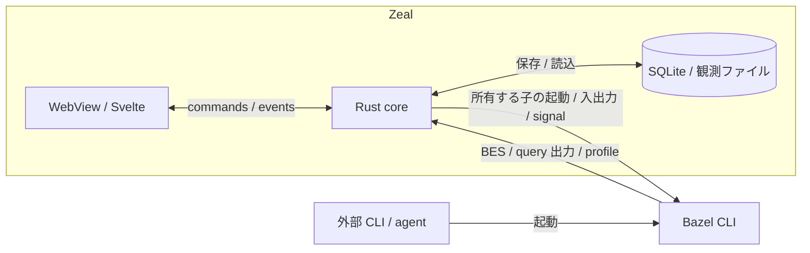

# Zeal 設計: 全体構成

_OhataKenji_
_Last update: 2026/11/15_
_Status: Approved_

## Goal

PRD の狙いは「Bazel に詳しい人が捉えている対象と関係を、GUI の構成と操作に反映する」ことである。
この文書は、[PRD](../prd.md)のマイルストーンに沿って Zeal を実装するための、システム構成と設計原則を定める。
個々の機能の詳細設計は M1〜M5 の各文書([m1](./m1-targets.md)・[m2](./m2-invocation-detail.md)・[m3](./m3-find-and-execute.md)・[m4](./m4-invocation-history.md)・[m5](./m5-analytics.md))に分け、この文書はそれらが共通して従う土台を固定する。

### Non Goals

- RBE・cloud runner との連携
- bazel の解析・実行ロジックの再実装
- 画面ごとの細部設計(各 M 文書で扱う)

## Background

Zeal は Bazel を使う SWE 向けの local first GUI で、要件と体験目標は [PRD](../prd.md)、画面の形は [wireframe mock](../mock/)に定まっている。
画面と操作の設計基準は mock 冒頭の「残ったもの」表である: tree、target の属性と入出力ファイル、composer、invocation、invocations、target 欄。
この文書群は、これらの要素を実データで成立させるための設計を書く。

用語を以下に定める。

- **workspace**: main repository と定義された外部 repository を含む Bazel の環境。Zeal では workspace root（main repository のルート）を開く
- **target / label / package / rule class**: Bazel の通常の意味。`//app/lib:parser` の `java_library` が rule class
- **composer**: toolbar にある build / test / run の実行入口。cmd 選択・target 欄・Send の三点
- **content**: ウィンドウ本体の表示先（targets / invocation / analytics / query）
- **invocation**: 一回のBazelコマンド呼び出しと、その観測記録全体
- **snapshot**: `bazel query` の結果を workspace 単位でメモリに取り込んだ構造データの世代(永続化しない)
- **BEP**: Build Event Protocol。Bazelが報告する呼び出し単位のイベント列。送信先のBuild Event Service(BES)をZeal内のreceiverが受け付ける
- **profile**: Bazel が出力する、phase 内訳と時系列を持つ chrome trace 形式の計測結果
- **観測 flag**: invocation 時に bazel へ付ける、BESへの送信とtool識別のflag群([m2](./m2-invocation-detail.md)参照)
- **invocation record**: BEPから観測した入力、時刻、build exitをapplicationが表示用に組み立てた値([m4](./m4-invocation-history.md))

## Overview

Zeal は Tauri v2 の単一ウィンドウアプリで、Rust core とシステム webview 上の Svelte 5 UI に分かれる。
対象 OS は POSIX 系(macOS を第一対象)とし、中断処理が SIGINT とプロセスグループを前提とする([m3](./m3-find-and-execute.md))。

Rust core が workspace の登録、子プロセスの所有、観測データの保存と読み取りを担う。
WebView が表示先と workspace の選択を持ち、Bazel が output_base の排他を担う。
bazel はライブラリとして組み込まず、常に子プロセスとして spawn する。

データは二系統に分かれる。
構造データのうち target の一覧は workspace の選択時と手動 refresh で `bazel query --output=label_kind` を実行して取得し、セッション側のメモリに置く(永続化しない)。
属性、依存、file は target を選んだときに proto query で取得する([Target の段階的な取得](./target-loading.md))。
観測データは invocation ごとの BEP と profile に残す。
invocationのevent fileは詳細表示のたびに一度parseし、入力、BEP時刻、build exitはSQLiteの共通invocation表に保存する。
phase の集計値や parse 結果は DB に保存しない。

設計全体を通じた判断基準は「構造と観測を区別し、観測できないものは不明と示す」である。
構造上存在する action が今回実行されたとは限らず、実行の事実は観測データがなければ分からない。
観測に欠損があるとき、UI は推測で埋めず「不明」または `not available` と表示する。
profile の marker 名を保ち、analysis と execution が重なる場合に別々の時間へ分割しない。
action 一覧、target と action の往復、cache hit の判別は今版に含めない。
二回の invocation の diff と、そのための追加の条件収集は次版で扱う([PRD](../prd.md))。
mock と記述が異なる箇所では、本設計の規則を優先する。

## Detailed Design

### コンポーネントと責務

| コンポーネント                                         | 責務                                                             |
| ------------------------------------------------------ | ---------------------------------------------------------------- |
| WebView (`App.svelte`, `AppView.svelte`, `session.ts`) | session の寿命、表示用データの導出、操作と IPC の接続            |
| IPC (`lib.rs`)                                         | 入力の受付、登録済み workspace の確認、処理の呼び出し            |
| workspace (`workspace.rs`, `state.rs`)                 | パスと Bazel の解決、workspace の登録と scope の保持             |
| 実行管理 (`runner.rs`, `terminal.rs`, `console.rs`)    | invocation ごとの起動、停止、終了回収、Console の入出力          |
| target と query (`ingest.rs`, `query.rs`)              | query の実行依頼、結果の解釈と呼出し元への返却                   |
| 観測 (`bes.rs`, `store/`, `detail.rs`, `profile.rs`)   | 外部起動を含む BES の受信、履歴の保存、詳細と profile の読み取り |

表は既存コードの責務を示すもので、追加の管理層は設けない。
起動 IPC は invocation ID だけを返し、実行状態は Rust core の通知から受け取る。
UI は workspace を離れると起動応答の待機を解除するが、Rust core の実行は止めない。

live ConsoleはPTYの出力を表示し、stdinと停止をメモリのprocess状態で制御する。
保存済みのログはBEPのProgressから詳細要求時に組み立てる。
UI が直接プロセスやファイルを触る経路は作らない。

### invocation ごとのプロセス管理

Zeal は、起動した Bazel を invocation ごとに管理する。
workspace を切り替えても、実行の所属と停止対象は変わらない。
各コマンドに --noblock_for_lock を付け、output_base の排他は Bazel に任せる。
実行後の結果とログは BEP の観測記録に従う。query の取得エラーは呼び出し元に返す。
Stop は Zeal が所有する実行だけを対象にし、BES で受信した外部実行は停止しない。
実行状態は capture の終了時に破棄する。
子プロセスを回収した時点で PGID を無効にし、以後は signal を送らない。
出力の保存が終わるまでは entry を残し、保存後は Console を含む実行状態を破棄する。
ターゲット一覧は workspace の選択、scope の変更、手動 refresh で取得する([Target の段階的な取得](./target-loading.md))。
refresh の結果は IPC の直接返却で届き、GUI は最新の要求の応答だけを採用する。
取り込み中も Send を使える。
実行中はConsoleを表示する。
プロセスが終わるとConsoleは畳まれ、同じ選択先は保存済みのBEP結果を表示する。
Consoleはliveの間はworkspace切替をまたいで再表示できるが、完了後はterminal出力を保持しない。
履歴とログはBEPの観測記録を使い、`run`のprogram出力はBEPに含まれないため残らない。
他の画面やworkspaceの選択は完了で変わらない。
Bazelが待機する原因は推測しない。

composerは `build` / `test` / `run` を受け付ける。
spawn は独立したプロセスグループで行い、stop と hard kill をグループへ送る。
子孫の完全回収は保証しない。
中断のエスカレーションと確認は、所有する invocation ごとに適用する([m3](./m3-find-and-execute.md))。
アプリ終了時に実行中の invocation があれば SIGINT を送り、猶予のあとでグループを kill してから終了する。

履歴の結果が未観測なら不明のまま残す。
以前のprocessの照合やsignal送信は行わない。
waitエラーでは実行枠を解放し、processの状態を不明と示す。
履歴のビルド結果はBEPの事実を維持する([m3](./m3-find-and-execute.md)、[m4](./m4-invocation-history.md))。

### invocation の定義

invocation の起動時に Zeal 側で UUID を発行し、観測用の成果物(BEP・profile・stdout/stderr)をその UUID で束ねる。
build/test/runには `--tool_tag=zeal` を付ける。queryには付けない。
起動元は保存と表示の分類に使わない。

invocationの入力と結果は、共通BES receiverが受け取ったBEPの事実をSQLiteに保存する。
アプリが起動したBazelもこのreceiverへ送る。
詳細fileが欠損した場合も、保存済みの入力と終了結果を残す。
子processのexitからBEPの結果を補完しない。
規則は [m4](./m4-invocation-history.md)で定める。

### データの置き場所

M4 の DB はアプリ全体で一つの `<app data dir>/zeal.db` とする。
workspaceは可能ならcanonicalizeしたpathの完全一致で識別してUUIDを割り当てる。
ログ込みeventと任意のprofileは `invocations/<invocation_id>/attempt/<number>/` に `bep.binpb.gz` と `profile.json.gz` として置く。
どちらの起動元でも、共通BES receiverがeventを保存し、eventが参照するローカルのgzip profileをコピーする。
`terminal.log` はConsole表示用の一時fileで永続化しない。
一覧と詳細はDB上のworkspace所属を確認してから読む。
core 自身の動作ログは app data dir 配下に置き、UUID、処理種別、エラー分類だけを記録する。
raw 入力、spawn argv、観測成果物の生の値は出さない。
リポジトリ内には何も書き込まない(bazel 自身が作成する convenience symlink は除く)。

### bazel の解決

実行ファイルは PATH の bazelisk を優先し(`.bazelversion` を尊重するため)、なければ PATH の `bazel` を使う。
v1 の対象 version は Bazel 8.7 以上を目安とし、検証は grpc/grpc の `.bazelversion` の環境を基準にする。それより古い version や他系列での動作は保証しない。
workspace の判定は `MODULE.bazel` / `WORKSPACE`(`WORKSPACE.bazel`)の存在で行う。
初回起動では workspace の選択を求め、bazel が見つからない場合と選択先が workspace でない場合は、その旨を表示して対象機能を停止する。

観測flagが受理されずBEPの結果が届かなければ、履歴の結果は不明とする。
自動再実行やversion別の対応表は持たない([m2](./m2-invocation-detail.md))。

### store の運用

保存と詳細読込の規則は[M4](./m4-invocation-history.md)に従う。
DB は `journal_mode=WAL` で開き、schema は `PRAGMA user_version` で管理する。
起動時の全件 check は行わず、破損系エラーは履歴利用不能として表示する。保存障害はBES受信時に検出する。
DB と sidecar の自動削除や再作成、復元用 manifest、backup は設けない。
対応するschemaと一致しないDBは変更せず拒否する。
permission、disk full、新しすぎる schema は別のエラーとして扱い、DB 初期化を勧めない。
生存する子の stop は DB 障害時も維持する([m4](./m4-invocation-history.md))。

### UI の一貫性

build / test / run は toolbar の composer から、query は Query 画面から起動する。
tree・dropdown・target 画面での選択は、すべて composer の target 欄への文字列挿入である(詳細は [m3](./m3-find-and-execute.md))。
表示先は targets / invocation / analytics / query とし、session が選択を管理する。
Stop は invocation の表示から、対象の invocation ID を指定して行う。

## Alternatives Considered

- **Electron**: 機能は同等に実現できるが、配布物とメモリ使用量が大きい。手元に常駐する local ツールとしては Tauri のほうが適する。
- **ネイティブ UI(Swift 等)**: mock の表現(一覧・簡易チャート・ログ)は web 技術で十分に実現でき、開発速度と移植性を優先した。
- **bazel のライブラリ利用**: bazel には安定した組み込み用 API がなく、subprocess が事実上の公式手段である。
- **GUIだけBEP fileを取り込む**: 入力と保存の経路が二つになるため採用しない。共通BES receiverで履歴を保存する。

## Caveats

- Bazel の version 差は flag と出力形式の単位で現れる。v1 は 8.7 以上を目安にし、観測 flag が受理されない環境は対象外として、発生したら Zeal 側のバグとして対応する。成果物の欠損は detail なしとして扱う。
- `bazel query` は大きい repo で遅くなり得る。grpc/grpc でのツリー用 query は warm 時の中央値 194ms だった。cold 時の所要時間と画面表示までの時間は別に測る。
- bazelisk 経由の初回呼び出しは bazel 本体の download で長時間ブロックし得る。実行中はConsoleを表示する。
- workspace を移動・rename するとルートパスが変わり、履歴は新規 workspace として分断される。
- 初版は同一 workspace で Zeal を二重起動しない前提で試す。実行中の invocation や取り込みがあっても Send は拒否しない。

## Security Concerns

- composer の入力を含むすべての引数は、shell を介さず引数配列のまま bazel に渡す。
- workspace のルートパス外のファイルを意図せず書き換えない(成果物は app data dir のみ)。

## Privacy Concerns

- Zeal の観測記録は local に保存する。開発版は明示した `ZEAL_OTLP_ENDPOINT` がある場合だけ、操作と処理時間を OTLP trace として外部ツールへ送る。通常版は送信しない。設定と送信項目は [development guide](../development.md#development-traces) に定める。
- アプリが起動するBazelは、自分のreceiverへの `bes_backend`、`bes_upload_mode=wait_for_upload_complete`、空の `bes_proxy` を指定する。`.bazelrc` の別BES先とproxyを上書きし、同時転送は行わない。remote cacheやRBE等の通信は既存設定に従う。
- invocation の成果物には build log が含まれるため、共有・同期の仕組みは設けない。
- リポジトリは公開のため、文書・コードともに機微情報を含めない(AGENTS.md の方針に従う)。

## Test Plan

- workspace の検出、bazelisk/bazel の解決、spawn から streaming までを一つの実リポジトリで通す end-to-end の spike を行い、構成が成立することを確かめる。
