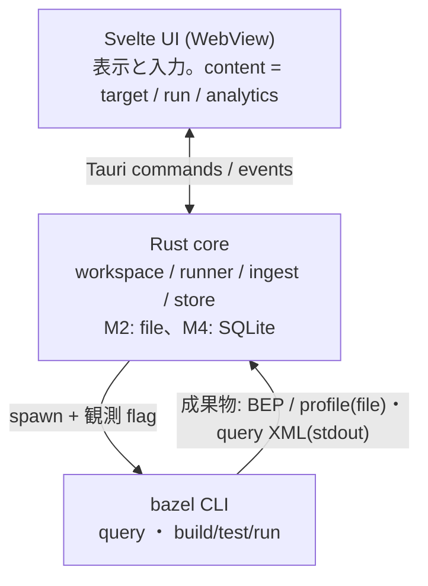

# Zeal 設計: 全体構成

実行中のログ、stdin、BES受信の現行仕様は [M6](./m6-live-runs-and-bes.md) を参照する。
この文書の完了後ログ表示とGUI起動限定の制約は、M6で更新した。

_OhataKenji_
_Last update: 2026/10/18_
_Status: Approved_

## Goal

PRD の狙いは「Bazel に詳しい人が捉えている対象と関係を、GUI の構成と操作に反映する」ことである。
この文書は、[PRD](../prd.md)のマイルストーンに沿って Zeal を実装するための、システム構成と設計原則を定める。
個々の機能の詳細設計は M1〜M5 の各文書([m1](./m1-targets.md)・[m2](./m2-run-detail.md)・[m3](./m3-find-and-run.md)・[m4](./m4-run-history.md)・[m5](./m5-analytics.md))に分け、この文書はそれらが共通して従う土台を固定する。

### Non Goals

- RBE・cloud runner との連携
- bazel の解析・実行ロジックの再実装
- 複数 workspace の同時管理
- 画面ごとの細部設計(各 M 文書で扱う)

## Background

Zeal は Bazel を使う SWE 向けの local first GUI で、要件と体験目標は [PRD](../prd.md)、画面の形は [wireframe mock](../mock/)に定まっている。
画面と操作の設計基準は mock 冒頭の「残ったもの」表である: tree、関係4行(deps / data / used by / files)、composer、run、runs、target 欄。
この文書群は、これらの要素を実データで成立させるための設計を書く。

用語を以下に定める。

- **workspace**: Zeal が対象とする、Bazel workspace を持つローカルのリポジトリルート
- **target / label / package / rule class**: Bazel の通常の意味。`//app/lib:parser` の `java_library` が rule class
- **composer**: toolbar にある実行の唯一の入口。cmd 選択・target 欄・Send の三点
- **content**: ウィンドウ本体の3状態(target / run / analytics)
- **run**: composer から起動した一回の bazel 呼び出しと、その観測記録全体
- **snapshot**: `bazel query` の結果を workspace 単位でメモリに取り込んだ構造データの世代(永続化しない)
- **BEP**: Build Event Protocol。bazel の `--build_event_json_file` 等で出力される、呼び出し単位のイベント列
- **profile**: `--profile` で出力される、phase 内訳と時系列を持つ chrome trace 形式の計測結果
- **観測 flag**: run 時に bazel へ付けて成果物を得る flag 群(BEP・profile の出力指定と profile 用補助 flag。[m2](./m2-run-detail.md)参照)
- **run record**: run ごとの入力、時刻、終了結果などの保存値。M2 は run.json、M4 から DB を正本とする([m4](./m4-run-history.md))

## Overview

Zeal は Tauri v2 の単一ウィンドウアプリで、Rust core とシステム webview 上の Svelte 5 UI に分かれる。
対象 OS は POSIX 系(macOS を第一対象)とし、中断処理が SIGINT とプロセスグループを前提とする([m3](./m3-find-and-run.md))。

Rust core が workspace の管理、bazel の子プロセス起動、観測データの読み取りを担い、UI は表示と入力だけを担う。
bazel はライブラリとして組み込まず、常に子プロセスとして spawn する。

データは二系統に分かれる。
構造データのうち静的な部分(target・依存・file)は `bazel query` の結果を起動のたびに取り込み、workspace 単位の snapshot としてメモリ上に置く(永続化しない)。
観測データは run ごとの BEP と profile に残す。
run dir の file は詳細表示のたびに parse し、M4 から run record を SQLite に保存する。
phase の集計値や parse 結果は DB に保存しない。

設計全体を通じた判断基準は「構造と観測を区別し、観測できないものは不明と示す」である。
構造上存在する action が今回実行されたとは限らず、実行の事実は観測データがなければ分からない。
観測に欠損があるとき、UI は推測で埋めず「不明」または `not available` と表示する。
profile の marker 名を保ち、analysis と execution が重なる場合に別々の時間へ分割しない。
action 一覧、target と action の往復、cache hit の判別は今版に含めない。
二回の run の diff と、そのための追加の条件収集は次版で扱う([PRD](../prd.md))。
mock と記述が異なる箇所では、本設計の規則を優先する。

## Detailed Design

### コンポーネントと責務

| コンポーネント  | 責務                                                                            |
| --------------- | ------------------------------------------------------------------------------- |
| UI(Svelte)      | content 3状態(target / run / analytics)の表示、composer、tree、runs 一覧        |
| core::workspace | workspace の選択と検出、bazel 実行ファイルの解決                                |
| core::runner    | bazel 呼び出しの直列化、spawn、観測 flag の付与、stdout/stderr の捕捉、中断処理 |
| core::ingest    | query XML / BEP / profile の parse。観測 file は詳細表示のたびに読む            |
| core::store     | run record と成果物の永続化。M2 は file、M4 から SQLite(rusqlite)               |

M3 の試作では stdout と stderr を同じ追記用ファイルへ直接接続する。
UI は client 終了後に保存したログを読み、実行中のログ配信は行わない。
UI が直接プロセスやファイルを触る経路は作らない。

### bazel 呼び出しの直列化とプロセス管理

bazel server は同一 output base 上で同時に一つのコマンドしか処理せず、後続の呼び出しは lock を待ってブロックする。
このため runner は同一 workspace の bazel 呼び出しを同時に一つに限る(mutex)。
run または query の実行中は snapshot 取り込み要求を予約せず拒否する。
取り込みは workspace を開いたときと手動 refresh のみ行う([m1](./m1-targets.md))。
M2 では取り込み中の Send を disabled にし、待ち行列を持たない([m2](./m2-run-detail.md))。
M3 で取り込みの完了を待っている間は「target データの取得待ち」と表示する。
実行中は「ログは完了後に表示」と示し、出力の有無と待機原因は判定しない。

M3 は `build` / `test` に絞り、`bazel run` は今後の拡張とする。
spawn は独立したプロセスグループで行い、stop と hard kill をグループへ送る。
子孫の完全回収は保証しない。
中断のエスカレーションと判定規則は [m3](./m3-find-and-run.md) で定める。
アプリ終了時に実行中の run があれば SIGINT を送り、猶予のあとでグループを kill してから終了する。
M4 は未完了 record を終了不明のまま残し、以前の process の照合や signal 送信は行わない。
wait エラーになった run は実行枠を解放して record を未完了のまま残し、M4 でも終了不明のまま扱う([m3](./m3-find-and-run.md)・[m4](./m4-run-history.md))。

### run の定義

run の起動時に Zeal 側で UUID を発行し、観測用の成果物(BEP・profile・stdout/stderr)をその UUID で束ねる。
build・test・run の spawn には `--tool_tag=zeal` を付与する。共有 output base 上の BEP 解析等で Zeal 発の呼び出しを識別できるようにするためである(query 系はこの flag を受理しない version があり得るため付けない)。

M4 は run record をSQLiteに保存し、既存の一覧と詳細画面から再表示する。
詳細fileが欠損した場合も、保存済みの入力と終了結果を残す。
M2 の file record から導出できる終了結果は M2 の範囲で表示する。
規則は [m4](./m4-run-history.md)で定める。

### データの置き場所

M4 の DB はアプリ全体で一つの `<app data dir>/zeal.db` とする。
workspace はcanonical pathの完全一致で識別してUUIDを割り当て、成果物を `workspaces/<workspace_id>/runs/<run_id>/` に置く。
一覧と詳細はDB上のworkspace所属を確認してから読む。
旧file履歴の移行は行わない。
core 自身の動作ログは app data dir 配下に置き、UUID、処理種別、エラー分類だけを記録する。
raw 入力、spawn argv、観測成果物の生の値は出さない。
リポジトリ内には何も書き込まない(bazel 自身が作成する convenience symlink は除く)。

### bazel の解決

実行ファイルは PATH の bazelisk を優先し(`.bazelversion` を尊重するため)、なければ PATH の `bazel` を使う。
v1 の対象 version は Bazel 8.7 以上を目安とし、検証は grpc/grpc の `.bazelversion` の環境を基準にする。それより古い version や他系列での動作は保証しない。
workspace の判定は `MODULE.bazel` / `WORKSPACE`(`WORKSPACE.bazel`)の存在で行う。
初回起動では workspace の選択を求め、bazel が見つからない場合と選択先が workspace でない場合は、その旨を表示して対象機能を停止する。
観測 flag が受理されない version では run はそのまま失敗として記録し、再実行経路は設けない([m2](./m2-run-detail.md))。version 別の対応表は持たない。

### store の運用

M2 では DB を持たず、run の dir の file を表示のたびに parse する([m2](./m2-run-detail.md))。以下は DB を入れる M4 からの運用である。
DB は `journal_mode=WAL` で開き、schema は `PRAGMA user_version` で管理する。
起動時の全件 check は行わず、破損系エラーは履歴利用不能として表示し、新規 run を抑止する。
DB と sidecar の自動削除や再作成、復元用 manifest、backup は設けない。
全Zealと残存processを停止した後にDBを手動初期化すると、全workspaceの要約を失う。
旧履歴と成果物からの復元は行わない。
permission、disk full、新しすぎる schema は別のエラーとして扱い、DB 初期化を勧めない。
生存する子の stop は DB 障害時も維持する([m4](./m4-run-history.md))。

### UI の一貫性

実行の入口は toolbar の composer のみで、他の画面からは実行しない。
tree・dropdown・target 画面での選択は、すべて composer の target 欄への文字列挿入である(詳細は [m3](./m3-find-and-run.md))。
content は target / run / analytics の3状態で、sidebar の tree と runs、composer の Send が状態遷移の起点になる。
この構成は mock の「window 1種・content 3状態・実行入口は composer だけ」と対応する。

## Alternatives Considered

- **Electron**: 機能は同等に実現できるが、配布物とメモリ使用量が大きい。手元に常駐する local ツールとしては Tauri のほうが適する。
- **ネイティブ UI(Swift 等)**: mock の表現(一覧・簡易チャート・ログ)は web 技術で十分に実現でき、開発速度と移植性を優先した。
- **bazel のライブラリ利用**: bazel には安定した組み込み用 API がなく、subprocess が事実上の公式手段である。
- **BEP の gRPC 接続**: `--build_event_json_file` での file 出力のほうが単純で、保存した file を後から再解析できる。「run の記録として残す」要件とも一致する。

## Caveats

- Bazel の version 差は flag と出力形式の単位で現れる。v1 は 8.7 以上を目安にし、観測 flag が受理されない環境は対象外として、発生したら Zeal 側のバグとして対応する。成果物の欠損は detail なしとして扱う。
- `bazel query` は大きい repo で遅くなり得る。snapshot 取り込みは grpc で実測 warm 約 56ms / cold 約 19s で、起動ごとの取り直しは実用範囲。
- bazelisk 経由の初回呼び出しは bazel 本体の download で長時間ブロックし得る。M3 では実行中と表示し、ログは client 終了後に読む。
- workspace を移動・rename するとルートパスが変わり、履歴は新規 workspace として分断される。
- 初版は同一 workspace で Zeal を二重起動しない前提で試す。取り込み中など bazel 呼び出しの待ちの間は Send が最大で query の timeout 分待たされ得る。

## Security Concerns

- composer の入力を含むすべての引数は、shell を介さず引数配列のまま bazel に渡す。
- workspace のルートパス外のファイルを意図せず書き換えない(成果物は app data dir のみ)。

## Privacy Concerns

- Zeal の観測記録は local に保存し、Zeal 自身による telemetry や外部送信は行わない。
- 子プロセスの bazel は利用者やリポジトリの既存設定に従い、BES、remote cache、RBE などへ通信し得る。Zeal はそれらの設定を変更しない。
- run の成果物には build log が含まれるため、共有・同期の仕組みは設けない。
- リポジトリは公開のため、文書・コードともに機微情報を含めない(AGENTS.md の方針に従う)。

## Test Plan

- workspace の検出、bazelisk/bazel の解決、spawn から streaming までを一つの実リポジトリで通す end-to-end の spike を行い、構成が成立することを確かめる。
