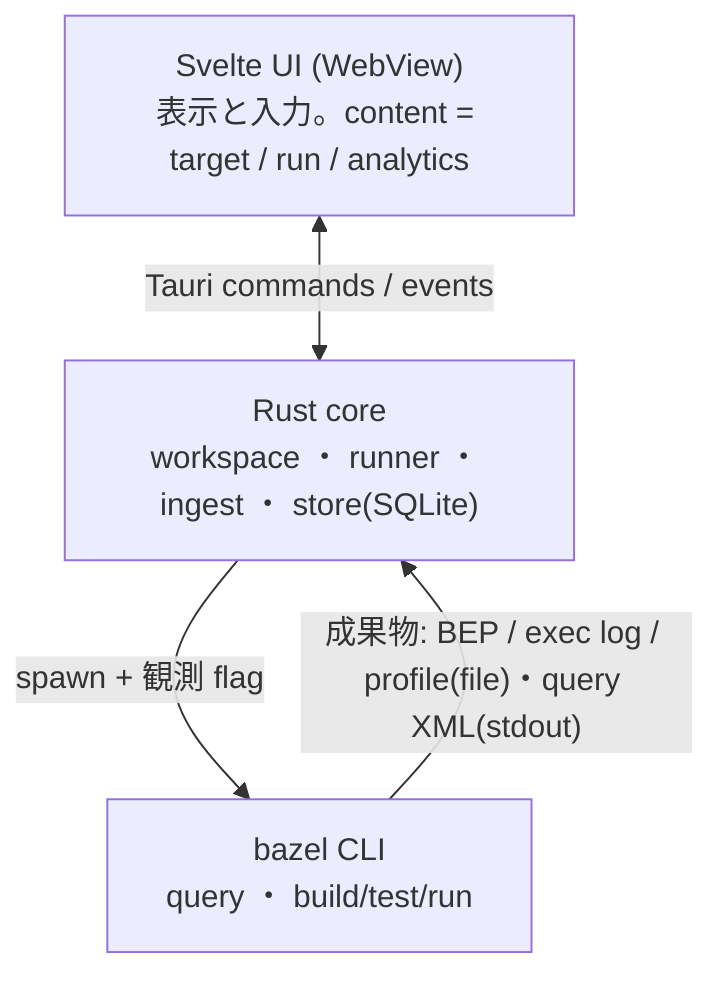

# Zeal 設計: 全体構成

_OhataKenji_
_Last update: 2026/10/15_
_Status: Approved_

## Goal

PRD の狙いは「Bazel に詳しい人が捉えている対象と関係を、GUI の構成と操作に反映する」ことである。
この文書は、[PRD](../prd.md)のマイルストーンに沿って Zeal を実装するための、システム構成と設計原則を定める。
個々の機能の詳細設計は M1〜M5 の各文書([m1](./m1-targets.md)・[m2](./m2-run-detail.md)・[m3](./m3-find-and-run.md)・[m4](./m4-run-history.md)・[m5](./m5-analytics.md))に分け、この文書はそれらが共通して従う土台を固定する。

### Non Goals

- RBE・cloud runner との連携
- bazel の解析・実行ロジックの再実装
- 複数 workspace の同時管理
- 画面ごとの細部設計(各 M 文書で扱う)

## Background

Zeal は Bazel を使う SWE 向けの local first GUI で、要件と体験目標は [PRD](../prd.md)、画面の形は [wireframe mock](../mock/)に定まっている。
画面と操作の設計基準は mock 冒頭の「残ったもの」表である: tree、関係4行(deps / data / used by / files)、composer、run、runs、target 欄。
この文書群は、これらの要素を実データで成立させるための設計を書く。

用語を以下に定める。

- **workspace**: Zeal が対象とする、Bazel workspace を持つローカルのリポジトリルート
- **target / label / package / rule class**: Bazel の通常の意味。`//app/lib:parser` の `java_library` が rule class
- **composer**: toolbar にある実行の唯一の入口。cmd 選択・target 欄・Send の三点
- **content**: ウィンドウ本体の3状態(target / run / analytics)
- **run**: composer から起動した一回の bazel 呼び出しと、その観測記録全体
- **snapshot**: `bazel query` の結果を workspace 単位でメモリに取り込んだ構造データの世代(永続化しない)
- **BEP**: Build Event Protocol。bazel の `--build_event_json_file` 等で出力される、呼び出し単位のイベント列
- **exec log**: `--execution_log_binary_file` で出力される、spawn 単位の実行記録
- **profile**: `--profile` で出力される、phase 内訳と時系列を持つ chrome trace 形式の計測結果
- **観測 flag**: run 時に bazel へ付けて成果物を得る flag 群(BEP・exec log・profile の出力指定と profile 用補助 flag。[m2](./m2-run-detail.md)参照)
- **run record**: run ごとに DB に保存される観測事実の行([m4](./m4-run-history.md))

## Overview

Zeal は Tauri v2 の単一ウィンドウアプリで、Rust core とシステム webview 上の Svelte 5 UI に分かれる。
対象 OS は POSIX 系(macOS を第一対象)とし、中断処理が SIGINT とプロセスグループを前提とする([m3](./m3-find-and-run.md))。
Rust core が workspace の管理、bazel の子プロセス起動、観測データの取り込み、SQLite への永続化を担い、UI は表示と入力だけを担う。
bazel はライブラリとして組み込まず、常に子プロセスとして spawn する。

データは二系統に分かれる。
構造データのうち静的な部分(target・依存・file)は `bazel query` の結果を起動のたびに取り込み、workspace 単位の snapshot としてメモリ上に置く(永続化しない)。
観測データ(実行した spawn・phase・所要時間)は run のたびに bazel に出力させた BEP・exec log・profile を取り込み、run 単位で DB に蓄積する。

設計全体を通じた判断基準は「構造と観測を区別し、観測できないものは不明と示す」である。
構造上存在する action が今回実行されたとは限らず、実行の事実は観測データがなければ分からない。
観測に欠損があるとき、UI は推測で埋めず「不明」と表示する(mock では `○`・`not available`)。

## Detailed Design

### コンポーネントと責務

| コンポーネント  | 責務                                                                                                        |
| --------------- | ----------------------------------------------------------------------------------------------------------- |
| UI(Svelte)      | content 3状態(target / run / analytics)の表示、composer、tree、runs 一覧                                    |
| core::workspace | workspace の選択と検出、bazel 実行ファイルの解決                                                            |
| core::runner    | bazel 呼び出しの直列化、spawn、観測 flag の付与、stdout/stderr の捕捉、中断処理                             |
| core::ingest    | query XML / BEP / exec log / profile の parse。構造データはメモリへ、観測データは DB への書き込み(取り込み) |
| core::store     | SQLite(rusqlite)。run record と成果物の永続化                                                               |

UI への実行中の通知は、runner が捕捉した stdout/stderr を Tauri の event で WebView に streaming して届ける。
stdout/stderr は専用スレッドで常時 drain し(pipe 詰まりで bazel 本体をブロックしない)、UI への送信は時間窓でバッチ化して溢れた分は省略表示にする。
UI が直接プロセスやファイルを触る経路は作らない。

### bazel 呼び出しの直列化とプロセス管理

bazel server は同一 output base 上で同時に一つのコマンドしか処理せず、後続の呼び出しは lock を待ってブロックする。
このため runner は同一 workspace の bazel 呼び出しを同時に一つに限る(mutex)。
run の実行中は snapshot 取り込み([m1](./m1-targets.md))を起動せず、取り込み要求は pending として記録して run 完了後に1回だけ行う。
逆に取り込みの走行中に Send された run はその完了を待ち(取り込みには query の timeout 分の待ちがあり得る)、待機中は「bazel server 待ち」と同じ状態で表示する。
Zeal 外のクライアント(terminal 等)が lock を持つ場合の「bazel server 待ち」は、invocation 開始前に stdout/stderr の最初の出力が一定時間来ないことで検出する(lock 待ちの文言は version 間で安定しないため parse しない。検出条件の詳細は [m3](./m3-find-and-run.md)が正本)。

spawn は独立したプロセスグループで行い、stop・中断・hard kill はグループ単位で送る(`bazel run` が起こした対象 binary も回収できるようにするため)。
中断のエスカレーションと判定規則は [m3](./m3-find-and-run.md) で定める。
アプリ終了時に実行中の run があれば SIGINT を送り、猶予のあとでグループを kill してから終了する。
起動時には前回の crash で残った「running のままの run」を reconcile する(規則は [m4](./m4-run-history.md))。

### run の定義

run の起動時に Zeal 側で UUID を発行し、観測用の成果物(BEP・exec log・profile・stdout/stderr)をその UUID で束ねる。
build・test・run の spawn には `--tool_tag=zeal` を付与する。共有 output base 上の BEP 解析等で Zeal 発の呼び出しを識別できるようにするためである(query 系はこの flag を受理しない version があり得るため付けない)。

run の表示は ● running / ✓ ok / ✗ failed / ■ interrupted / ○ no detail の5記号で、mock の runs 一覧と一致する。
記号は保存する status ではなく、「終了結果(outcome)」と「詳細の有無(detail)」という二つの観測事実から導出する表示である。
規則は [m4](./m4-run-history.md)で定める。

### データの置き場所

DB と run の成果物は Tauri の app data dir 配下に置き、workspace ごとに領域を分ける。
workspace はルートパスを正規化したもので識別し、ディレクトリ名にはパスの hash を使う(衝突した場合は正規化パスとの対応で弁別する)。
core 自身の動作ログ(reconcile の結果・spawn argv・DB 破損時の退避等)も app data dir 配下に出力し、障害時の手がかりとする。
リポジトリ内には何も書き込まない(bazel 自身が作成する convenience symlink は除く)。

### bazel の解決

実行ファイルは PATH の bazelisk を優先し(`.bazelversion` を尊重するため)、なければ PATH の `bazel` を使う。
v1 の対象 version は Bazel 8.7 以上を目安とし、検証は grpc/grpc の `.bazelversion` の環境を基準にする。それより古い version や他系列での動作は保証しない。
workspace の判定は `MODULE.bazel` / `WORKSPACE`(`WORKSPACE.bazel`)の存在で行う。
初回起動では workspace の選択を求め、bazel が見つからない場合と選択先が workspace でない場合は、その旨を表示して対象機能を停止する。
観測 flag が受理されない version では run はそのまま失敗として記録し、再実行経路は設けない([m2](./m2-run-detail.md))。version 別の対応表は持たない。

### store の運用

M2 では DB を持たず、run の dir の file を表示のたびに parse する([m2](./m2-run-detail.md))。以下は DB を入れる M4 からの運用である。
DB は `journal_mode=WAL` で開き、schema は `PRAGMA user_version` で管理して migration を store 内に置く。
起動時の全件 check は行わず、SQLite が破損系エラー(SQLITE_CORRUPT 等)を返した時点で退避・再作成する(disk full 等の一時的なエラーとは区別する)。
run record は再生成できないため、破損時の退避と再作成の扱いは [m4](./m4-run-history.md)で扱う。

### UI の一貫性

実行の入口は toolbar の composer のみで、他の画面からは実行しない。
tree・dropdown・target 画面での選択は、すべて composer の target 欄への文字列挿入である(詳細は [m3](./m3-find-and-run.md))。
content は target / run / analytics の3状態で、sidebar の tree と runs、composer の Send が状態遷移の起点になる。
この構成は mock の「window 1種・content 3状態・実行入口は composer だけ」と対応する。

## Alternatives Considered

- **Electron**: 機能は同等に実現できるが、配布物とメモリ使用量が大きい。手元に常駐する local ツールとしては Tauri のほうが適する。
- **ネイティブ UI(Swift 等)**: mock の表現(一覧・簡易チャート・ログ)は web 技術で十分に実現でき、開発速度と移植性を優先した。
- **bazel のライブラリ利用**: bazel には安定した組み込み用 API がなく、subprocess が事実上の公式手段である。
- **BEP の gRPC 接続**: `--build_event_json_file` での file 出力のほうが単純で、保存した file を後から再解析できる。「run の記録として残す」要件とも一致する。

## Caveats

- Bazel の version 差は flag と出力形式の単位で現れる。v1 は 8.7 以上を目安にし、観測 flag が受理されない環境は対象外として、発生したら Zeal 側のバグとして対応する。成果物の欠損は detail なしとして扱う。
- `bazel query` は大きい repo で遅くなり得る。snapshot 取り込みは grpc で実測 warm 約 56ms / cold 約 19s で、起動ごとの取り直しは実用範囲。
- bazelisk 経由の初回呼び出しは bazel 本体の download で長時間ブロックし得る。「bazel を取得中」と区別して表示する。
- workspace を移動・rename するとルートパスが変わり、履歴は新規 workspace として分断される。
- 同一 workspace で Zeal を二重起動しないよう single instance を強制する(プロセス管理の前提条件)。取り込み中など bazel 呼び出しの待ちの間は Send が最大で query の timeout 分待たされ得る。

## Security Concerns

- composer の入力を含むすべての引数は、shell を介さず引数配列のまま bazel に渡す。
- workspace のルートパス外のファイルを意図せず書き換えない(成果物は app data dir のみ)。

## Privacy Concerns

- すべて local で完結し、telemetry や外部送信は行わない。
- run の成果物には build log が含まれるため、共有・同期の仕組みは設けない。
- リポジトリは公開のため、文書・コードともに機微情報を含めない(AGENTS.md の方針に従う)。

## Test Plan

- workspace の検出、bazelisk/bazel の解決、spawn から streaming までを一つの実リポジトリで通す end-to-end の spike を行い、構成が成立することを確かめる。
