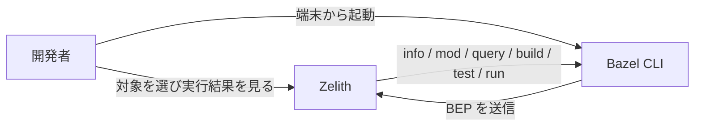
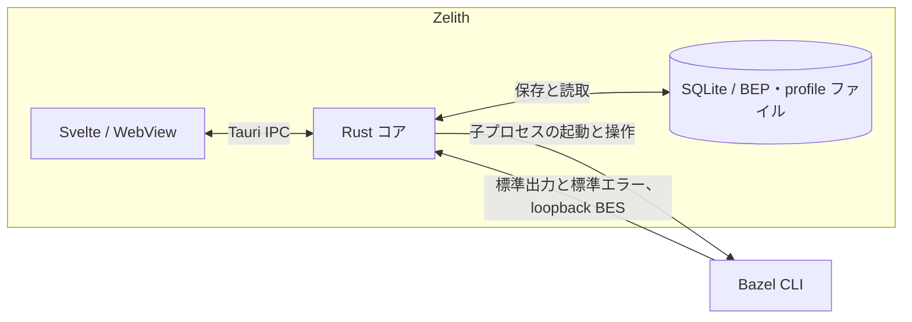

# Zelith の全体構成

_OhataKenji_
_Last update: 2026/11/18_

Zelith は Bazel の対象を探し、実行し、結果を調べるローカルの GUI です。
Bazel がコマンドと排他を扱い、Zelith が起動したプロセスと観測した記録を管理します。
機能の目的は [PRD](../prd.md) に定めます。

## Background

**workspace** は Zelith が開く Bazel リポジトリのルートです。
**invocation** は一回の Bazel コマンドです。
**snapshot** は Bazel から取得した対象一覧です。
**BEP** は Bazel が送るビルドイベントで、Zelith 内の **BES** が受信します。
**profile** は Bazel が出力するタイミングの記録です。

## Overview

### システムコンテキスト

開発者は Zelith または端末から Bazel を使います。
端末から起動した Bazel も、送信先を設定すれば Zelith に BEP を送れます。

### コンテナ

Tauri の単一ウィンドウで、Svelte の UI と Rust コアが IPC で通信します。
コアが SQLite と成果物ファイルをローカルに置きます。
プロセスの停止には POSIX のプロセスグループを使います。

### コンポーネント

| コンポーネント                              | 責務                                                                                |
| ------------------------------------------- | ----------------------------------------------------------------------------------- |
| [UI セッション](../../src/README.md)        | 選択と読取の状態を持ち、コアの実行状態と保存済みの履歴を ID と workspace で照合する |
| [実行の所有](../../src-tauri/src/runner.rs) | Zelith が起動したプロセスを管理し、端末入出力と停止を操作する                       |
| [Bazel への問い合わせ](./target-loading.md) | 対象一覧、対象の詳細、利用者が指定した query を Bazel から取得する                  |
| [履歴](../../src-tauri/src/store.rs)        | BES に届いた事実を保存し、履歴・詳細・比較・Analytics の読み取りに使う              |

## 実行と観測

コアは canonical path で workspace を登録し、Zelith が起動した実行を ID で保持します。
Bazel の起動には PATH 上の `bazelisk` を優先し、なければ `bazel` を使います。
対応の目安は Bazel 8.7 以上です。
Bazel が `--noblock_for_lock` で同じ output base の競合を拒否します。
Zelith は workspace の切り替えでプロセスを変更せず、待ち行列や自動再実行を持ちません。
snapshot は表示中の workspace についてメモリに持ち、対象一覧は workspace を開いたときと手動操作で取得します。

Modules は画面を開いただけでは Bazel を起動しません。
利用者が読み込みを選ぶとコアが `bazel mod graph` で依存関係を取得し、結果はその画面だけが保持します。
行の選択は取得済みの関係を表示し、`Explain` を押したときだけ Bazel に選定理由を問い合わせます。

個別の Stop は ID と所有元の workspace が一致する実行だけに作用します。
Stop とアプリ終了は同じ遷移で停止を開始し、SIGINT を一度送り、猶予後に SIGKILL を試みます。
アプリ終了時は、所有する全実行で一つの猶予期限を共有します。
回収時にプロセスグループ ID を無効にし、端末出力を読み終えたら実行の所有を解放します。
期限までに終了を確認できなければ、シグナル送信の権限を無効にします。
停止では所有するプロセスグループと、PTY が示すフォアグラウンドのグループにシグナルを試みます。

履歴には現在の workspace と、その Git `origin` を共有する workspace の記録を表示します。
最新の100件に加え、その範囲外の実行中の記録と選択中の記録も、同じ履歴の範囲で取得します。
実行中の履歴行は、同じ ID と所有元を持つ実行の状態を表示します。
Console と Stop はその所有元を指定します。
実行中は Console が端末出力を表示し、終了後は履歴が BEP の記録を表示します。
BEP の記録がない場合は、コアがプロセスの終了コードと出力の末尾 16 KiB を直近 32 件までメモリに保持し、所有元の workspace の履歴にだけ返します。
同じ workspace・ID の BEP が後から届けば、履歴はその記録に切り替わります。

BEP の終了コードはビルドの結果です。
`run` ではビルド完了後もプログラムが実行中なら Console を使えます。
プロセスの終了コードから BEP の結果を補わず、プログラムの端末出力は履歴に保存しません。
DB が読めない間も、所有元の workspace ではプロセスを停止できます。

## 保存

SQLite は workspace、コマンド、対象パターン、時刻、ビルド終了コードを保存します。
詳細は要求時に BEP と profile を読み、解析結果を永続化しません。
profile の原本は gzip で 512 MiB まで保存します。内蔵ビューは gzip 64 MiB、展開後 256 MiB、50 万イベント、IPC 予算 64 MiB のいずれかを超えると、タイムラインを表示しません。
DB は WAL と `PRAGMA user_version` を使い、未対応の schema や破損は利用不能として表示します。
破損時に DB を再作成せず、履歴や成果物の自動整理を行いません。
履歴と成果物の保存規則は [M4](./m4-invocation-history.md) を参照してください。

## Security Concerns

コアは Bazel を引数配列で起動します。
repository が実行するコードの信頼は利用者が判断します。
Zelith の成果物はアプリデータ領域に保存します。

## Privacy Concerns

履歴と成果物はローカルに保存します。
Zelith が起動する Bazel には自身の BES、空の BES proxy、`wait_for_upload_complete` を指定します。
remote cache や RBE の通信は Bazel の既存設定に従います。
開発版の OTLP は明示設定がある場合にだけ操作と処理時間を送ります。 [開発時のトレース](../development.md#development-traces)
