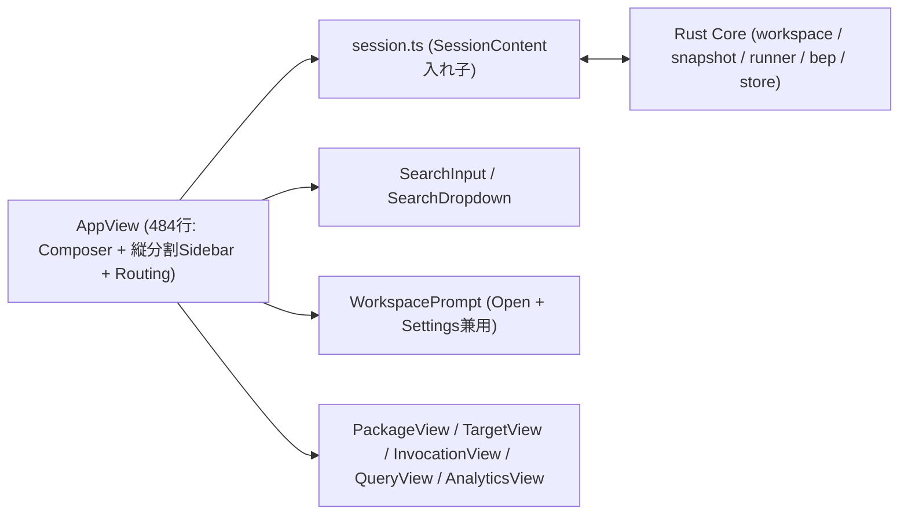
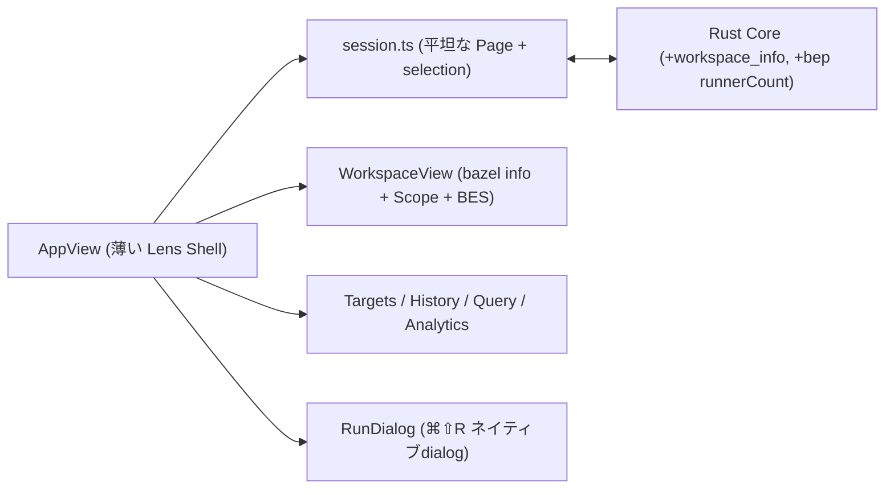

# Zeal 設計: Phase 1 — Lens Shell と既存画面の再構成

_Antigravity_
_Last update: 2026/11/21_
_Status: Approved_

## Goal

Zeal のフロントエンドを「左レール + 役割別サイドバー + レスポンシブ右詳細ペイン」の Lens 構造へ再構成し、既存の全機能（Workspace 情報、Targets、History、Query、Analytics）を静かな 90/8/2 ダークスレート UI 上に統合する。
同時に、旧レイアウト由来で肥大化した状態とコンポーネントを解体・削除し、最終的な C4 コンポーネント構造と総コード量を現在より減らすことを目標とする。
画面の参照元は [redesign.html](../mock/redesign.html)、要件は [PRD](../prd.md) とする。

### Non Goals

- `⌘K` Command Palette（Phase 2 で対応）。
- `cquery` / `aquery` の Query 統合および `Workspace → Configs`（`--announce_rc` 解析）（Phase 3 で対応）。
- `Modules`（Bzlmod 1:N repo / MVS）（Phase 4 で対応）。
- `Workspace` の `Maintenance` 破壊操作（`Shutdown` / `Clean` / `Expunge`）および `output_base` のディレクトリサイズ走査（`du` 相当の I/O コストを避けるため Phase 1 では扱わない）。
- `AnalyticsView.svelte` / `QueryView.svelte` / `ComparisonPanel.svelte` の機能変更（見た目とトークンの整理のみ行う）。
- 後方互換性の維持（[AGENTS.md](../../AGENTS.md) に従い、旧 UI 経路や互換レイヤーは残さず削除する）。

## Background

現行の Zeal（[全体構成](./overview.md)、[Frontend](../../src/README.md)）では、`AppView.svelte`（484行）が次の 4 つの責務を同時に抱えている。

1. **Topbar Composer**: `cmd` / `targetField` / `argumentsText` / `argumentsOpen` と `SearchInput` / `SearchDropdown` による常設コマンド入力欄。
2. **縦分割サイドバー**: `Targets` と `Invocations` を 1 本のサイドバーに縦積みし、`targetsShare` / `collapsed` / `dividerDown`（ポインタドラッグ）で高さを奪い合う構造。
3. **入れ子の画面状態**: `SessionContent` が `{ kind: WorkspacePage } | { kind: "invocation", id, page }` を持ち、「Invocation を閉じたときに戻る先（`page`）」をセッション状態に埋め込んでいる。
4. **Workspace 情報の不在**: `output_base` や `execution_root` など Bazel の物理配置を見る画面がなく、`WorkspacePrompt` が設定編集（`TargetScope`）と新規オープンを兼ねてウィンドウ全体を乗っ取っている。

本設計では **state > coupling > complexity > code** の順で最適化し、「書かないコードが一番良いコード」と **Worse is Better**（実装の単純さを最優先し、80% の価値を最小構造で届ける）に従う。

**用語**:

- **Lens Shell**: `Topbar (40px)` + `Left Rail (60px)` + `Sidebar (242px, 任意)` + `Main (1fr)` + `Right Detail Pane (clamp(520px, 50vw, 960px), 任意)` の 4 スロット構成。
- **Spawn Runners (BEP)**: BEP の `BuildMetrics.action_summary.runner_count` から取得する実測の spawn ランナー別実行数（remote/disk cache hit とローカル実行の内訳）。

## Overview

### 現行 C4 コンポーネント構造（解体前）



### Phase 1 後の C4 コンポーネント構造（目標）



変更の要点は 3 つである。

1. **解体と削除**: Topbar Composer、縦分割サイドバーのドラッグ機構、`SearchInput`/`SearchDropdown`、`SessionContent` の入れ子 `page`、`WorkspacePrompt` の `settings` モードを削除する。
2. **最小の追加**: `WorkspaceView.svelte`（`bazel info` 物理マップ + `TargetScope` 編集 + BES 設定）、`ActionPair.svelte`（`[ 主ボタン ] ⋯`）、`RunDialog.svelte`（`⌘⇧R`）の 3 つの小さなコンポーネントだけを追加する。
3. **既存資産の直接活用**: Rust 側は `workspace_info`（引数なし `bazel --noblock_for_lock info`）と `bep.rs` の `BuildMetrics.action_summary.runner_count` 投影（`merge_bounded` 経由）のみ追加し、既存の `runner.rs` / `runargs.rs` / `store.rs` / `snapshot.rs` / `detail.rs` / `actions.rs` は変更しない。

## Detailed Design

### 1. 解体・削除リスト（The Best Code is No Code）

Phase 1 で以下を削除し、コード量と状態空間を縮める。

| 削除対象                                                                                            | 場所                                                   | 削除する理由                                                                                                    |
| --------------------------------------------------------------------------------------------------- | ------------------------------------------------------ | --------------------------------------------------------------------------------------------------------------- |
| Topbar Composer 一式（`cmd`, `targetField`, `argumentsText`, `argumentsOpen`, `composerWorkspace`） | `src/AppView.svelte`                                   | 実行は `Targets` の `ActionPair`、`History` の `Re-run`、および `RunDialog (⌘⇧R)` に一本化する。                |
| `SearchInput.svelte`, `SearchDropdown.svelte`                                                       | `src/lib/`                                             | Topbar Composer 専用の検索 UI。Phase 2 の `⌘K` は `search.ts` のインデックスを直接利用するため不要。            |
| 縦分割サイドバー（`targetsShare`, `collapsed`, `dividerDown`）                                      | `src/AppView.svelte`                                   | `Targets` と `History` を左レールで分離するため、縦分割のドラッグ状態が不要になる。                             |
| `SessionContent` の入れ子 `page`                                                                    | `src/lib/session.ts`                                   | 左レールで各ドメインが独立するため、「Invocation の裏のページ」を記憶する必要がない。                           |
| `WorkspacePrompt` の `mode="settings"` 経路                                                         | `src/AppView.svelte`, `src/lib/WorkspacePrompt.svelte` | `TargetScope` 編集を `WorkspaceView` へ移し、`WorkspacePrompt` は「未選択時／新規オープン時」専用に単純化する。 |

### 2. 状態モデルの単純化（`src/lib/session.ts`）

**Before**:

```ts
export type WorkspacePage = "targets" | "analytics" | "query";
export type SessionContent =
  | { readonly kind: WorkspacePage }
  | { readonly kind: "invocation"; readonly id: string; readonly page: WorkspacePage };
```

**After**:

```ts
export type Page = "workspace" | "targets" | "history" | "query" | "analytics";

interface Workspace {
  path: string;
  info: Reader<WorkspaceInfo>; // 追加: captured ws identity で stale 応答を破棄
  // ...既存の snapshot / target / history フィールドは維持
}

interface SessionState {
  core: AppState | null;
  workspace: Workspace | null;
  page: Page;
  selectedInvocationId: string | null;
  start: object | null; // 起動中トークン
  error: string | null;
  saved: Saved;
}
```

- **不変条件**:
  - `page === "history"` のときのみ `selectedInvocationId` の詳細（または実行中 `ConsoleView`）を表示する。
  - `Targets` の `selection`（package / target）と `History` の `selectedInvocationId` は独立に保持し、タブ往復で選択が消えない。
  - **stale 遷移の防止**: `showPage` / `select` / `selectInvocation` が呼ばれた時点で `state.start = null` を明示的にクリアする。これにより、起動処理（`start()`）の遅延応答がユーザーの別画面遷移を上書きしない（現行 `session.ts` の不変条件を維持）。
  - `workspace_info` の非同期応答は `ws` オブジェクト同一性（`state.workspace === ws`）と `disposed` で検証し、workspace 切替後の遅延応答を破棄する。
  - **右詳細ペインに履歴スタック（`← Back`）は持たない**（状態を増やさない）。

### 3. Lens Shell とレイアウト規約（`src/AppView.svelte`, `src/styles/`）

4 スロットの CSS Grid で構成する。

```css
.app {
  display: grid;
  grid-template-rows: 40px minmax(0, 1fr);
  height: 100vh;
}
.workspace {
  display: grid;
  grid-template-columns: 60px auto minmax(0, 1fr) auto;
  min-height: 0;
}
.sidebar {
  width: 242px;
}
.inspector {
  width: clamp(520px, 50vw, 960px);
}
.page-center {
  max-width: 1080px;
  margin: 0 auto;
  width: 100%;
}
```

| Page        | Sidebar (`242px`)                                             | Main (`1fr`)                          | Right Detail Pane                  |
| ----------- | ------------------------------------------------------------- | ------------------------------------- | ---------------------------------- |
| `workspace` | なし                                                          | `.page-center`: `WorkspaceView`       | なし                               |
| `targets`   | Package Tree (`Tree.svelte`)                                  | Target Table (`PackageView.svelte`)   | Target 選択時: `TargetView.svelte` |
| `history`   | Invocation List + 状態フィルタ (`All` / `Failed` / `Running`) | `InvocationView` または `ConsoleView` | なし（将来拡張枠）                 |
| `query`     | なし                                                          | `.page-center`: `QueryView`           | なし                               |
| `analytics` | なし                                                          | `.page-center`: `AnalyticsView`       | なし                               |

- **Topbar (`40px`)**: 左に `WorkspaceSwitcher`（1 つの `Workspaces` 一覧＋末尾に `Open workspace… (⌘O)`、ステータスランプなし）。中央の `⌘K` 枠は Phase 2 まで置かない（機能しないダミー UI を作らない）。
- **ドロップダウン**: すべてブラウザ標準の `<details>` / `<summary>` を使い、JS によるポップオーバー開閉・座標計算を書かない。
- **Workspace ページ（`WorkspaceView.svelte`）**:
  - `bazel info` 物理マップ表（`Key` / `Path` の 2 列、クリックコピー、エラー時・ロック競合時の `Retry` ボタン付き）。
  - **Target Scope 編集**: 現行 `WorkspacePrompt` の `include` パターン編集をそのまま `WorkspaceView` 内に配置し、保存時は既存の `session.openWorkspace(ws, scope)` を呼ぶ。
  - **Local BES 設定スニペット**: 現行 `WorkspacePrompt.svelte` と同じく既存のローカル BES エンドポイント定数（`127.0.0.1:4718`）を使い、`AppStateDto` のスキーマは変更しない。
- **Targets の実行ボタン（`ActionPair.svelte`）**: `PackageView` と `TargetView` の共通コンポーネントとして `[ 主ボタン ] ⋯` を採用する。`⋯` 内に `Build`（主操作が Build 以外のとき）と `Run with flags… (⌘⇧R)` を収める。
- **History の実行制御**:
  - 実行中（Zeal 所有）: 四角い停止アイコン（■）ボタン。
  - 完了時: 純粋な `Re-run` ボタン 1 つのみ（Split Button なし）。
    - **有効条件**: `record.cmd` が `"build" | "test" | "run"` のいずれかであり、`record.pattern` が `targetError(pattern) === null` かつ `canSend(view, pattern)` を満たす場合のみ有効化する（それ以外は disabled）。
    - **フラグ扱い**: `session.start(cmd, pattern, "")` として引数なしで再実行する（`bep.options.explicitCmdLine` には前回の `--invocation_id` や `--bes_backend` が含まれるため再送しない。カスタムフラグ付き実行は `RunDialog (⌘⇧R)` を使う）。
  - パターン表示: 1 行省略表示（`text-overflow: ellipsis` + `title` 全文）。
  - タブ構成: 現行 [InvocationView.svelte](../../src/lib/InvocationView.svelte) の `All | Targets | Details | Logs | Timing | Compare` を維持する。

### 4. Rust バックエンドの最小追加（2 箇所のみ）

#### 4.1 `workspace_info` コマンド（`src-tauri/src/workspace.rs`, `src-tauri/src/lib.rs`）

`Workspace` ページの物理マップ表示のため、登録済み workspace に対して `bazel info` を 1 回だけ実行する。

```rust
#[derive(Clone, Debug, Serialize)]
#[serde(rename_all = "camelCase")]
pub struct WorkspaceInfo {
    pub workspace: String,
    pub release: Option<String>,
    pub output_base: Option<String>,
    pub execution_root: Option<String>,
    pub bazel_bin: Option<String>,
    pub bazel_testlogs: Option<String>,
    pub repository_cache: Option<String>,
}
```

- **コマンドと引数**: `CoreState.bazel`（フロントエンド入力ではなく解決済みバイナリ）に対し、キー引数を付けず **`["--noblock_for_lock", "info"]`** のみで起動する（特定キー指定による Bazel バージョン依存エラーを防ぐ。`disk_cache` は `bazel info` キーではないため対象外）。
- **出力パース**: 標準出力の `key: value` 行から上記 6 キーのみを抽出し、未知キーは無視する。
- **プロセス保護と資源上限**:
  - `AppState` に登録済みの canonical `PathBuf` を `current_dir` に設定して実行する（未登録パスは拒否）。
  - `tauri::async_runtime::spawn_blocking` 内で実行し、`.stdin(Stdio::null())`・`.process_group(0)` を設定する。
  - `stdout`（上限 64 KiB）と `stderr`（上限 8 KiB）を別スレッドで並列ドレインし、パイプデッドロックと OOM を防ぐ（`query.rs` と同じ方針）。
  - タイムアウトは **30 秒**（コールド JVM / `bazelisk` 起動を考慮）。タイムアウト時はプロセスグループへ `SIGKILL` を送り、`wait()` でゾンビプロセスを回収する。
  - `--noblock_for_lock` でロック競合した場合（初期 `refreshSnapshot()` との競合含む）はエラーを返し、`WorkspaceView` の `Retry` ボタンで再試行できるようにする。

#### 4.2 Spawn Runners 集計の投影（`src-tauri/src/bep.rs`）

既に `src-tauri/proto/` に含まれる `BuildMetrics.action_summary.runner_count`（`name: String`, `count: i32`）を `Bep` 構造体へ投影する。

```rust
#[derive(Clone, Debug, PartialEq, Deserialize, Serialize)]
#[serde(rename_all = "camelCase")]
pub struct RunnerCount {
    pub name: String,
    pub count: u32,
}

// Bep に追加:
#[serde(default, skip_serializing_if = "Option::is_none")]
pub runner_counts: Option<Vec<RunnerCount>>,
```

- **安全な変換とサイズ上限**:
  - `build_event_stream.proto` の `rc.count`（`i32`）は `u32::try_from(rc.count)` で変換し、負値は破棄する。
  - `bep.rs::merge_bounded()` を更新し、`runner_counts` を既存の `DISPLAY_LIMIT`（8 MiB）のバイト予算内で `replace` マージする（無制限な `BuildMetrics` による上限迂回を防ぐ）。
- **UI 表示の正確さ**:
  - Bazel の `runner_count` には集計行 `{ name: "total", count: N }` が含まれるため、UI 側では **`name !== "total"` の行だけを内訳・合算対象** にする（二重計上しない）。
  - `runner_count` は spawn ランナー（`"remote cache hit"`, `"disk cache hit"`, `"darwin-sandbox"` 等）の集計であり、ローカルの Skyframe Action Cache ヒットは含まない。したがって UI では「Spawn Cache Hits (BEP)」として `name: count` の実測内訳を併記し、ローカル Action Cache を含んでいるかのような誤解を与えない。未記録時はセクション自体を非表示にする。

### 5. `RunDialog.svelte`（`⌘⇧R`）

- ネイティブ `<dialog>` 要素を使用。
- フィールド: `cmd`（`build` / `test` / `run`）、`target`（パターン文字列）、`flags`（任意フラグ）。
- **検証とプレビュー**: 既存の `targetError` / `runargs::validate_pattern` と完全に一致させ、`-` 始まりのパターンはフラグ注入防止のためエラーとして拒否する（`--` の自動挿入は行わない）。プレビューは `runargs::argv` と同じ順序（`bazel <cmd> <pattern> <flags>`）を表示する。
- 実行: 既存の `session.start(cmd, target, flags)` を呼び出すだけで、Rust 側の変更はゼロ。
- ショートカット: ブラウザ／WebView のリロード（`⌘R`）と衝突しない `⌘⇧R` を割り当てる。

## Alternatives Considered

### 案 A: 旧 Topbar Composer を残したまま、見た目だけダークスレートに塗り替える

- **利点**: `AppView.svelte` の変更行数が少ない。
- **欠点**: `AppView.svelte` の 484 行の複雑さ（縦分割ドラッグ・入れ子 `SessionContent`・常設検索ドロップダウン）がそのまま残り、Phase 2 以降で結局作り直すことになる。
- **却下理由**: 「変更行数の小ささより最終系の単純さを選ぶ」原則に反する。

### 案 B: `Workspace → Overview` で `output_base` / `external/` のディスクサイズを計算する

- **利点**: どのディレクトリが容量を食っているか一目で分かる。
- **欠点**: 大規模リポジトリの `output_base` は数十万ファイルに及び、再帰 `stat` 走査が数秒〜数十秒の I/O 負荷とキャンセル制御の複雑さを生む。
- **却下理由**: Worse is Better に従い、Phase 1 は `bazel info` のパス表示に絞る。

### 案 C: `Targets` の右ペインをドラッグリサイズ可能にする

- **利点**: ユーザーが好みの幅に調整できる。
- **欠点**: ポインタ追跡・幅の永続化・最小/最大幅の競合処理など状態が増える。
- **却下理由**: `clamp(520px, 50vw, 960px)` の CSS 1 行で 1280px ノートPCから 2560px モニタまで破綻しないため、JS 状態を書かない。

## Caveats

- **`bazel info` とサーバーロック**: 同じ `output_base` で別ビルドや `refreshSnapshot()` が実行中の場合、`--noblock_for_lock` により `workspace_info` はエラーを返す。Zeal はロック待ちでハングさせず、`Retry` ボタン付きのエラー表示で正直に扱う。
- **キャッシュヒット率の範囲**: BEP の `runner_count` は spawn ランナー単位の集計であり、ローカル Skyframe Action Cache ヒット（`action_cache_statistics`）とは別物である。内訳ラベル（`name: count`）を必ず併記する。
- **1280px 以下の狭幅ウィンドウ**: `60px + 242px + 520px = 822px` のため、`Targets` で右ペインを開くと中央一覧は `~458px` になる。`960px` 未満の極狭画面ではメディアクエリで右ペインを `420px` に縮める。

## Security Concerns

- **コマンド実行**: `workspace_info` は `CoreState.bazel` を固定引数配列（`["--noblock_for_lock", "info"]`）で起動し、シェルを経由しない。`workspace` 引数は `AppState` に登録済みの canonical `PathBuf` に一致することを検証し、`.current_dir(&ws)`・`.stdin(Stdio::null())`・`.process_group(0)`・出力サイズ上限（64 KiB / 8 KiB）・30 秒タイムアウト（`SIGKILL` + `wait()` 回収）を適用する。
- **フラグ注入防止**: `RunDialog` は既存の `targetError` / `runargs::validate_pattern`（先頭 `-` 拒否）と `runargs::argv` をそのまま維持し、シェル変数展開やコマンド置換を行わない。
- **BEP メモリ上限**: `runner_counts` は `bep.rs::merge_bounded()` を通して既存の `DISPLAY_LIMIT`（8 MiB）内に収め、`i32` 負値は `u32::try_from` で安全に破棄する。
- **XSS 防止**: Svelte テンプレートの標準エスケープのみを使い、`{@html}` は使用しない。

## Privacy Concerns

- `workspace_info` が返すローカルパスや BEP の `runner_count` はすべてローカルメモリ／ローカル DB 内に留まり、外部へ送信しない。
- 本設計書およびテストデータに実在の社内パスや機微情報を含めない。

## Test Plan

1. **Rust ユニットテスト**:
   - `workspace.rs`: `bazel info` の標準出力パース（全キー揃い・一部欠損・値に `:` を含むパス・未知キー無視）およびタイムアウト／出力上限の境界。
   - `bep.rs`: `Payload::BuildMetrics` の `action_summary.runner_count` 投影（正常系・負値破棄・空・`merge_bounded` の `DISPLAY_LIMIT` 超過時の `truncated`）。
2. **Frontend ユニットテスト（Vitest）**:
   - `session.ts`: 平坦化した `page` + `selectedInvocationId` の遷移、`showPage`/`select`/`selectInvocation` による `state.start` クリア、`workspace_info` の stale 応答破棄。
   - `RunDialog`: `targetError` 検証（先頭 `-` 拒否）と `runargs::argv` 整合プレビュー。
   - `bep` ランナー集計ヘルパー（`"total"` 除外、空配列、cache hit 混在）。
   - `History` `Re-run` 有効/無効条件（`cmd`・`pattern` 欠損/非対応時）。
3. **結合・手動確認**:
   - 1280px / 1920px / 2560px の 3 幅で `Workspace` / `Targets` / `History` / `Query` / `Analytics` の崩れがないこと。
   - `<details>` ドロップダウンと `⌘⇧R` モーダルのキーボード操作（`Esc` 閉じ、フォーカス復帰）。
   - 既存テストスイート（`cargo test` / `pnpm test`）全通過。
