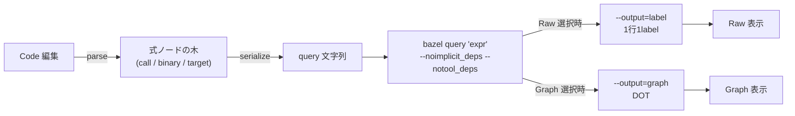

# Zeal 設計: query editor

_OhataKenji_
_Last update: 2026/11/01_
_Status: Draft_

## Goal

Bazel query の概念をなんとなく知っているが、毎回構文を手打ちするのが面倒な利用者が、query を組み立てられるようにする。
エディタは [mock](../mock/query-editor.html) の形に従う。
grammar をそのまま UI に写し、関数名・引数名・演算子を独自の呼称で隠さない。
PRD のシナリオ1・3を支える機能で、query の見方は [m1](./m1-targets.md) の snapshot と揃える。

### Non Goals

- `set(...)`、`let ... in ...`、`$name` の変数参照。使われる頻度に対して実装が重いため切り捨てる(worse is better。Code では手書きできる)
- Sky Query 専用の関数(`allrdeps` 等)
- `cquery`、`aquery`。使える関数と結果の意味が違うため、別モードとして設計する
- query の履歴・保存・共有
- 結果の各 target の詳細画面
- コンポーネント分割などの実装細部(コードレビューで扱う)

## Background

対象の構文は [Bazel query language](https://bazel.build/query/language) の EBNF に従う。
`expr` は target pattern、関数呼び出し、`expr intersect|union|except expr`、`set`、`let`、`$name`、括弧で構成される。
集合演算は同じ優先順位で左結合し、`^`、`+`、`-` という記号表記も受理される。
関数の引数は `expr`(入れ子の式)、`word`(文字列)、`int` のいずれかである。
`rdeps` は `rdeps(universe, expr[, depth])` と、`universe` にも式を受け取る。
引数の中に式を置けなければ、`deps(A) intersect deps(B)` という日常的な query すら作れない。

用語を以下に定める。

- **式ノード**：式の木の1要素。種別は target pattern、関数呼び出し(call)、二項演算(binary)の3種
- **expression hole**：種別が決まっていない空の `expr` 位置
- **kind selector**：各式ノードの先頭にある、式の種別を切り替える select。Target pattern・全関数・`intersect`/`union`/`except` を列挙する
- **Builder / Code**：編集モード。Builder は GUI で組み立て、Code は文字列を直接編集する
- **snapshot**・**run**：[overview](./overview.md#background) に従う。本機能の ad-hoc query は snapshot 取り込みとは別の `bazel query` 呼び出しである

command 生成に関わる flag は二つ。
`--noimplicit_deps` は暗黙の依存を除く。UI の既定は ON(Bazel 既定からずらす)。
`--notool_deps` は tool 経由の依存を除く。UI の既定は OFF(Bazel 既定どおり)。

## Overview

Builder は操作の列ではなく、式の木をそのまま編集するエディタである。
内部表現は grammar に沿った再帰的な AST である。
組み立ては外側から進める。
`intersect` を選ぶと左右に hole が現れ、それぞれで `deps` を選び、その引数に target を入れる。

各式ノードの先頭に kind selector を一つだけ置く。
空の hole でも完成した式でも、入口は常にこの select である。
削除や置換のボタンは置かない。
undo/redo も持たない。間違えた式は選び直すか Code で直す。

Builder と Code は serialize/parse で往復する。
結果は Raw(label 出力)と Graph(DOT の有向グラフ)の二つの見方で示す。
一回の `bazel query` は一つの `--output` しか持てないため、二つの見方は別の呼び出しで取得する。



## Detailed Design

### 式ノードのデータモデル

内部表現は mock と同じ3種のノードである。
`set`・`let`・`$name` は対象外なので、変数の scope 追跡や word 列の編集機構は持たない。

- **target**：`text` を持つ target pattern。serialize 時に word 規則で quote する
- **call**：関数名 `fn` と、schema 順の `args` を持つ。`expr` 型の引数には式ノードが入る
- **binary**：`op`(`intersect`/`union`/`except`)と `left`・`right` の式ノードを持つ

関数は catalog で schema 化する。
各関数は signature、引数の並び(名前・型・省略可否・既定値・`int` の最小値)、主要 `expr` 引数を指す `wrapArg`、説明文を持つ。
`deps`、`rdeps`、`somepath`、`allpaths`、`kind`、`filter`、`attr`、`labels`、`tests`、`buildfiles`、`loadfiles`、`executables`、`siblings`、`same_pkg_direct_rdeps`、`some`、`visible` を収録する。
表示・検証・serialize はすべてこの catalog を唯一の情報源とする。
この一覧は説明用であり、正本は実装の catalog である。

catalog は対象 version(Bazel 8.7 以上)の query ドキュメントから手作業で作る。
対象 version を更新するたびに bazel.build/query/language と照合する。
自動同期は持たない。

### 組み立て順序と kind selector

編集は外側の式から内側へ進める。
expression hole には「Choose expression…」として全種別を並べ、完成した式にも同じ一覧を持つ kind selector を置く。

種別の切り替えは二段階に分ける。
関数→別の関数では、旧関数の `wrapArg` が指す `expr` 引数を新関数の `wrapArg` の位置へ移し、残りの引数は同名・同型のものだけ移す。
`deps` → `rdeps` なら `expr` の中身が引き継がれ、`universe` には既定値 `//...` が入る。
`intersect`→`union` などの二項演算では左右の式を保つ。
異なる種別への変更は、その位置のノードを新しい既定ノードに置き換える。

この設計により「関数だけは select で変えられるが、別種別にするには削除し直さなければならない」という不統一を除く。
選べる種別を制限する仕組みは持たない。

### 構文に沿った描画

描画は grammar の構造に沿わせる。

- **call**：kind selector で関数名を示し、signature 順の引数を `name: 入力` の形で並べる。`expr` 型の引数はその場に式エディタを再帰的に描く
- **binary**：`left`・`right` を縦に積み、select で演算子を示す。左右分割は入れ子で幅が潰れるため採らない

式ノードの折りたたみは持たない。

### serialize と quote 規則

serialize は AST から query 文字列を作る純粋関数とする。

- word は次の条件をすべて満たすときだけ quote しない：非空、文字集合 `[A-Za-z0-9_./:@$~*\[\]-]` のみ、keyword(`except`・`in`・`intersect`・`let`・`set`・`union`)でない、`-` や `*` で始まらない
- それ以外は `"..."` で quote し、`"` を含む場合は `'...'` を使う。両方を含む word は serialize エラーにする(Bazel query には escape がない)
- `pattern` 引数など正規表現の位置の word は常に quote する
- 省略可能な引数(`depth`、`count`)は未指定なら出力しない
- `binary` は常に括弧で囲む

### 検証

検証は欄ごとに行う。
全規則は mock の `validate` を正とし、主要なものを以下に示す。

- 必須の `expr` 欄が空、または省略不可の `int` が未入力：「Required」
- `int` 引数が整数でない、schema の `min`(`depth` は 0、`count` は 1)未満、または 2^31-1 を超える：エラー
- target pattern や関数の `word` 引数が `-`・`*` で始まる、制御文字を含む、両 quote 種を含む：エラー

欄エラーがあっても serialize は試み、失敗する場合はその旨を生成 query と command の欄に出す。
エラーがある間は Run と Copy command を無効にする。
前回実行済みの結果とその Copy output は触らない。
Code モードには欄エラーがないため、式が空の間だけ Run と Copy command を無効にする。

### Builder ⇄ Code の往復

Builder → Code は serialize の結果をそのまま流す。
serialize が失敗する間は Code へ切り替えられない。
Code → Builder は tokenizer と recursive descent で、対応する構文 subset(3種のノード・word・括弧・記号表記)を parse する。
`set`・`let`・`$name`・未対応の関数を含む式は parse エラーになる。
parse できても検証エラーのある式は Builder に戻さず、エラーと「Revert to last Builder」の操作を出す。
Builder で保持していた AST は捨てず、戻せるようにする。

serialize は `binary` に常に括弧を付け、記号表記を単語形に正規化し、word の quote 形式も再選択する。
意味は同じだが、書き方は手書きと変わり得る。
往復で失われる情報は括弧・`^`/`+`/`-` の表記・quote 形式だけである。

### コマンドと実行

生成する command は `bazel query 'expr' [--noimplicit_deps] [--notool_deps]`。
画面の `'expr'` は表示と Copy command 用であり、実行時は shell を介さず引数配列で spawn する。
式の先頭が `-` の場合、bazel はこれを query ではなく flag と解釈し得る。
最終的な1引数が `-` で始まる場合は core 側でも実行を拒否する(`--` 区切りで回避できるかは spike で確かめる)。

この Run は composer の run(build・test)ではなく、snapshot 取り込みと同種の `bazel query` 呼び出しである。
実行は overview の直列化規則に従い、query・run・取り込みのいずれかが実行中なら新しい query を拒否し、理由つきで Run を無効にする。
timeout(目安5分)と中断(SIGINT→SIGKILL)は snapshot 取り込みと同じ規則を適用し、実行中は Stop で止められる。
見方の切り替えやプリセット選択による自動実行も、同じ検証・直列化・`-` 拒否の経路を通る。
`--keep_going` は付けない。部分結果を知る手段がないため、早く失敗して式を直させる方が扱いやすい。

query が非0終了した場合は、結果欄に exit code と stderr の末尾を表示する。
同じ見方の前回結果は新しい結果で置き換わる。失敗も結果として保持する。
query や flag が前回の実行時から変わっていれば、stale 表示を出す。

### 結果の見方

結果は Raw と Graph の二つの見方だけを提供する。
実行は現在選択中の見方について行い、見方ごとに結果を保持する。
もう一方の見方に切り替えたとき、同じ query・flag の結果が未取得ならその見方の query を実行する。

- **Raw**：`--output=label` の1行1label テキスト。件数の多い結果の表示は保証範囲に含めない
- **Graph**：`--output=graph` の DOT を Graphviz で描画し、SVG を `` の blob URL で表示する。v1 では rule class や target の詳細は出さない

「Copy output」は現在の見方の出力をコピーする(Raw なら label 一覧、Graph なら DOT テキスト)。

Graph は `--nograph:factored` を付けて target とノードを1対1に保つ。
既定の factored 出力は同値の target を一つのノードに併合するため、個々の target に対応付けられない。
ノード数は `--graph:node_limit` で切り詰められ得る。切り詰めは stderr の WARNING として結果欄に出す。

実装ではレイアウトを Graphviz(`@viz-js/viz` の wasm)に任せ、自前のレイアウトは持たない。

### 例と補完

左側に Examples として代表的な query をプリセットで並べる。
初期の利用はここから編集に入ることを想定する。
プリセット選択は flag を既定に戻し、結果の実行も行う。
Code に未適用の編集があっても確認せず捨てる。再入力コストが低く、確認 UI の実装が重いため(worse is better)。
label・attribute 名・`kind` の pattern の入力には、snapshot の target・属性名・rule class を datalist で補完する。

## Alternatives Considered

- **Target に Operation を積む線形 pipeline**(Grafana builder の見た目に近い案)
  二項演算の右側や `rdeps` の `universe` に式が必要で、`deps(A) intersect deps(B)` が作れない
- **選択中の式に対して一箇所の操作欄から関数を適用**
  編集対象と「適用」ボタンが画面上で離れ、どの式に効くか分かりにくい
- **「外側に追加」「…を外す」の wrap/unwrap 操作**
  ラベルの意味が利用者に伝わらず、kind selector の置換で同等の編集ができる
- **`left`/`right` の左右分割**
  式が入れ子になると横幅が足りなくなる
- **関数の select と、別経路の「式の種類の置き換え」**
  機能が重複する。全種別を一つの kind selector に統合した
- **Bazel の用語を親しみやすい名前に置き換える**
  対象利用者は概念を知っていて構文の手間を省きたい層であり、用語の隠蔽は学習の助けにならない

## Caveats

- parse は対応構文の subset のみを扱う。subset 外の query は Builder に戻せず、Code のまま使う
- serialize の括弧付けと表記の正規化により、Builder 経由後の query 文字列は手書きと見た目が変わる
- Raw は先頭5000行まで表示する。巨大な結果は core 側でも先頭4MiBで切り詰め、truncated を出す
- Graph の見通しは Graphviz に委ねる。大きな結果での見やすさは自前で制御しない
- `set`・`let`・`$name` を含む式は Code では実行できるが Builder には戻せない
- `cquery`・`aquery` で使えない関数や型制約は今回の catalog に表れない。別モードの設計とする
- `aquery` には `--output=graph` がない。Graph は `query`・`cquery` のみの見方とする

## Security Concerns

- spawn は shell を介さず引数配列で行う。実行の直列化も [overview](./overview.md#security-concerns) に従う
- 画面の command 文字列(`'...'`)は表示と Copy command 用であり、実行経路ではない
- 最終的な1引数が `-` で始まる場合は core 側でも実行を拒否する([m3](./m3-find-and-run.md) と同じ規則)
- 結果の label・DOT は workspace 由来の文字列であり、text として表示する。Graphviz の SVG 出力は DOM に埋め込まず、blob URL の `` で表示する(svg の script・外部参照を封じる)
- 式は任意の `bazel query` を表せるため、高コストな query は bazel server の時間とメモリを消費する。既存の timeout と中断の規則に従う

## Privacy Concerns

query と結果には workspace の構造情報が含まれるが、local のまま扱い、外部へ送信しない。
共通方針は [overview](./overview.md#privacy-concerns) に従う。
mock の fixture は実在しない label のみを使う。

## Test Plan

- serialize / parse の roundtrip golden test を、mock の Examples 一式に対して行う
- catalog の全関数について、signature 順の serialize と optional 引数の省略を確認する
- `quoteWord` の境界：keyword、空白を含む word、`-`・`*` 始まり、両 quote 種を含む word
- 検証：空の必須 `expr`、`int` の `min`、2^31-1 超過、`-`・`*` 始まりの word で欄エラーが出ること
- kind selector の切替：`deps`→`rdeps` で `expr` が保たれ `universe` に既定値が入ること、`deps`→`somepath` で `expr` が `from` に移ること、`intersect`→`union` で左右が保たれること
- Code の parse：括弧、左結合、`^`/`+`/`-` が AST に戻ること。`set`・`let`・`$name` を含む式が Builder に戻らないこと
- flag の組み合わせで生成 command が変わること
- 実行経路：検証エラー中の Run 無効、非0終了で exit code と stderr が出ること、実行中の拒否、stale 表示
- **smoke**：Bazel 8.7以上の小さな repo で catalog 全16関数を実行し、signature・既定値・受理可否を確かめる
- **smoke**：`--nograph:factored`・`--graph:node_limit` の flag 組と、SVG の `` 表示を実機で確かめる
- **spike**：`aquery` の出力形式から action/artifact の表が作れるかを調べる
- **spike**：式が `-` で始まる場合に `--` 区切りで受理されるかを確かめる

## Appendix: Example

Builder で `deps(//app:server) intersect deps(//tools:cli)` を組み立てる手順は次のとおりである。

1. ルートの kind selector で `intersect` を選ぶ。`left`・`right` に expression hole が現れる
2. `left` の hole で `deps` を選び、引数 `expr` に `//app:server` を入力する
3. `right` の hole で `deps` を選び、引数 `expr` に `//tools:cli` を入力する

生成される command は次の形になる。

```sh
bazel query '(deps(//app:server) intersect deps(//tools:cli))' --noimplicit_deps
```
