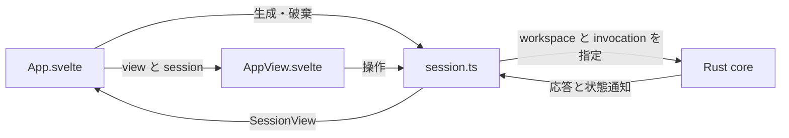

# Zeal 設計: セッションの所有と非同期応答

WebView は表示先と取得したデータを持ち、Rust core は実行中のプロセスを所有する。
workspace を切り替えても Rust の実行は変わらない。
全体の責務は [overview](./overview.md)、ファイルの配置は [frontend README](../../src/README.md) を参照する。

## 制御の経路

`App.svelte` が session の寿命を所有し、Tauri transport で `createSession` を一度だけ作る。
公開された `SessionView` と session を `AppView` へ props で渡し、view は操作を session の公開 API に委ねる。
`session.ts` が画面の操作を受け、直接 IPC を await する。
内部の Message / Effect への変換と状態全体の複製を削除し、要求と応答の扱いを同じ関数に置く。
フォーム入力、展開状態、workspace open/settings ダイアログ、Console の byte stream は各画面の処理に残る。

`openWorkspace` は Promise を返す。
現在の要求が canonical workspace を選択したとき `true`、後続の要求や dispose に追い越されたとき `false`、現在の要求自体が失敗したときだけ reject する。
フォームは reject をローカルの error として表示し、成功時だけ閉じる。
最新の要求を表す token は settle 後も残り、明示的な open が始まった時点で保存済み `lastWorkspace` による自動選択を以後は行わない。open が失敗した場合も同様である。

## 古い応答を捨てる境界

選択中の workspace だけが target 一覧と履歴を持つ。
切替時に新しい Workspace object を作るため、A→B→A でも最初の A の応答は採用されない。
ターゲット選択と保存済み結果にも、それぞれの取得先 object を使う。
target/package の選択変更は content object を新しくし、進行中の start の遅れた応答が表示先を奪わないようにする。
refresh と workspace open は要求ごとの token、start は開始時の content object・workspace open token・選択中の workspace object の同一性を照合する。
workspace open の token は session 内の `workspaceRequest` が保持し、view には出さない。最新の token は settle 後もクリアしない。
core の状態通知は revision が新しいものだけを採用する。

開始済み IPC の取消は行わない。
古い応答は現在の値を上書きせず、古いターゲットの次の取得段階にも進まない。
`dispose` は購読を解除し、以後の応答と操作を無視する。
購読登録が遅れて完了した場合も直ちに解除する。
`init` は mount した session ごとに一度だけ呼び、root が `dispose` と対にして寿命を管理する。

## 必要な取得順序

同じ workspace の target 読み取りは detail → outputs → actions の順に await する。
取得中に選択が変わったら、その応答を捨てて最新の選択から始める。
outputs が失敗しても actions は取得する。
workspace を切り替えた場合は、古い workspace の読み取りを待たない。

履歴の取得中に複数の更新通知が来た場合だけ、後続の取得一回にまとめる。
履歴の選択中 record が変われば、同じ invocation の detail と profile を読み直す。
再取得の失敗時は、取得済みの値とエラーを併せて表示する。
関係ない core 通知では再取得しない。

## Console と結果画面

表示先は invocation ID を保持する。
その invocation の live Console があれば Console を表示し、core が所有を解放したら同じ ID の BEP 結果を表示する。
完了通知は表示先を変えないため、別の画面を見ている場合は移動しない。
BEP のビルド成功と、`bazel run` のプログラム終了は区別する。
