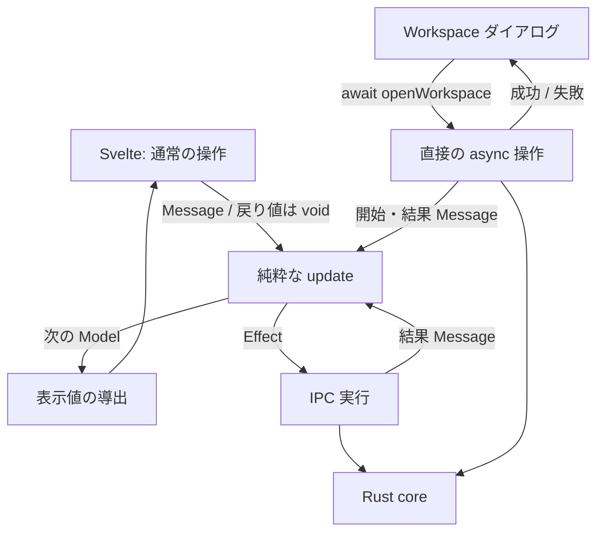

# Zeal 設計: セッション状態と副作用の分離

_Devin_
_Last update: 2026/11/08_
_Status: Approved_

## Goal

既存の画面動作と非同期処理の安全性を保ち、操作を理解・変更するために読むコードを減らす。
Svelte と Elm-style の純粋な状態遷移を維持するが、API の統一や Elm runtime の再現より実装の単純さを優先する。
機能要件は [PRD](../prd.md)、画面は [mock](../mock/) に従い、この設計では追加しない。

### Non Goals

- Rust / IPC / 保存形式の変更、新機能、Svelte の置換。
- 汎用取得エンジン、scheduler、コマンド登録表、新しい状態管理ライブラリ。
- 既存の JavaScript API の返り値の互換性、全操作の Promise 化。
- 通知欠落からの自動回復、artifact の同時点整合性、不要な取得を一切しない保証。
- 行数合わせの圧縮、機能・競合テストの削除、別ファイルへの移動を削減と数えること。

## Background

**Session** は、Rust の状態通知と UI の選択から、画面に必要な読み取りと表示状態を決める frontend の処理である。
**Model / Message / Effect** は、それぞれ状態、出来事、実行すべき IPC の指示を指す。通常の遷移は純粋な `update(model, message)` が次の Model と Effect を返す。

状態更新と IPC が混在していた実装を純粋関数へ移し、全体同期・依存キー・Attempt を削除した中間版は 1,381 行となった。PR 分岐元の main は 760 行で、Svelte の接続部分、テスト、設計書はこの比較に含めない。
中間版には公開 async API を維持するための Promise 管理と、判断の受け渡しが残っていた。本設計ではその不要な契約を削り、各用途の規則を直接表す。
Elm-style 化やテスト通過だけでは、実装量の増加を正当化できない。

判断基準は [The Best Code is No Code At All](https://blog.codinghorror.com/the-best-code-is-no-code-at-all/) と [The Rise of “Worse is Better”](https://www.jwz.org/doc/worse-is-better.html) である。
前者からは「まず短く、必要性が分かった分だけ増やす」、後者からは「インターフェースの統一より実装の単純さ」を採る。
既知の画面動作を壊す許可とは解釈しない。捨てるのは不要な内部契約と先回りした完全性である。

## Overview

C4 の System Context は、開発者が Zeal を操作し、Zeal が Bazel に処理を依頼して結果を表示する関係である。
Container は既存の WebView、Rust core、SQLite、観測ファイルから変更しない。全体は [全体構成](./overview.md) を参照する。
WebView 内では Svelte が表示・入力、session の実行層が購読と IPC、純粋な core が状態遷移を担当する。図の箱は論理的な責務であり、それぞれを新しいクラスやファイルにする必要はない。
Console の byte stream、offset、入力キュー、xterm / DOM handle は専用処理に残す。hover やメニュー開閉も Svelte の局所状態のままとする。
通常の操作は Message を送るだけにし、完了は Model の loading / error / data として観測する。

workspace を開く操作だけは、既存のダイアログが成功後に閉じ、失敗時に入力を残してエラーを表示するため、直接の async メソッドを残す。
これは既存の初期化処理と同じく実行層が IPC を呼び、開始・結果を update に渡す限定的な経路とする。UI の状態更新経路を増やさない。

## Detailed Design

### 状態判断と実行の境界

`session_model.ts` の `update(model, message) → { model, effects }` は入力 Model を変更せず、同じ入力に同じ結果を返す。IPC、時刻取得、UUID 生成、DOM 操作は行わない。
Model はアプリ状態・選択・取得結果・現在の要求を持ち、loading や選択中 record はそこから導出する。Rust の実行状態、frontend の起動要求、表示先は別の情報として扱う。
Promise と listener の解除関数は `session.ts` に置く。結果 callback は表示状態を直接変更せず、Message を純粋な update に戻す。
初期化は重複実行を防ぎ、dispose 後の結果を無視する。購読登録中に dispose された場合も、登録された listener を解除する。

### API は利用側が必要な契約だけを持つ

| API                                                            | 契約と理由                                                                   |
| -------------------------------------------------------------- | ---------------------------------------------------------------------------- |
| `select`, `selectInvocation`, `openConsole`                    | `void`。選択結果を View で観測する                                           |
| `start`, `stop`, `refresh`                                     | `void`。UI は既に Promise を待たず、状態通知とエラー表示を使っている         |
| `loadDetail`, `loadProfile`, `loadInvocations`, `loadSnapshot` | `void`。Retry の callback は返り値を使わない                                 |
| `openWorkspace`                                                | `Promise<void>`。ダイアログの成功時 close と失敗時 error に必要              |
| `init`, `dispose`                                              | 初期化・購読解除の既存責務を維持。`init` 内の重複初期化防止用 Promise は残す |

`dispatch` は update → Model の置換 → publish → Effect の実行だけを行い、`void` を返す。
`operations: Map<id, Promise>`、`waitFor`、Effect 完了から公開 API へ返す配送を削除する。
Effect の重複は Model の取得中状態で防ぐ。実行層は二重に要求 ID を追跡しない。
Effect の Promise は実行層で必ず処理し、失敗は結果 Message にする。fire-and-forget を未処理の rejection にしない。

### workspace の一操作を汎用的な完了待ちにしない

`openWorkspace(path, scope)` は実行層に一つだけ置く。

1. dispose 済みなら何もしない。既存の純粋な `sessionBusy` 判定が busy なら、既存と同じエラーで reject する。
2. 現在の `stateRevision` を捕捉し、開始 Message を同期的に dispatch する。Model は `opening = true` にする。
3. 既存 IPC を一度呼ぶ。成功・失敗を `Result` にして、捕捉した revision とともに結果 Message を dispatch する。
4. update は `opening = false` にする。成功かつ revision が現在と同じなら state を受理し、止めていた target 読み取りを再開する。失敗・古い成功では state を上書きしないが、target の再開判定は行う。
5. IPC が失敗したら呼び出し元へも reject する。成功なら resolve する。開始後の dispose は結果の dispatch を無効にし、IPC 自体は取り消さない。

busy 判定と開始 dispatch の間に await を置かないため、同じ session の workspace 操作は重ならない。
この操作には要求 ID / Promise resolver / waiter を Model に持たせず、単一の `opening` だけを持つ。状態通知では opening を解除しない。
既存の `workspaceRequest` と `openWorkspace` / `rejectWorkspaceOpen` Effect を削除し、同じ処理を二経路に残さない。

この一操作の受付判定は、実行層から純粋な selector を呼ぶ。すべての受付を update の Effect に統一するための応答プロトコルは作らない。
ダイアログに Session の Message や要求 ID を漏らさず、同じ Promise の使い方を保つ。初期化以外へ、この例外を横展開しない。

### 必要な要求識別は残し、配送専用の ID は消す

target detail / outputs / saved detail / profile は、各々 `{ running, wanted }` の要求 ID を持つ。
選択・データ条件が変われば wanted を最新要求へ置き換え、古い IPC の running は応答が来るまで保持する。
応答が wanted と一致するときだけ採用する。古い応答は worker を空け、その用途の最新要求だけを進める。
同じ要求の重複 Retry は共有し、成功・失敗で wanted を完了させる。失敗後の無関係な通知では再試行しない。

要求 ID は Model の単一カウンタから割り当てる。合成 dependency key、Attempt、用途別 generation を重ねず、保留要求の引数は発行時に現在の選択から得る。

履歴は実行中要求・workspace に対する有効性・後続一回の通知を持つ。同じ workspace の取得中通知は一回にまとめ、現在の応答も受理する。
snapshot は現在の要求 ID だけを持つ。版の変更では古い取得を待たず新しく取得し、古い応答は捨てる。
workspace A→B→A でも旧応答を採用しない。物理的に実行中の直列読み取りは、workspace を離れても完了まで占有を保持する。

要求 ID は読み取りと start の識別にだけ使う。stop / refresh の Effect ID と、start 後の状態再取得の独立した Effect ID は削除する。
start 後の状態再取得には既存の start ID と `stateRevision` を渡せば足りる。backend の新しい版管理は追加しない。
workspace の opening、start の pending request、読み取りの要求状態以外に、同じ意味の loading flag は追加しない。

### 出来事から必要な用途だけへ進む

全 Message の後で全取得を再評価する `syncAll` は置かない。通常の操作・結果は担当用途だけを進め、複数用途に影響する state 通知では変更内容を比較する。

| 出来事                                                 | 必要な取得・状態変更                                                                                                                              |
| ------------------------------------------------------ | ------------------------------------------------------------------------------------------------------------------------------------------------- |
| 初期 state / workspace 変更                            | 旧表示・旧要求の受理権を破棄し、履歴と利用可能な snapshot を読む                                                                                  |
| 履歴通知 / active invocation の変更 / readiness の回復 | 履歴を要求し、取得中なら後続一回へまとめる                                                                                                        |
| 履歴の受理                                             | 選択中 record の変更、または idle・エラーなしの detail と履歴の不一致に限り detail/profile を更新する。profile が取得中でも新しい必要性を記録する |
| scope / snapshot の版の変更                            | target の旧取得を無効にして snapshot を読む。保存済み invocation は触らない                                                                       |
| snapshot の受理                                        | target/package 選択を検証し、待っている target 取得だけを進める                                                                                   |
| target 選択                                            | 最新の detail を必要とし、その detail を受理した後だけ outputs を必要とする                                                                       |
| saved invocation 選択                                  | detail/profile を独立に要求する。同じ選択の取得中要求は共有する                                                                                   |
| 読み取り結果                                           | 対応する結果を反映し、その用途の待機要求だけを再開する                                                                                            |
| busy / start / workspace 操作の終了                    | それが止めていた読み取りだけを再開する。取得済みのデータは再取得しない                                                                            |
| 明示 Retry                                             | 対象の読み取りだけを要求し、開始時にその error を消す                                                                                             |

snapshot の失敗後は、次の authoritative state 通知または明示 Retry で再試行する既存の例外を保つ。他の取得完了から暗黙に retry しない。
履歴一覧が前回と同じでも、取得済み detail との不一致を確認する。detail と profile は独立して完了・失敗を表示し、一方の失敗で他方を隠さない。
record の比較はその用途に残し、JSON 比較の完全排除や backend revision の追加を要件にしない。

### Console の遷移を一度の出来事として扱う

start 応答と実行状態通知はどちらが先でもよい。開始通知から先に Console を開く場合も、workspace と対応する実行の Console 所有権を確認する。
初期状態取得と start 後の再照合では `stateRevision` を比較し、要求後に届いた状態通知を遅い `get_state` 応答で上書きしない。
起動失敗、起動直後の終了、再照合失敗も既存の規則で扱う。start の再照合完了では state が idle のままでも履歴を更新する。公開 Promise の削除によって内部の再照合を省かない。

実行終了時に、その invocation の Console をまだ見ている場合だけ保存済み詳細へ移る。単に「実行中でない」という条件の反復評価で別の選択を奪わない。
同じ完了を繰り返し処理せず、既存 API の Console 再表示の振る舞いも保つ。新しい UI の入口は追加しない。

### 一つの判断は一か所で読み切れるようにする

target の取得可否は boolean ではなく、取得可能なら `{ label, fetchedAt }`、不可能なら `null` を返す用途固有の関数にする。
選択、snapshot の一致、workspace、busy の検査はその中で一度行い、呼び出し元では同じ値を再検査しない。outputs 固有の「対応する detail がある」は outputs 側に残す。

state 通知では用途ごとに変更を判定するが、元と新しい state に加えて多数の変更フラグを helper に渡さない。
target の変更判定・無効化・次の要求を同じ用途内にまとめ、渡したフラグから元の条件を復元しないと読めない分割を解消する。
小さな関数の数や lint の数値を目的に分割せず、全体同期に戻さない。

既存の二ファイル（純粋な Model と実行層）を基本とし、これ以上の層を設計要件にしない。
Result / Message / Effect の型と実行 switch は具体的なままにする。少量の反復は許容し、行数のための型レベル DSL や汎用 handler 登録を作らない。
純粋性のためのコピーは残すが、新しい汎用 immutable-state 基盤は作らない。

## Alternatives Considered

- **汎用 Slice / policy 設定表:** 個別の取得規則と共通 runtime の両方を読む負担が残るため、用途固有の関数を選ぶ。
- **backend revision / IPC 契約の拡張:** 強い整合性を定義できるが、今回必要だと確認していない保証のために保存・読取・通知へ変更を広げない。
- **Svelte の effect に取得を分散:** 記述量を減らせても、選択・取得・完了の関係が暗黙になる。DOM 連携に使い、session の制御には使わない。
- **すべてを async API と Effect に統一する:** インターフェースは揃うが、UI が使わない完了待ちまで追跡する。今回削除する対象。
- **workspace ダイアログも完全な Message/View 駆動にする:** 形式は統一できるが、局所的な close / busy / error を session へ移す追加設計が必要。直接的な await を残す方が小さい。
- **Effect を関数の closure にする:** Effect union と switch を減らせるが、効果をデータとして比較するテストと引き換えになる。まず利用されない契約を消し、別方式への全面置換はしない。
- **main の imperative 実装へ戻す:** 記述量は少ないが、純粋な遷移と副作用の分離を失う。main は費用比較の基準として使い、現状の増加を無条件には容認しない。

## Caveats

これは Elm 言語ではなく、純粋な core と薄い実行層を用いる TypeScript の設計である。workspace 操作の限定的な非対称性を明示的に受け入れる。
`void` に変わる API の Promise を待っていたテストは書き換える。表示上の完了・失敗・順序に関する assertion は減らさない。
公開メソッドの戻り値は、処理完了・保存完了・関連する全取得完了の統一的な保証ではなくなる。
backend の通知欠落・再起動、全 artifact の原子的読取、開始済み IPC の取消は保証しない。プロセス終了と保存済み観測の完成は別であり、欠損・不完全・終了不明を推測で補わない。

## Security Concerns

認可、workspace 検証、プロセス停止、ファイルアクセスの権限は Rust core に残す。frontend の stale 応答破棄を取消や認可と混同しない。
新しい IPC command、権限、外部サービスは追加しない。

## Privacy Concerns

新しい外部送信・全 Message の logging は追加しない。Model に含まれるパス・引数等を診断用の公開成果物へ出さない。

## Test Plan

設計レビューの承認は、実装の正しさや削減量の実証とは分ける。変更時は次の順で確認する。

1. API の Promise 待ちを、既存 harness の IPC 応答と状態観測による待ちに変更する。架空の時間経過ではなく、既存の `settle` と deferred reply を使う。
2. workspace の成功・失敗・busy 拒否・新しい state 通知との競合・登録中/実行中の dispose を確認する。古い成功だけでなく失敗でも target が再開することを保つ。
3. 既存の A→B→A、履歴集約・stale detail、snapshot overlap、detail→outputs、独立した retry、start/Console の順序・選択保持を維持する。
4. update の入力不変・決定性と用途外 Effect が出ないテストを維持する。新しいテスト基盤は作らない。
5. focused session tests、その後 `mise run check:frontend`。実機では workspace ダイアログ、Console、busy 後の target 再開を確認する。

実装の受け入れには、テスト通過に加えて次を必要とする。

- 全体同期、合成 dependency key、Attempt、用途別 generation、Promise Map、waitFor、workspace の二重経路、配送専用 ID、target 条件の二重検査が存在しない。
- workspace の完了待ちのために同規模の resolver 管理や追加の UI 状態機械を作っていない。
- profile 完了、target 選択、workspace open と、start 応答より先に終了通知が来る Console 遷移を変更前と読み比べる。不要な配送層が消え、残る順序判断が分散・悪化していないことを確認する。
- production / tests / docs を分け、main 760 行と変更前 1,381 行の両方へ比較する。別ファイルへ移したコードも集計する。
- 変更前より production code が減らない場合は単純化完了としない。減っても main 比の増分は責務ごとに説明し、必要性を説明できない部分は残さない。

削減行数は実装前には確約しない。減少量やレビュー人数だけを、単純な設計の証明にしない。
