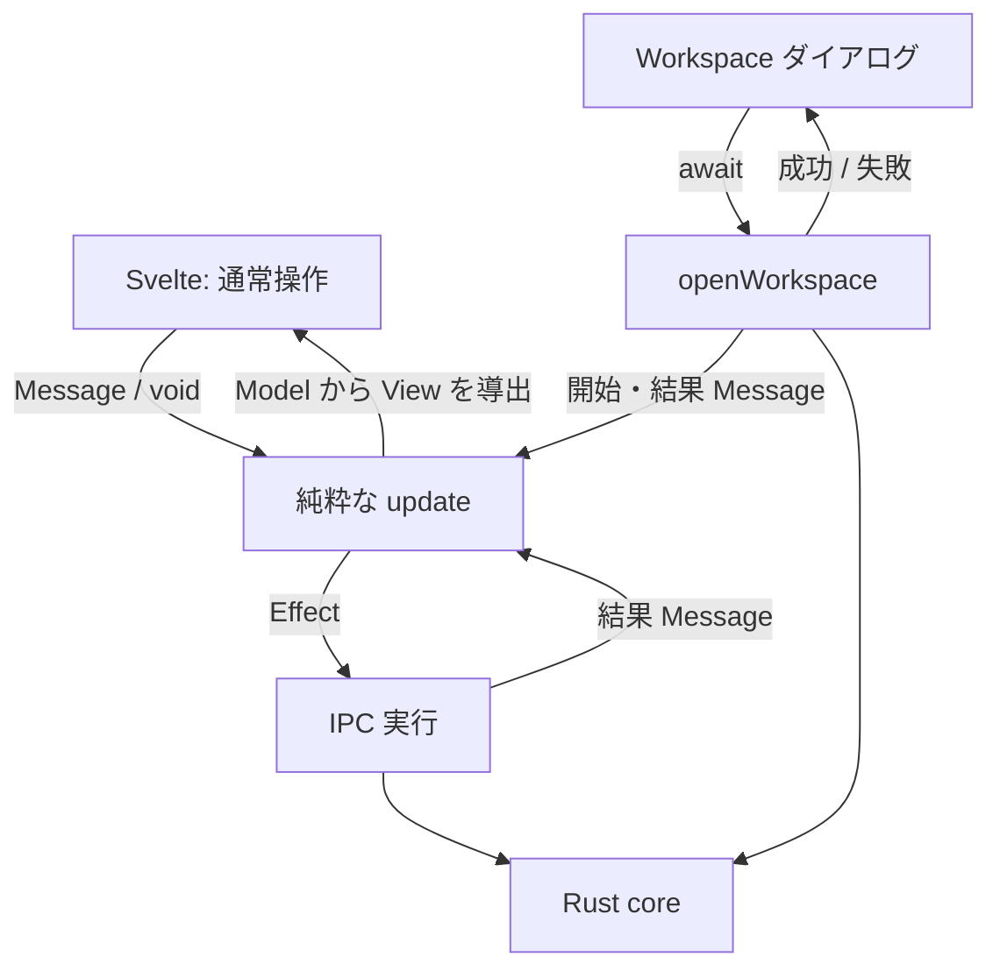

# Zeal 設計: セッション状態と副作用の分離

_Devin_
_Last update: 2026/11/08_
_Status: Approved_

## Goal

既存の動作を保ち、理解・変更するために読むコードを減らす。形式の統一より、実装の単純さを優先する。

機能は [PRD](../prd.md)、画面は [mock](../mock/) に従う。

### Non Goals

- Svelte の置換、新機能、Rust / IPC / 保存形式の変更。
- 汎用取得エンジン、scheduler、状態管理ライブラリの追加。
- 全 API の Promise 化や、古い戻り値との互換性維持。

## Background

**Session** は、Rust の状態通知と UI の選択から、必要な取得と表示を決める処理。
**Model** は状態、**Message** は操作・通知・結果、**Effect** は実行する IPC の指示を表す。

以前の実装は、純粋関数化しても不要な Promise 管理と条件の受け渡しが残っていた。
[Atwood](https://blog.codinghorror.com/the-best-code-is-no-code-at-all/) の「読むコードを減らす」と、[Worse is Better](https://www.jwz.org/doc/worse-is-better.html) の「統一より実装の単純さ」を基準に、それらを削る。

## Overview

**変更するのは WebView 内の session 制御だけ。** 開発者 → Zeal → Bazel の関係と、WebView / Rust core / SQLite / 観測ファイルの境界は維持する。[全体構成](./overview.md)を参照。

状態の更新は純粋な `update` に集め、現在の Model と Message から、次の Model と副作用の指示を返す。Svelte は表示、実行層は IPC を担当する。
通常操作は `void` とし、完了は画面の data / loading / error で表す。workspace だけは、成功でダイアログを閉じ、失敗で入力とエラーを残すため `await` する。

図は責務を示すもので、箱ごとにクラスやファイルを増やさない。
Console の byte stream・入力キュー・xterm は専用処理に残す。メニューや hover も Svelte の局所状態のままにする。

## Detailed Design

### 1. 状態更新の入口を一つにする

- **`session_model.ts`：** `update(model, message) → { model, effects }`。入力を変更せず、同じ入力に同じ結果を返す。IPC・時刻取得・DOM 操作はしない。
- **`session.ts`：** update → Model の置換 → publish → Effect 実行。IPC の失敗も結果 Message にし、未処理の Promise rejection を残さない。
- **Model に重複状態を持たせない。** loading は要求状態から導出する。Rust の実行状態、frontend の起動要求、表示先は区別する。

| API                                                            | 戻り値                   |
| -------------------------------------------------------------- | ------------------------ |
| `select`, `selectInvocation`, `openConsole`                    | `void`                   |
| `start`, `stop`, `refresh`                                     | `void`                   |
| `loadDetail`, `loadProfile`, `loadInvocations`, `loadSnapshot` | `void`                   |
| `openWorkspace`                                                | `Promise<void>`          |
| `init` / `dispose`                                             | `Promise<void>` / `void` |

Promise と listener 解除関数は実行層に置く。`init` は重複を防ぎ、`dispose` は結果を無視する。購読登録中の dispose でも、登録された listener を解除する。
**Promise Map・`waitFor`・公開 API への完了配送は持たない。** Effect の重複防止は Model に任せる。

### 2. workspace の完了待ちは、この操作だけに閉じる

1. dispose 済みなら何もしない。`sessionBusy` が true なら既存のエラーで reject する。
2. `stateRevision` を捕捉し、開始 Message で `opening = true` にする。ここまで await しない。
3. 既存 IPC を一度呼び、成功・失敗を revision 付きの結果 Message にする。
4. update で `opening = false` にする。成功かつ revision が一致する場合だけ state を受理する。**失敗・古い成功でも、待機 target の再開を判定する。**
5. 呼び出し元には成功で resolve、IPC 失敗で reject する。開始後に dispose されても IPC は取り消さず、結果の反映だけを止める。

状態通知では opening を解除しないため、workspace 操作は重ならない。
汎用 resolver、workspace 用 Effect、別の UI 状態機械は作らない。受付には実行層から純粋な selector を使い、ダイアログへ要求 ID を漏らさない。

### 3. 古い応答を捨てても、実行中の要求は忘れない

target detail / outputs / saved detail / profile は、それぞれ次の2値を持つ。

- **running：** 実行中の要求 ID。応答まで worker を占有する。
- **wanted：** 今必要な要求 ID。選択やデータ条件が変われば置き換える。

応答が wanted と一致するときだけ採用する。古い応答でも worker を解放し、その用途の最新要求だけを進める。
同じ要求への Retry は共有する。成功・失敗で要求を完了させ、無関係な通知で失敗を再試行しない。

| 用途     | 別に残す規則                                                             |
| -------- | ------------------------------------------------------------------------ |
| 履歴     | 取得中の通知を後続1回にまとめる。同じ workspace の現在の応答も受理する。 |
| snapshot | 版が変われば古い取得を待たず、新しく取得する。古い応答は捨てる。         |

workspace を離れると旧要求の受理権を失う。**A→B→A でも旧応答を採用しない。** 直列 worker の占有は応答まで維持する。
ID は Model の単一カウンタで生成し、保留引数は発行時の選択から得る。読み取りと start の識別にだけ使い、stop / refresh に配送専用 ID を付けない。

### 4. 出来事から、必要な取得だけを進める

**全体同期 `syncAll` は置かない。** 次の5経路を直接書く。

| 出来事                                           | 進める処理                                                                                                                  |
| ------------------------------------------------ | --------------------------------------------------------------------------------------------------------------------------- |
| 初期 state・workspace 変更                       | 旧表示と受理権を破棄し、履歴と利用可能な snapshot を読む。                                                                  |
| 履歴通知・active invocation 変更・readiness 回復 | 履歴を要求する。履歴受理時は選択中 record の変更、または idle・エラーなしの detail との不一致で detail/profile を更新する。 |
| scope・snapshot 版の変更                         | target を無効化して snapshot を読む。保存済み invocation は維持する。snapshot 受理時に選択を検証し、待機 target を進める。  |
| target / saved invocation の選択                 | target は detail → outputs の順。saved detail/profile は独立に要求し、一方の失敗で他方を隠さない。                          |
| 結果・busy 終了・Retry                           | 関係する用途の結果反映と待機要求の再開だけを行う。Retry 開始時は対象の error を消す。                                       |

**見落としやすい例外**

- 履歴一覧が同じでも、取得済み detail との不一致は確認する。profile が取得中でも、更新が必要なら wanted を更新する。
- snapshot の失敗は、次の authoritative state 通知か明示 Retry で再試行する。
- busy 中は最新の target 選択を待つ。再開時に取得済みデータまで再取得しない。

target は選択・snapshot の一致・workspace・busy を1か所で判定し、取得可能なら `{ label, fetchedAt }`、不可能なら `null` を返す。outputs 側には対応する detail の確認だけを足す。
state 比較・無効化・次の要求は用途内でまとめ、多数の変更フラグを helper 間で渡さない。

### 5. Console は対応する完了で一度だけ遷移する

- **開始通知が start 応答より先でもよい。** workspace と Console 所有権を確認して開く。起動失敗・直後の終了・再照合失敗も扱う。
- **遅い state 応答で通知を上書きしない。** 初期取得と start 後の再照合に `stateRevision` を使う。再照合は start ID で対応付け、idle のままでも完了時に履歴を更新する。
- **別の選択を奪わない。** 終了した実行の Console をまだ見ている場合だけ保存済み詳細へ移る。同じ完了を繰り返し処理せず、既存 API の Console 再表示も保つ。

## Alternatives Considered

| 採らない案                                       | 理由                                                                                               |
| ------------------------------------------------ | -------------------------------------------------------------------------------------------------- |
| 汎用 Slice・policy 設定表                        | 個別規則に加えて共通 runtime も読む必要がある。                                                    |
| 全操作を async / Effect に統一                   | 不要な完了追跡が増える。workspace を完全な Message/View 駆動にするとダイアログの状態管理も増える。 |
| backend revision / IPC の拡張                    | 必要性を確認していない保証へ変更を広げることになる。                                               |
| Svelte effect に分散・元の imperative 実装へ戻す | 記述量は減らせても、明示的で純粋な状態遷移を失う。                                                 |
| Effect を closure にする                         | union / switch は減るが、Effect をデータとして比較するテストを失う。                               |

## Caveats

- 通知欠落・backend 再起動からの回復、artifact の同時点整合性、開始済み IPC の取消は保証しない。
- プロセス終了と観測データの完成は別。欠損・不完全・終了不明を推測で補わない。
- API の戻り値は全取得の完了保証ではない。TypeScript が Elm の純粋性を保証するわけでもない。

## Security Concerns

認可・workspace 検証・停止・ファイル権限は Rust core に残す。古い応答の破棄は、取消や認可の代わりではない。新しい権限や IPC は追加しない。

## Privacy Concerns

外部送信や全 Message の logging は追加しない。パス・引数を公開診断資料へ出さない。
