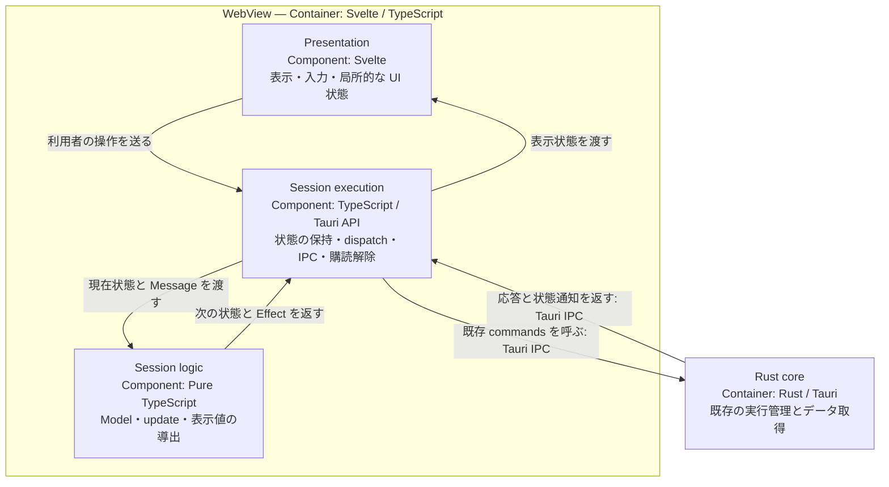

# Zeal 設計: セッション状態と副作用の分離

_Devin_
_Last update: 2026/11/08_
_Status: Deprecated_

後継: [必要な状態遷移だけを残す](./session-state-minimal.md)。本書は前段階の設計判断の記録として残す。

## Goal

既存の画面操作と非同期処理の振る舞いを保ちながら、session の状態判断と副作用を分け、次の変更で読む必要があるコードを減らす。
実装の単純さを最優先にし、Elm Architecture はそのために必要な部分だけ使う。
機能要件は [PRD](../prd.md)、画面は [mock](../mock/) に従い、この変更では追加しない。

### Non Goals

- Svelte の置き換え、状態管理ライブラリの追加。
- 汎用 Slice / Query engine、scheduler、event bus の開発。
- backend の版管理プロトコル、SQLite schema、artifact 公開方式の変更。
- 複数 Bazel 実行、キュー、自動再接続、新しい Console 操作の追加。
- 全画面の状態を中央へ集めること、取得回数の最小化、将来用途の先回りした抽象化。

## Background

**Session** は、Rust が報告するアプリ状態と利用者の選択を受け取り、必要なデータを取得して Svelte に表示状態を渡す frontend の処理である。
現在は `src/lib/session.ts` が状態更新、IPC、古い応答の排除、Console の画面遷移を担っている。

取得には用途固有の違いがある。履歴は通知をまとめ、snapshot は新しい取得を古い取得の完了まで待たず、target の outputs は detail の後に取得する。
これらを同じ Slice に載せると、個別の規則に加えて共通エンジンの設定と内部状態も読む必要がある。
揃ったインターフェースより、各動作を直接読める実装を選ぶ。

設計の判断基準は [The Best Code is No Code At All](https://blog.codinghorror.com/the-best-code-is-no-code-at-all/) と、Richard Gabriel の _The Rise of “Worse is Better”_ に沿う。
短く技巧的に書くことではなく、理解・維持する処理そのものを減らす。完全性や統一のためだけの仕組みは追加しない。

採用する [Elm Architecture](https://guide.elm-lang.org/effects/) の要素は、**Model**（状態）、**Message**（操作や結果）、**update**（純粋な状態遷移）、**Effect**（実行すべき処理の指示）である。
Elm の言語や runtime を再現することは目的にしない。

## Overview

C4 の System Context は、開発者が Zeal を操作し、Zeal が Bazel に処理を依頼して結果を表示する関係である。
Container は既存の WebView、Rust core、SQLite、観測ファイルから変更しない。全体の構成は [全体構成](./overview.md) を参照する。
今回変更する WebView 内部だけを、次の Component 図で示す。

図の scope は session の制御経路。枠内の四角は論理的な Component、枠外は隣接 Container、矢印はラベルに記した呼び出し・データの方向である。
IPC はプロセス間通信を指す。各箱を新しいクラスやファイルにする必要はない。Console の byte stream と DOM 描画はこの図の対象外で、既存の専用処理に残す。

基本形は `update(model, message) → { model, effects }` とする。
純粋な update が「何をするか」を決め、session の実行部分が既存 IPC を呼び、結果を Message に戻す。
Svelte は表示と入力を担当し、別の状態更新経路を持たない。

## Detailed Design

### 保存する状態を増やさない

Model は既存のアプリ状態、選択、取得結果、現在の要求を表す。
loading や選択中 record など、そこから求められる表示値は導出し、別々に更新しない。
Promise、listener の解除関数、DOM handle は Model に入れず、実行部分に置く。

Rust の実行状態、frontend の起動要求、表示先は別の情報として扱う。
振る舞いを変えない `completed` 状態や、同じ意味の flag は持たない。
一方、取得中に来た履歴通知を覚える flag など、既存の振る舞いに必要な状態は残す。

### 状態判断を純粋関数へ移す

利用者の操作、`app-state`、`invocations-changed`、IPC の成功・失敗を Message として扱う。
update は入力を変更せず、次の Model と必要な Effect を返す。IPC、時刻取得、DOM 操作は行わない。
Effect を返す遷移で要求中の状態も記録し、同じ状態通知だけでは重複取得を起こさない。

target、invocation、実行操作の判断は用途ごとの関数にまとめる。
共通の状態を扱う普通の関数呼び出しで合成し、独立した store や動的な登録機構は作らない。
純粋な判断は `session_model.ts`、購読・IPC・Promise は `session.ts` に置く。
ファイル分割だけでは単純化したと判断しない。以下の遷移表と要求の表現を実装の基準にする。

### 出来事から必要な取得へ直接つなぐ

全 Message の後で全取得を再評価する `syncAll` は置かない。
通常の操作・応答は担当する用途だけを進め、複数用途に影響する `app-state` は変更内容を比較して必要な用途にだけ通知する。

| 出来事                                 | 次に進める処理                                                                                                 |
| -------------------------------------- | -------------------------------------------------------------------------------------------------------------- |
| 初期状態の受理・workspace 変更         | 履歴と利用可能な snapshot を取得する。旧 workspace の表示と要求の受理権を破棄する                              |
| 履歴通知・active invocation の変更     | 履歴を取得する。取得中なら後続一回へまとめる                                                                   |
| 履歴の受理                             | 選択中 record の変更、または idle・エラーなしの detail と履歴の不一致がある場合だけ、detail/profile を更新する |
| scope・snapshot の版の変更             | target の表示と要求の受理権を破棄し、snapshot を取得する。保存済み invocation は触らない                       |
| snapshot の受理                        | target/package 選択を検証し、待っている target detail だけを進める                                             |
| target 選択                            | detail/outputs の旧要求を無効にし、最新の target detail を要求する。busy 中は最新の選択だけを残す              |
| target detail の受理                   | その detail に対応する outputs を要求する                                                                      |
| target outputs の受理                  | 結果を表示する。別の選択の要求が待っている場合だけ次の outputs を進める                                        |
| saved invocation の選択                | detail/profile を独立に要求する。同じ選択の取得中要求は共有する                                                |
| detail/profile の応答                  | 対応する結果を反映し、その読み取りで待っている要求だけを進める。履歴や targets は評価しない                    |
| 実行・workspace 操作が busy でなくなる | その操作が止めていた target / saved 読み取りを再開する。取得済みデータは再取得しない                           |
| start の再照合完了                     | 対応する Console の一度の遷移、履歴更新、待機していた読み取りの再開                                            |
| 明示的 Retry                           | 対象の読み取りだけを要求する。取得中ならその要求を共有する                                                     |

snapshot 取得失敗後の次の authoritative state 通知による retry は既存の例外として、state 受理時だけ扱う。
他の取得完了を契機に retry したり、全体同期によって暗黙に取得を始めたりしない。

### 要求の状態をそのまま表す

直列の detail/profile/target 読み取りには、**実行中の要求 ID** と **現在必要な要求 ID** の二つを持つ。
ID は Model 内の単一カウンタから割り当てる。

- 同じ取得を待つ操作では ID を変えず、要求を共有する。
- 選択や取得条件が変わると、必要な要求 ID を置き換える。選択解除なら不要にする。
- 実行中の IPC は取り消せないので、古い要求の実行中 ID は完了まで保持する。
- 応答の ID が現在必要な ID と一致した場合だけ採用する。古い応答でも、その worker が空いたことは反映する。
- worker が空き、必要な要求が残っていて、読み取り可能なら、その要求だけを発行する。
- 成功・失敗とも処理した要求を完了させる。失敗後は Retry または実際のデータ変更まで再要求しない。

これにより、合成 dependency key、`Attempt`、用途別 generation を併用しない。
保留要求の引数は発行時に現在の選択から得る。各操作が必要な要求を更新する責任は上の遷移表で限定する。
この小さな要求表現はデータであり、用途別設定を読む汎用 runner は作らない。

履歴と snapshot はこの直列規則に押し込まない。
履歴は実行中要求と後続通知の有無を持ち、workspace を離れた要求だけを無効にする。同じ workspace の通知で古くなった履歴応答も一度反映してから後続を読む。
snapshot は現在の要求 ID だけを持ち、新しい版では古い要求を待たずに置き換える。

### 取得の違いを直接書く

| 用途                        | 維持する規則                                                                                                      |
| --------------------------- | ----------------------------------------------------------------------------------------------------------------- |
| 履歴                        | 取得中の通知は一つの後続取得にまとめ、start 後にも一度更新する。workspace 切替前の応答は表示しない                |
| Snapshot                    | 版が変われば古い取得を待たずに取得する。同じ版への重複要求を避ける                                                |
| Target detail / outputs     | 選択・scope・snapshot に対応する detail を受理してから outputs を取得する。Bazel が busy なら最新の選択だけを待つ |
| Invocation detail / profile | 選択と履歴更新に追従する。片方の失敗で他方を隠さない                                                              |
| Retry                       | 失敗を表示し、既存の明示的な再試行を保つ。同じ条件で失敗を繰り返す自動ループは作らない                            |

これらは `mode` や `acceptStale` などの設定へ変換しない。
必要な取得を各用途の update が決め、依存する次の取得は前の結果を受理した遷移から発行する。

履歴と取得済み detail の不一致を検出して読み直す既存の動作も保つ。履歴一覧が前回と同じという理由だけで、この確認を省かない。
現在の record 比較などが必要なら、その用途の場所に残してよい。JSON 比較を完全に排除することも、新しい revision を導入することも要件にしない。

### 古い応答は frontend の要求の識別で捨てる

frontend の要求 ID を使い、結果が現在の要求・選択に属するかを update で確認する。
workspace を離れると以前の要求の受理権を失わせ、A→B→A でも以前の start 応答が画面を取り戻さないようにする。
カウンタを使う場合は Model の値から進め、時刻や UUID の生成を状態判断に持ち込まない。

初期状態取得や start 後の再照合では、要求後に新しい状態通知を受け取ったかを既存同様に判定する。
遅い `get_state` の応答で、受信済みの状態通知を上書きしない。
これは frontend が観測した順序の保護であり、backend 全体の版管理を追加するものではない。

### Console の遷移を一度の出来事として扱う

起動応答と実行状態通知の前後関係、起動失敗、起動直後の終了は、既存の再照合を使って扱う。
失敗時には以前の表示を壊さず、再試行できる状態へ戻す。

実行終了を受け取ったとき、その invocation の Console を表示している場合だけ saved detail へ切り替える。
単に「現在実行中でない」という条件を毎回評価して、別の選択を奪わない。
同じ完了を繰り返し処理せず、既存 API の Console 再表示の振る舞いも保つ。新しい UI の入口は追加しない。

Console の byte 列、offset、入力キュー、xterm の handle は既存の Console 処理に残す。
hover やメニュー開閉なども Svelte の局所状態のままとし、session の Message にする必要はない。

### 実行部分は判断を持たない

dispatch は update の結果を Model に反映してから Effect を実行する。
IPC の成功・失敗は Message に変換するだけで、完了 callback が直接表示状態を書き換えない。
共通の retry engine や同期ループは置かない。

購読登録、初期化、公開 API の Promise の完了、dispose は現在の session の実行部分で扱う。
dispose 後の結果は無視し、登録途中に dispose された listener も解除する。
既存の呼び出し契約を保ち、同じ判断を旧経路と新経路の両方へ残さない。

## Alternatives Considered

- **汎用 Slice の改良:** 見た目は揃うが、個別の違いと共通 runtime の両方を理解する負担が残るため採用しない。
- **backend の revision / IPC 契約の拡張:** 強い整合性を定義できるが、今回の整理に必要だと確認できていない。保存・読取・通知へ変更を広げるため採用しない。
- **Svelte の effect に取得を分散:** 記述量は減らせても、選択・取得・完了の関係が暗黙になる。DOM 連携には使い、session の制御には使わない。
- **既存構造のまま競合だけ修正:** 最小の修正には適するが、状態判断と副作用の混在は残る。今回の分離が理解する処理を減らせなければ、こちらへ戻す。

## Caveats

この設計は、任意の通知欠落や backend 再起動、全 artifact の同時点 snapshot を保証しない。
プロセス終了と保存済み観測の完成は別であり、欠損・不完全・終了不明を推測で補わない。
既存 IPC の制約で問題が再現した場合は、その問題と最小の解決策を別途検討し、先回りして保証を増やさない。

純粋関数へ移すこと自体が成功条件ではない。Message や Effect の変換が重複を増やすなら、関数の分け方を減らす。
少量の重複は許容し、総行数の短縮のために分岐を隠す書き方はしない。

## Security Concerns

プロセス停止、workspace 検証、ファイルアクセスの権限は既存の Rust core に残す。
frontend が古い結果を捨てることを、副作用の取消や認可の代わりにしない。
この変更では新しい IPC command や権限を追加しない。

## Privacy Concerns

新しい外部送信やイベント記録基盤は追加しない。
Model / Message にパス・引数等が含まれ得るため、デバッグ目的でも全量 logging を導入しない。

## Test Plan

既存の session テストを観測可能な振る舞いの基準とし、共通 Slice という実装方式への依存だけを外す。
update のテストでは、待ち時間なしで Message 列と返された Effect を確認する。新しい網羅的テスト基盤は作らない。

- 選択変更・workspace A→B→A・dispose 後の古い応答が、現在の表示を書き換えない。
- 履歴通知の集約、同一一覧と stale detail の再照合、snapshot の重複防止と版をまたぐ取得を保つ。
- 正しい target detail の後にだけ outputs を取得し、失敗と明示的な retry を保つ。
- start 応答と状態通知の順序を入れ替えても、既存の起動・終了・選択保持の動作を保つ。
- 純粋な update が入力を変更せず、同じ入力で同じ状態と Effect を返す。

実装は既存の公開契約を保ったまま判断を移し、置換した Slice / lifecycle の不要部分を削除する。
focused tests の後に `mise run check:frontend` を実行し、実アプリでは起動・停止・Console・選択切替を確認する。
設計の受け入れ条件は次のとおり。テスト通過だけでは完了にしない。

- 全体同期、合成 dependency key、`Attempt`、用途別 generation が除去されている。
- profile/detail/outputs の応答から、無関係な用途の取得判断へ到達しない。
- 選択の変更、通知の集約、worker の解放が、上の表の対応する経路だけで説明できる。
- main と比較し、production code とテスト・設計書を分けて増減を示す。途中で追加した抽象化の撤去を、main からの改善として数えない。
- 行数のための圧縮、汎用 policy 設定、テストの削除で達成しない。増えた型や受け渡しに対して、消えた判断・管理状態を具体的に示す。
